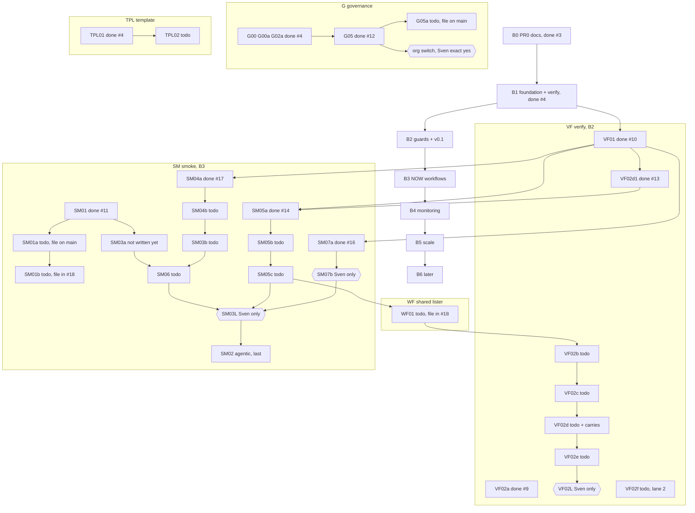

# Roadmap: steps, blocks and why

State as of 2026-10-29 (Amsterdam, UTC+1). Main is `41adeab`. This page only orders and links. The PBI files are the source of truth, and this page never copies their text.

Link legend: a normal link means the file is on main. `path (in #n at sha)` means the file only exists in that open PR so far.

## Goal

1. This repo is a catalog of policy-gated agentic workflows for GitHub (gh-aw), built personal first (svennijhuis) and org-ready.
2. Every rule is a `policies/POLnn.yml` file with a check in `policies/checks/POLnn.sh` and good and bad fixtures in `test/fixtures/`.
3. One runner, `scripts/verify.sh`, runs all checks: exit 0 ok, 1 finding, 2 needs a human.

## 1. All blocks and their order

Backlog blocks B0 to B6 are in [docs/pbi/README.md](pbi/README.md). The work now in flight sits in B2 (VF, WF, TPL), B3 (SM) and B5 (G).

Why this order: `POL23.sh` and `verify.sh` are shared hot files. Only one open PR may edit `POL23.sh`, so the lane 1 chain (SM05a, SM05b, SM05c, WF01, VF02b through VF02e) runs strictly in series. VF02f is template files only (lane 2, no POL23).

## 2. Blocks

### VF: one verify entry point and a consumer verify template

- Goal: one `scripts/verify.sh` for CI, the local gate and every agent, plus a verify template consumer repos can install.
- Why: before VF01 every caller could run its own lint mix, and a gate that only uses denylists keeps getting bypassed (Cursor 5655973880 found 2 highs on main after #10). VF02 adds POL30 so a consumer template cannot spend tokens or auto-trigger without Sven's yes.
- Steps in order: VF01, VF02a, VF02d1, then VF02b, VF02c, VF02d, VF02e, then VF02L (Sven only). VF02f is parallel on lane 2 (does not edit `POL23.sh` or `scripts/verify.sh`).
- VF02b through VF02e each extend POL30 and may edit `policies/checks/POL23.sh` when new fixture trees join the verify loop; VF02d also carries POL27, POL28 and POL03 follow-ups in their own check scripts. VF02c and VF02e are POL30 rule work only (no separate POL23 note beyond that shared pattern).
- Index: [docs/pbi/verify/README.md](pbi/verify/README.md). Parent: [docs/pbi/verify/VF02.md](pbi/verify/VF02.md).

| PBI | Status | File |
|---|---|---|
| VF01 | merged #10, squash `a174b5b` | [docs/pbi/done/VF01.md](pbi/done/VF01.md) |
| VF02a | merged #9, squash `2e41e13` | [docs/pbi/done/VF02a-pol01-extension.md](pbi/done/VF02a-pol01-extension.md) |
| VF02d1 | merged #13, squash `5624c0f` (2 rounds, waivers to VF02d) | [docs/pbi/done/VF02d1.md](pbi/done/VF02d1.md) |
| VF02b, VF02c, VF02d, VF02e, VF02f | todo, sections in the parent | [docs/pbi/verify/VF02.md](pbi/verify/VF02.md) |
| VF02L | Sven only, no PR | [docs/pbi/verify/VF02.md](pbi/verify/VF02.md) |

Next: VF02b, after WF01 (lane 1, edits POL23).

### SM: post-deploy API smoke on tst and acc

- Goal: a fixed smoke scenario format, offline checks for setup, auth and triggers, a runner and a report, then one live install in the API repo.
- Why: smoke runs against real environments with a token, so a bad scenario or workflow could leak secrets, hit prod or run on the wrong trigger. Every check fails closed before anything goes live.
- Steps in order (lane 2 unless noted): SM07a (done), SM04a (done), SM01a, SM04b, SM01b, SM03a, SM03b, SM06, VF02f. Lane 1: SM05a, SM05b, SM05c. Then Sven only: SM07b, SM03L. SM02 (agentic) is last. SM03a has no section in any PBI file yet. SM01a includes the fix-map row 1 `|` repair as one line in [SM01a](pbi/smoke/SM01a.md).
- SM08 holds the Cursor findings and closes when SM01, SM04a, SM05a, SM05b, SM05c and SM07a are merged.
- Index: [docs/pbi/smoke/README.md](pbi/smoke/README.md).

| PBI | Status | File |
|---|---|---|
| SM01 | merged #11, squash `9680af0` | [docs/pbi/done/SM01.md](pbi/done/SM01.md) |
| SM05a | merged #14, squash `5ef9b6a` | [docs/pbi/done/SM05a-det-triggers-pol03.md](pbi/done/SM05a-det-triggers-pol03.md) |
| SM07a | merged #16, squash `2d8c764` | [docs/pbi/done/SM07a-setup-check.md](pbi/done/SM07a-setup-check.md) |
| SM04a | merged #17, squash `41adeab` | [docs/pbi/done/SM04a-auth-check.md](pbi/done/SM04a-auth-check.md) |
| SM01a | todo (file on main) | [docs/pbi/smoke/SM01a.md](pbi/smoke/SM01a.md) |
| SM01b | todo, PBI file in open [#18](https://github.com/svennijhuis/agentic-workflows/pull/18), head `0e4bad4` | `docs/pbi/smoke/SM01b.md` (in #18 at 0e4bad4) |
| SM05b, SM05c | todo, sections in [SM05.md](pbi/smoke/SM05.md) | [docs/pbi/smoke/SM05.md](pbi/smoke/SM05.md) |
| SM04b | todo, section and Reviewer lows in [SM04.md](pbi/smoke/SM04.md) SM04b bullet (parts list) | [docs/pbi/smoke/SM04.md](pbi/smoke/SM04.md) |
| SM03a | not written yet | [docs/pbi/smoke/SM03.md](pbi/smoke/SM03.md) |
| SM03b | todo | [docs/pbi/smoke/SM03.md](pbi/smoke/SM03.md) |
| SM06 | todo | [docs/pbi/smoke/SM06.md](pbi/smoke/SM06.md) |
| SM07b | Sven only, section in [SM07.md](pbi/smoke/SM07.md) | [docs/pbi/smoke/SM07.md](pbi/smoke/SM07.md) |
| SM03L | Sven only, live, off | [docs/pbi/smoke/SM03.md](pbi/smoke/SM03.md) |
| SM02 | todo, agentic, last | [docs/pbi/smoke/SM02.md](pbi/smoke/SM02.md) |
| SM08 | todo, closes with the build PBIs | [docs/pbi/smoke/SM08-cursor-findings.md](pbi/smoke/SM08-cursor-findings.md) |

Next: SM05b (lane 1) and SM01a (lane 2, before SM04b).

### G: governance and the org switch

- Goal: the repo is built org-ready from day 1, so moving to an org is a checklist, not a rewrite.
- Why: Sven wants a central place for GitHub agentic workflows later, but the org switch is one-way (billing, rulesets, org secrets, teams). Everything else stays the same at the switch.
- Steps in order: G00, G00a, G02a, G05, G05a. The switch itself waits for Sven.

| PBI | Status | File |
|---|---|---|
| G00, G00a, G02a | merged #4, squash `2ccf76d` | [G00](pbi/done/G00-org-target-structure.md), [G00a](pbi/done/G00a-consumer-strategy.md), [G02a](pbi/done/G02a-pr-owner-architecture-questions.md) |
| G05 | merged #12, squash `f184995` | [docs/pbi/done/G05-org-only-appendix.md](pbi/done/G05-org-only-appendix.md), checklist [governance/ORG-ONLY.md](../governance/ORG-ONLY.md) |
| G05a | todo (file on main) | [docs/pbi/governance/G05a-org-only-followups.md](pbi/governance/G05a-org-only-followups.md) |
| Org switch | off, needs Sven's exact yes | [governance/ORG-ONLY.md](../governance/ORG-ONLY.md) |

Next: G05a (lane 3, docs only), then the org switch itself (Sven only).

### TPL: one PBI template

- Goal: one PBI template for this repo and agentPacks; shared fields are `triage`, `feedback`, `harness`, `review-input`, and `kind`, plus `Source` (see [docs/pbi/_template.md](pbi/_template.md)).
- Why: reviewers and testers need the same shared fields (`triage`, `feedback`, `harness`, `review-input`, `kind`) plus proof and door in every PBI, or gates are judged on chat instead of the file.
- Steps in order: TPL01, then TPL02 (backfill old PBIs).

| PBI | Status | File |
|---|---|---|
| TPL01 | merged #4, squash `2ccf76d` | [docs/pbi/done/TPL01-one-pbi-template.md](pbi/done/TPL01-one-pbi-template.md) |
| TPL02 | todo (file on main) | [docs/pbi/docs/TPL02-template-backfill.md](pbi/docs/TPL02-template-backfill.md) |

Next: TPL02, lane 3.

### WF: one shared workflow file lister

- Goal: every policy and the verify loops find workflow files the same way (`*.yml`, `*.yaml`, `*.lock.yml`).
- Why: the same bug hit 3 times (#14 POL03 loop, verify.sh fixture loops, check-smoke), each time because a script had its own `*.yml` glob.
- Steps in order: shared lib plus unit test, switch every loop to it, POL23 case for local globs, delete the dead globs.
- Related carry (not WF01 scope): `status: 0x12C` is [SM01a](pbi/smoke/SM01a.md) row 1. `steps: 0x2` is the SM07a follow-up at `scripts/check-smoke-setup.sh:81` (#16). Both are noted in `docs/pbi/verify/WF01.md` (in #18 at 0e4bad4); a shared decimal-int helper stays outside WF01, not the workflow-file lister.

| PBI | Status | File |
|---|---|---|
| WF01 | todo, PBI file in open [#18](https://github.com/svennijhuis/agentic-workflows/pull/18), head `0e4bad4` (round 1 in progress) | `docs/pbi/verify/WF01.md` (in #18 at 0e4bad4) |

Next: lane 1, after SM05c and before VF02b.

## 3. Todo PBIs (parked, filed)

WF01 and SM01b are filed on open [#18](https://github.com/svennijhuis/agentic-workflows/pull/18) at head `0e4bad4`.

| Item | Where it is written | Lane, after |
|---|---|---|
| WF01 shared lister | `docs/pbi/verify/WF01.md` (in #18 at 0e4bad4) | lane 1, after SM05c |
| SM01b check-smoke carry (Cursor 5657706637) | `docs/pbi/smoke/SM01b.md` (in #18 at 0e4bad4) | lane 2, after SM01a |
| G05a ORG-ONLY follow-ups | [docs/pbi/governance/G05a-org-only-followups.md](pbi/governance/G05a-org-only-followups.md) | lane 3, file on main |
| SM04b token hygiene and Reviewer lows | [docs/pbi/smoke/SM04.md](pbi/smoke/SM04.md) SM04b bullet | lane 2, after SM01a |
| SM05b, SM05c | [docs/pbi/smoke/SM05.md](pbi/smoke/SM05.md) | lane 1, after SM05a |
| VF02d carries | 4 open todo rows in [docs/pbi/verify/VF02.md](pbi/verify/VF02.md) on main, plus 5 waiver rows in #18 at `0e4bad4` | lane 1, VF02d |

## 4. Lanes

| Lane | Who | Order |
|---|---|---|
| 1 | Builder, Grok path (policy chain, edits POL23) | VF02d1 (done), SM05a (done), SM05b, SM05c, WF01, VF02b, VF02c, VF02d, VF02e |
| 2 | Builder, Cursor CLI (one script each) | SM07a (done), SM04a (done), SM01a, SM04b, SM01b, SM03a, SM03b, SM06, VF02f |
| 3 | Docs only PRs | #18 now; G05a (file on main); later TPL02 |

## 5. What stays off and why

| Item | Why it is off | Who unblocks |
|---|---|---|
| SM07b | Sven runs `smoke/SETUP.md` himself and names the API repo | Sven |
| SM03L | live smoke install in another repo, one-way, needs SM07b | Sven's exact yes |
| VF02L | staged dispatch run plus agentPacks publish, one-way | Sven's exact yes |
| Token dependent steps | Sven will not add a GitHub token, so they are proven offline only (stubs, fixtures) and stay documented and off | Sven |
| Org switch | one-way: billing, rulesets, org secrets, teams | Sven's exact yes |
| Azure | no apply by bots; bots never touch Entra or Azure | Sven's exact yes |
| Spend (tokens, credits) | nothing that spends runs without a yes | Sven |

## 6. Recurring issues and the shared fix

| Issue | Seen in | Shared fix |
|---|---|---|
| Workflow files listed as `*.yml` only, so `*.yaml` and lock files are missed | #14, verify.sh loops, check-smoke | WF01 `scripts/lib/wf-files.sh` |
| Hex status literal (`0x12C`) | SM01a row 1 | [SM01a](pbi/smoke/SM01a.md) status literal rules (not WF01) |
| Hex steps literal (`0x2`) | #16, SM07a | `scripts/check-smoke-setup.sh:81` (decimal int; shared helper outside WF01) |
| YAML anchors, aliases and duplicate keys slip past checks | #13, #16, #17 | shared `yaml_strict` precheck in `scripts/lib` (candidate, no PBI id yet; next session assigns one) |
| Denylists keep getting bypassed | #10, #13 | allowlists (VF02d1 run allowlist) |

## 7. Rules of the road

- One PBI per PR, max 2 fix rounds (the build is round 0). Anything still open after round 2 goes to a named todo PBI and does not block.
- Merge gates: Tester PASS (odd PRs Tester, even PRs Tester 2), Reviewer PASS, `verify.sh` 0 failures, 0 open threads, Cursor review on the head SHA, PO GO.
- Builder squash merges one PBI at a time. The second PR merges main in before its GO.
- Only one open PR edits `POL23.sh` at a time.
- Never force push; use a `-v2` branch. Personal svennijhuis only. FAKE values in fixtures.

## 8. Next session start list

Other open PR, no decision yet: [#7](https://github.com/svennijhuis/agentic-workflows/pull/7) "Bump gh-aw compiler pin to v0.93.5". State from gh: open, draft, head `6242cf2`, branch `aw-upstream/2026-10-26`, no checks reported, mergeable CONFLICTING.

1. Check #18 for gate state on its current head. #14 and #17 are merged. Before GO, #18 must merge main, keep #14's SM05 parts list and the SM08 close rule, must not renumber SM05 steps 6 to 9. On merge, keep main's parts list and SM08 close rule, and keep #18's SM05 step 7 POL25 `det_agentic` / late `# gh-aw-metadata:` sentence (not main's step 7 that stops at the three POL03 metadata fixtures alone) and step 8 line numbers (L46 and `det_entry_err` L53 to L55, not main's L38 blank-trigger wording).
2. Lane 1: SM05b. Lane 2: SM01a (fix-map row 1 `|` repair as one line in [SM01a](pbi/smoke/SM01a.md)), then SM04b.
3. Lane 3: G05a when free; TPL02 after that.
4. Give `yaml_strict` a PBI id with PO.
5. Sven only, any time: SM07b.
