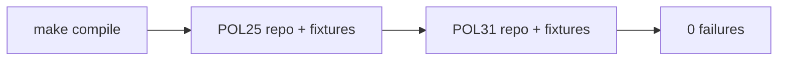

# Roadmap

State as of 2026-11-01. This page orders work at a high level. PBI files under `docs/pbi/` remain the source of truth for individual items.

## Goal

1. This repo is a catalog of agentic workflows for GitHub (gh-aw), personal first (`svennijhuis`) and org-ready.
2. The gate matches [githubnext/agentics](https://github.com/githubnext/agentics): `make compile` (`gh aw compile --strict`), then [POL25](../policies/POL25.yml) and [POL31](../policies/POL31.yml) on the repo and fixtures via `make verify`.
3. CI is one manual job: [`.github/workflows/verify.yml`](../.github/workflows/verify.yml).

## Now

| Track | Focus |
| --- | --- |
| Catalog workflows | Block 1: `workflow_dispatch` only, staged safe-outputs, squad-review adapter until F01 |
| Consumer path | `gh aw add` at tags, import-schema `with:` only ([consume.md](how-to/consume.md)) |
| Governance | Org switch checklist in [governance/ORG-ONLY.md](../governance/ORG-ONLY.md) (off until Sven's yes) |
| Backlog | [docs/pbi/README.md](pbi/README.md) |

## Gate (done shape)

Security and compile rules beyond POL25/POL31 live in workflow frontmatter; strict compile is the primary enforcement.

## What stays off

| Item | Why | Who unblocks |
| --- | --- | --- |
| Non-dispatch triggers on catalog workflows | token spend, one-way | Sven's exact yes per workflow |
| Org switch | billing, rulesets, org secrets | Sven's exact yes |
| Spend (tokens, credits) | nothing runs without a yes | Sven |

## Rules of the road

- One PBI per PR where possible; attach `make verify` log on the PR SHA when CI is blocked (Q0).
- Never force push.
- Personal `svennijhuis` only until org switch.

## See also

- [AGENTS.md](../AGENTS.md)
- [how-it-works.md](explanation/how-it-works.md)
