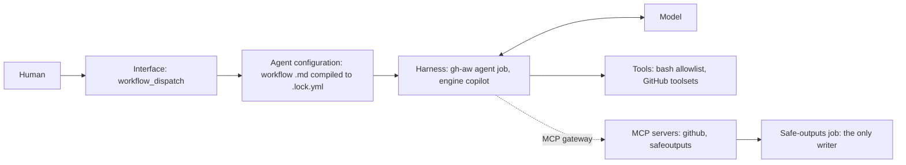

# Harness model (ARC07)

What runs where in this catalog. PBI: [ARC07](../pbi/done/ARC07-harness-model.md) (was HX01). Source: [Theo, What is a harness?](https://x.com/theo/status/2113424203345265053) (D37).

Theo's definition: a harness is the tools, a syntax for calling them via text, a system that parses the message and runs the code, a way to give the result back to the LLM, and a list of tools with descriptions. The interface (what a human clicks or types) is a separate piece. An agent is a harness plus a model, and "different agents are often simply different harness configurations".

## Glossary

| Term | Here |
|---|---|
| Interface | How a run starts: `workflow_dispatch` from the Actions tab or `gh aw run`. No schedule or event trigger on agentic workflows ([POL25](../../policies/POL25.yml)) |
| Harness | The gh-aw agent job: engine (Copilot CLI today), sandbox, firewall, MCP gateway, safe-outputs job |
| Model | The LLM the engine calls; engine version pinned in `.github/aw.json` |
| Agent configuration | The workflow `.md` frontmatter and body, compiled into the `.lock.yml` that runs |
| Tools | Code that runs inside the sandbox: the bash allowlist and the GitHub toolsets |
| MCP | Code that lives elsewhere; the harness calls it through the MCP gateway (github MCP server, safeoutputs) |
| Agent card | `workflows/<name>.card.yml`: the layers above for one workflow, secret NAMES only ([HX02](../pbi/done/HX02-agent-card.md)) |

## Layers

## Catalog

| Workflow | Interface | Harness | Engine | Tools | MCP (transport, secret name) | Writes |
|---|---|---|---|---|---|---|
| `squad-review` | `workflow_dispatch`, input `pr` | gh-aw agent job | copilot (`COPILOT_GITHUB_TOKEN`) | bash, github | github (stdio, `GH_AW_GITHUB_MCP_SERVER_TOKEN`), safeoutputs (stdio, none) | review comments, COMMENT review, staged |

The card for each row should match the frontmatter and the lock manifest. A new workflow adds a card and a row here in the same PR. `gh aw compile --strict` covers manifest consistency.
