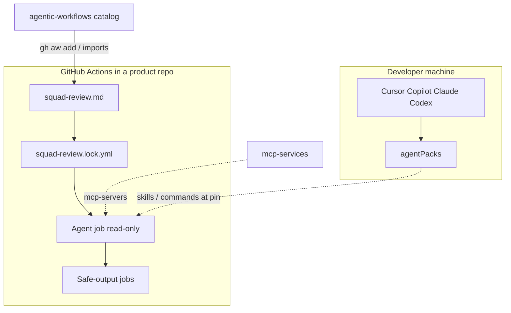

# How GitHub Agentic Workflows work

This catalog is a **package of Markdown workflows** that consumer repos compile into GitHub Actions.

## Two agent layers

| Layer | Repo | Runs where | Who starts it |
| --- | --- | --- | --- |
| IDE / CLI plugins | [agentPacks](https://github.com/svennijhuis/agentPacks) | Developer machine | A person |
| Agentic workflows | **this repo** | GitHub Actions in a consumer repo | Triggers (catalog: `workflow_dispatch` only until Sven enables more) |

Wire standards with pinned imports and `workflows/shared/agentpacks.md`; do not copy SKILL.md into this repo ([agentpacks contract](../reference/agentpacks-contract.md)).

MCP servers: [mcp-services](https://github.com/svennijhuis/mcp-services).



## Workflow vs shared fragment

- `workflows/*.md` has `on:` and is installable.
- `workflows/shared/*.md` has no `on:`. Imports merge tools, network, MCP, and prompts.

Relative imports resolve from `workflows/`, so shared files stay at `workflows/shared/` (gh-aw path rule in [layout](../reference/layout.md)).

Shared names in Block 1: `defaults.md`, `security.md`, `reporting.md`, `agentpacks.md` (replaces older `org-defaults.md` / `squad.md` fragments).

## Compile and lock files

In a **consumer** repo after `gh aw add`:

```text
.github/workflows/squad-review.md
.github/workflows/squad-review.lock.yml   # generated; Actions runs this
```

In **this catalog**, each installable workflow keeps a committed `.lock.yml` next to the `.md`. `make compile` runs `gh aw compile --strict` and `make verify` fails if locks drift.

## Runtime security

Agent job stays read-only. Writes use `safe-outputs:` in a separate job. Cross-repo needs `target-repo`, allowlists, and scoped tokens ([auth](../reference/auth.md)). Declared in frontmatter; enforced by strict compile.

## Package manifest

[`aw.yml`](../../aw.yml) lists installable workflows for `gh aw add svennijhuis/agentic-workflows`.

## Org defaults

`GH_AW_DEFAULT_*` variables can set budgets org-wide. Example: [`governance/defaults.example.yml`](../../governance/defaults.example.yml). Personal account uses repo vars and per-workflow caps in frontmatter.

## Guides

- [Using at Scale](https://github.github.com/gh-aw/guides/using-at-scale/)
- [Sharing Workflows](https://github.github.com/gh-aw/practices/sharing-workflows/)
- [consume.md](../how-to/consume.md)
