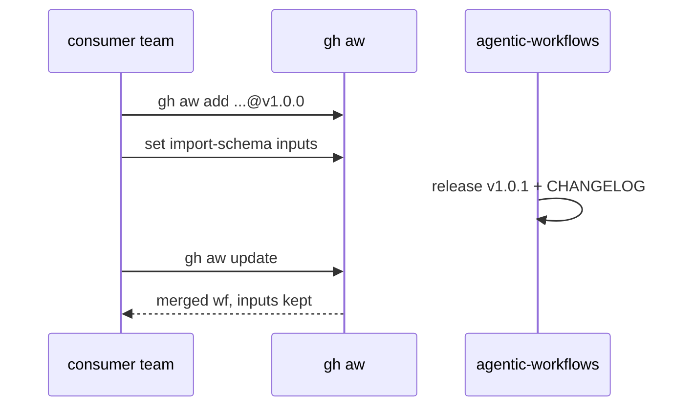

# Consume catalog workflows

Install org-standard agentic workflows from `svennijhuis/agentic-workflows` without editing upstream Markdown. Replace `svennijhuis` only when the catalog moves ([ARC06](../pbi/done/ARC06-org-switch.md)).

## One-time setup (consumer repo)

```bash
gh extension install github/gh-aw
cd your-product-repo
gh aw init
git add .github .gitattributes
```

`gh aw init` is for authoring in that repo. It does not install this catalog.

Enable GitHub Actions and Copilot on the repository. Set secrets per [auth.md](../reference/auth.md).

## Install (tag only, never a branch)

```bash
gh aw add svennijhuis/agentic-workflows/squad-review@v1.0.0
```

What happens:

1. Markdown copies to `.github/workflows/squad-review.md` with `source:` set.
2. Compiler writes `.github/workflows/squad-review.lock.yml`.
3. Declared `imports` resolve to pinned SHAs in the lock file.

```bash
git add .github/workflows/squad-review.md .github/workflows/squad-review.lock.yml
```

Do not vendor catalog Markdown by copy-paste. You lose `source:` and `gh aw update`.

## Configure (import-schema inputs only)

Team settings go in `imports:` `with:` blocks. Unknown keys fail compile.

```yaml
imports:
  - uses: svennijhuis/agentic-workflows/workflows/shared/defaults.md@v1.0.0
    with:
      severity: high
```

Do not edit imported files in the consumer repo. See [agentpacks contract](../reference/agentpacks-contract.md) and [C12](../pbi/done/C12-agentpacks-import-contract.md).

Remote imports cache under `.github/aw/imports/` by SHA. Block 2 trial picks commit vs `inlined-imports: true` (documented in [C05](../pbi/done/C05-imports-import-schema.md)).

## Update

```bash
gh aw update squad-review   # one workflow
gh aw update                # all tracked sources
```

Default is 3-way merge so local `with:` inputs survive. Use `--no-merge` to replace with upstream. Read [CHANGELOG](../../CHANGELOG.md) upgrade notes before bumping tags.

Keep CLI current:

```bash
gh extensions upgrade github/gh-aw
```

## Channels and deprecation

- **Stable**: exact tags `vX.Y.Z` in production.
- **Moving major**: `@v1` only if you run `gh aw update` on a cadence (Block 2+).
- **Deprecation**: window and comms in [G06](../pbi/governance/G06-correctionops-feedback-loop.md) (later).
- **Support path**: [G03](../pbi/governance/G03-onboarding-support.md) (Block 2).

## Import fragments without a full workflow

```yaml
imports:
  - svennijhuis/agentic-workflows/workflows/shared/defaults.md@v1.0.0
  - svennijhuis/agentic-workflows/workflows/shared/security.md@v1.0.0
```

Fragments live under `workflows/shared/` in the catalog ([layout.md](../reference/layout.md)).

## After install, check

- Secret names the workflow expects (`gh secret list`, names only).
- `permissions:` on the lock file.
- `network.allowed` and MCP URLs.
- `safe-outputs` `max:` and `target-repo`.
- Triggers: catalog ships `workflow_dispatch` only until Sven enables more per workflow.

## Block 2 proof checklist (one-way, Sven's yes)

- [ ] Repo A and repo B install the same workflow at `v1.0.0`.
- [ ] Catalog cuts patch `v1.0.1` with CHANGELOG note.
- [ ] Both repos run `gh aw update`; `with:` inputs unchanged.
- [ ] Evidence in [G00a](../pbi/done/G00a-consumer-strategy.md).

## Flow



## See also

- [trial.md](trial.md) for X01 TrialOps
- [verify-workflow.md](verify-workflow.md) for catalog contributors
- Strategy PBI [G00a](../pbi/done/G00a-consumer-strategy.md)
