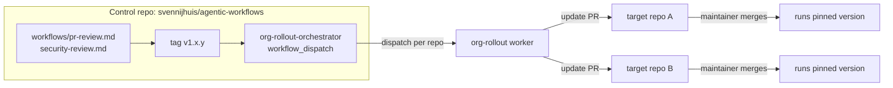

# Org flow: central workflows, one repo, rollout updates

This repo is the **control repo**. It is the single source of truth for `pr-review` and `security-review` (templates in `workflows/`). The orchestrators, workers and `code-quality` run here in `.github/workflows/`. Target repos never edit a copy; they pin a ref from here. Today the targets are `svennijhuis` repos. For an org, change only the owner in the `repos` input and the token scope.



Everything runs in GitHub Actions. Nothing has to run on a laptop. `gh workflow run` only starts the Action; the Actions tab "Run workflow" button does the same.

## Add to one repo

```bash
gh extension install github/gh-aw
cd <target-repo>
gh aw add svennijhuis/agentic-workflows/pr-review@v1.0.0
gh aw compile
git add .github/workflows && git commit -m "add pr-review v1.0.0" && git push
```

Same for `security-review`. The `source:` line in the added file is the pin.

## Roll out an update

1. Change the workflow here, merge, tag a new version (see [CHANGELOG](../../CHANGELOG.md)).
2. Run the orchestrator (Actions tab, or `gh workflow run org-rollout-orchestrator.lock.yml -f workflow=pr-review -f ref=v1.1.0`). Leave `repos` empty to find every svennijhuis repo that has the workflow, or pass `-f repos=svennijhuis/repo-a,svennijhuis/repo-b`.
3. Each target repo gets one `[agentic-workflows]` PR with the new pin and the compiled `.lock.yml` (the worker runs `gh aw compile` in Actions with a pinned gh-aw version, so every lock file comes from the same compiler). The maintainer only reviews and merges.

`.github/` is a protected path for `create-pull-request` in gh-aw. The worker sets `protected-files: { policy: request-review, exclude: [".github/workflows/"] }`, so only `.github/workflows/` is allowed in its PR. Any other protected file (for example `README.md` or `package.json`) still gets a REQUEST_CHANGES review.

`only_existing` defaults to `true`: repos that do not have `.github/workflows/<workflow>.md` yet are skipped, so only repos that already use the workflow get an update PR. Pass `-f only_existing=false` to also install it in repos that do not have it.

In a single repo you can also skip the orchestrator: `gh aw update pr-review` then `gh aw compile`.

## Roll back

Revert the update PR in the target repo, or rerun the orchestrator with the previous `ref`. Nothing in the control repo has to change.

## Other gallery examples here

| Workflow | Pattern |
| --- | --- |
| [dependabot-rollout-orchestrator](../../.github/workflows/dependabot-rollout-orchestrator.md) + [dependabot-rollout](../../.github/workflows/dependabot-rollout.md) | Orchestrator dispatches a worker per repo, worker opens a `dependabot.yml` PR |
| [code-quality](../../.github/workflows/code-quality.md) | Side repo checks out one target repo and opens `[quality]` issues there |
| [security-review](../../workflows/security-review.md) | Report-only code scanning alerts, installed per repo |

## Tokens Sven sets (not in the repo)

Fine-grained PATs, scoped to the target repos only, stored as Actions secrets in this control repo. The rollout PR changes `.github/workflows/`, so the tokens that push it need Workflows: Read and write. `GITHUB_TOKEN` cannot do that.

| Secret | Permissions | Used by |
| --- | --- | --- |
| `GH_AW_READ_ORG_TOKEN` | Contents: Read | orchestrators and workers (read targets) |
| `ORG_REPO_CHECKOUT_TOKEN` | Contents: Read and write, Actions: Read and write, Workflows: Read and write | workers (checkout target) |
| `GH_AW_CROSS_REPO_PAT` | Contents, Issues, Pull requests: Write, Workflows: Read and write | workers (open PRs or issues) |
| `GH_AW_MAIN_REPO_TOKEN` | Contents: Read, Issues: Read and write | code-quality |
| `COPILOT_GITHUB_TOKEN` | Copilot Requests: Read | every workflow (engine) |

All triggers are `workflow_dispatch`. No schedules.

## Option (not enabled): rollout on release

To start the rollout automatically on a new tag, add a release trigger to `org-rollout-orchestrator.md` and recompile:

```yaml
on:
  workflow_dispatch:
    # inputs as today
  release:
    types: [published]
```

The orchestrator then uses the release tag as `ref` and an empty `repos` (all repos that have the workflow). This is off today; only `workflow_dispatch` is active.
