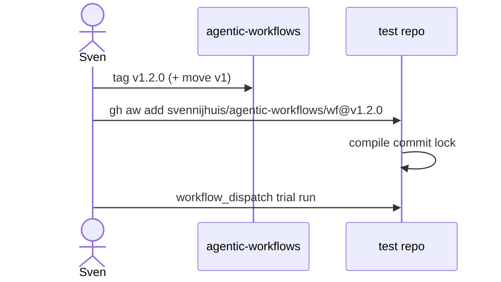

# TrialOps (X01)

Every catalog workflow gets a trial in a dedicated test repo before consumer rollout (Bar H). Block 1 documents the process only; no trial repo spend without Sven's yes.

## Named ask for Sven

Trial repo name and visibility are not chosen in Block 1. Sven names the repo when creating it (X01).

## Install pin in the trial repo

```bash
gh aw add svennijhuis/agentic-workflows/<workflow>@v1.0.0
gh aw compile
# commit .md + .lock.yml in the trial repo
```

## Checklist before promotion

1. **Dispatch**: `workflow_dispatch` only until Sven enables other triggers.
2. **Staged**: report-only or staged safe-outputs first ([POL03](../../policies/POL03.yml)).
3. **Measure AIC**: record cost in the workflow PBI Evidence ([B03a](../pbi/observability/B03a-value-vs-cost.md)).
4. **Promote**: update [governance/rollout.yml](../../governance/rollout.yml) ladder when gates pass ([G01](../pbi/governance/G01-rollout-ladder-human-review.md), Block 2).

## Commands (printed only in Block 1)

Do not run these from automation in Block 1. Trial spends AIC; requires Sven's exact yes per workflow.

```bash
# gh aw trial --repo <trial-repo> --workflow <name>
# gh aw run <name>   # also spends credits; Sven's yes only
```

## Flow



## See also

- [consume.md](consume.md)
- PBI [X01](../pbi/testing/X01-test-repo-trialops.md)
- [gh-aw TrialOps](https://github.github.com/gh-aw/experimental/trial-ops/)
