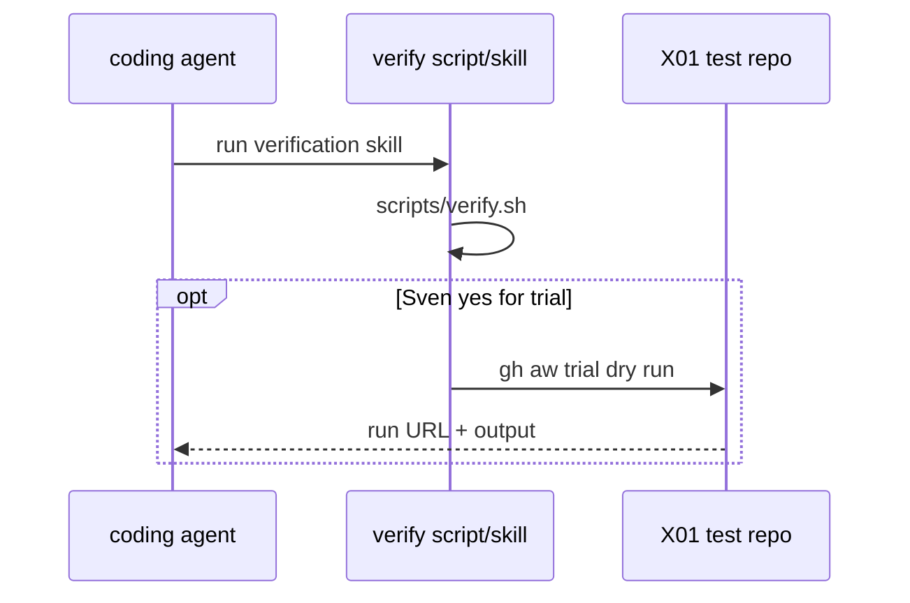

# Verify a change

Local gate for this catalog. Same path for Builder, Tester, and agents.

## Run the full gate

From the repo root:

```bash
./scripts/verify.sh
```

`scripts/verify.sh` checks tools (gh, gh-aw v0.93.5, actionlint, gitleaks, yq, shellcheck), compiles `workflows/` with `--strict`, ensures lock files are fresh, lints Actions YAML, runs shellcheck on scripts, exercises import-schema fixtures, runs every `policies/checks/POLnn.sh`, and runs the POL23 meta check.

Pass: last line `0 failures`, exit `0`. Fail: one line per issue as `file:line RULE message`.

## One check on one file

```bash
bash policies/checks/POLnn.sh test/fixtures/bad/POLnn.md   # expect exit 1
bash policies/checks/POLnn.sh test/fixtures/good/POLnn.md # expect exit 0
```

POL17 uses folder `test/fixtures/bad/POL17/` instead of a single `.md` file.

## Q0: Actions billing blocked

Attach the full `./scripts/verify.sh` log for the exact PR commit SHA as a PR comment. Do not treat missing CI as a pass.

## Trial command (print only)

Do not run in Block 1. Spend AIC only with Sven's exact yes per workflow.

```bash
# gh aw trial --repo <X01-trial-repo> --workflow <workflow-name>
```

## Flow



## See also

- Skill: [.github/skills/verify-aw/SKILL.md](../../.github/skills/verify-aw/SKILL.md)
- [AGENTS.md](../../AGENTS.md)
- PBI: [docs/pbi/done/X06-verification-skill.md](../pbi/done/X06-verification-skill.md)
