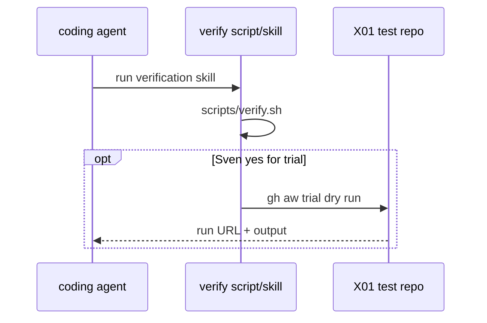

# Verify a change

Local gate for this catalog. Same path for Builder, Tester, and agents.

## Run the full gate

From the repo root:

```bash
./scripts/verify.sh
```

`scripts/verify.sh` checks tools against `.github/aw.json` (the top-level `gh-aw` pin and the `tools:` map for actionlint, gitleaks, yq and shellcheck; git, gh and jq must exist), copies the working tree into a temp repo and there compiles `workflows/` with `--strict --actionlint` and diffs the locks (the real tree is never written), lints Actions YAML, runs shellcheck on scripts, exercises import-schema fixtures, runs every `policies/checks/POLnn.sh`, and runs the POL23 meta check.

Exit codes are in the header of `scripts/verify.sh` and in [C01](../pbi/done/C01-verify-script.md):

- `0` pass: last line `0 failures`.
- `1` fail: one line per issue as `file:line RULE message`.
- `2` needs-human: the gate could not run, so the result is inconclusive. The line reads `file:line VERIFY needs-human <reason>`. A tool is missing or at the wrong version, or a producer exited non-zero with no finding. A human installs the pin from `.github/aw.json` `tools:` (version, url, sha256) or fixes the crashed producer, then re-runs. Never treat exit 2 as a pass.

## One check on one file

```bash
bash policies/checks/POLnn.sh test/fixtures/bad/POLnn.md   # expect exit 1
bash policies/checks/POLnn.sh test/fixtures/good/POLnn.md # expect exit 0
```

Some checks use a folder (`test/fixtures/bad/POL17/`, `bad/POL27/`, `bad/POL28/`, `bad/POL29/`). Each immediate child of a bad folder is one case and must exit exactly 1 on its own (POL23).

## Q0: Actions billing blocked

Attach the full `./scripts/verify.sh` log for the exact PR commit SHA as a PR comment. Do not treat missing CI as a pass.

## Trial command (print only)

Do not run in Block 1. Spend AIC only with Sven's exact yes per workflow.

```bash
# gh aw trial --repo <X01-trial-repo> --workflow <workflow-name>
```

## Flow



## See also

- Skill: [.github/skills/verify-aw/SKILL.md](../../.github/skills/verify-aw/SKILL.md)
- [AGENTS.md](../../AGENTS.md)
- PBI: [docs/pbi/done/X06-verification-skill.md](../pbi/done/X06-verification-skill.md)
