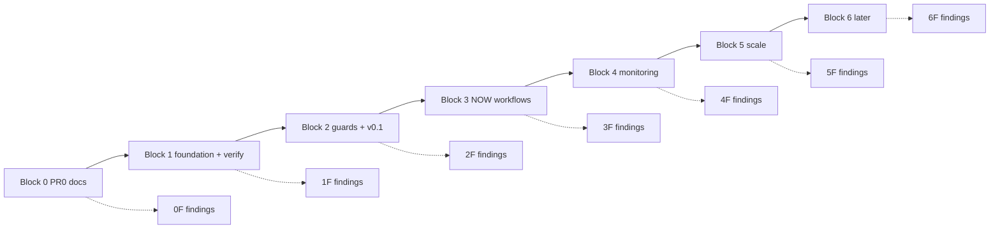

# PBI backlog (PR 0)

PR 0 is **Block 0**: documentation only. Builder opens the merge PR; agents add files under `docs/pbi/` only.

**Block rule** (from `agentic-workflows-blocks.md`): Sven names the stop block ("work to block 3"). Work stops at the end of that block. Inside a block: one PBI per PR, normal gates (`scripts/verify.sh`). **Findings rule:** Same FAIL from Reviewer or Tester twice on the same item, or any revert, becomes a POL check PBI in the next nF block (gist A5). After each block, Sven tests and fills **Block nF findings**; new PBIs get the next free id per area.

**How to read**: Each PBI uses the same template (Status, Area, Wave, Block, Lane, Depends on, proof, door, Goal, Context, Steps, Definition of Done, Evidence, mermaid Flow, Named asks, Cost, Sources). Workflow PBIs include every Bar H item in DoD. `proof:` is the exact command that proves the DoD (for example `./scripts/verify.sh`, `gh aw compile --dir workflows --strict`, or a policy fixture that must exit 1). `door:` is `two-way` (safe to iterate locally) or `one-way` (token spend, writes outside the repo, tags, secrets, Azure, rulesets, org switch); one-way PBIs also list `one-way gate` with Sven's yes and rollback. Settled rules live in [decisions/0002-settled-decisions.md](decisions/0002-settled-decisions.md). Gist review: [gist-review.md](gist-review.md).

## Bar H (every workflow PBI)

Workflow PBIs must meet Bar H (plan v3 + gist A7):

- Shared defaults import
- Pinned gh-aw plus import SHA or tag
- Caps (`max-ai-credits`, `max-daily-ai-credits`, `max-turns`, `timeout-minutes`)
- Steps: pre-check, then noop when nothing to do
- Staged or report-only first
- Dedupe (title, group-by-day, close-older, expires)
- `min-integrity: approved`
- Minimal network allowlist
- Tool allowlist
- Threat detection on
- `on.roles` plus skip-bots
- Fixed issue/PR format (`shared/reporting.md`)
- Trial-repo run on X01
- Audit of first 3 runs
- Measured cost per run in PBI Evidence
- **Workflow fetches its own context with tools and imports; the prompt never pastes repo content** (gist A7)

## Block flow (B0 to B6)

## Index (by Block, then ID)

| ID | Title | Block | Door | Area | Wave | Status | Depends on | Lane | File |
|---|---|---:|---|---|---|---|---|---|---|
| 0001 | Repository layout | 0 | two-way | decisions | PR 0 | accepted |  | Cursor CLI | [decisions/0001-repo-layout.md](decisions/0001-repo-layout.md) |
| 0002 | Settled decisions | 0 | two-way | decisions | PR 0 | accepted |  | Cursor CLI | [decisions/0002-settled-decisions.md](decisions/0002-settled-decisions.md) |
| D00 | Documentation overview (Diataxis map) | 0 | two-way | docs | PR 0 | todo | C02 | Cursor CLI | [docs/D00-docs-overview.md](docs/D00-docs-overview.md) |
| F00 | Agent factory fit index | 0 | two-way | agent-factory | PR 0 | todo | none | Cursor CLI | [agent-factory/F00-fit-index.md](agent-factory/F00-fit-index.md) |
| X06 | Verification skill (repo-local) | 1 | two-way | testing | W1 | todo | none | Builder | [testing/X06-verification-skill.md](testing/X06-verification-skill.md) |
| C01 | Verify script (`scripts/verify.sh`) | 1 | two-way | core | W1 | todo | none | Builder | [core/C01-verify-script.md](core/C01-verify-script.md) |
| C02 | Org-ready repository layout | 1 | two-way | core | W1 | todo | G00, C01 | Builder | [core/C02-org-ready-layout.md](core/C02-org-ready-layout.md) |
| C03 | shared/defaults: Copilot engine, caps, admission | 1 | two-way | core | W1 | todo | C02, C05 | Builder | [core/C03-shared-defaults.md](core/C03-shared-defaults.md) |
| C04 | Auth: COPILOT_GITHUB_TOKEN, GH_AW_GITHUB_TOKEN, GitHub App | 1 | one-way | core | W1 | todo | C03 | Builder | [core/C04-auth-copilot-pat.md](core/C04-auth-copilot-pat.md) |
| C05 | Imports, import-schema, inlined imports, shared fragments | 1 | two-way | core | W1 | todo | C02 | Builder | [core/C05-imports-import-schema.md](core/C05-imports-import-schema.md) |
| C06 | Copilot engine version and checksum pins | 1 | two-way | core | W1 | todo | C03, C05 | Builder | [core/C06-copilot-engine-version-pins.md](core/C06-copilot-engine-version-pins.md) |
| C11 | Instructions: copilot-instructions, AGENTS.md, aw-author agent | 1 | two-way | core | W1 | todo | C02 | Builder | [core/C11-instructions-copilot-agents-md.md](core/C11-instructions-copilot-agents-md.md) |
| C12 | agentPacks import contract v1.1 | 1 | two-way | core | W1 | todo | C05, G00a | Builder | [core/C12-agentpacks-import-contract.md](core/C12-agentpacks-import-contract.md) |
| G00 | Org target structure | 1 | two-way | governance | W1 | todo | none | Cursor CLI | [governance/G00-org-target-structure.md](governance/G00-org-target-structure.md) |
| G00a | Consumer strategy | 1 | one-way | governance | W1 | todo | G00, L01 | Cursor CLI | [governance/G00a-consumer-strategy.md](governance/G00a-consumer-strategy.md) |
| POL01 | Pinned versions only (no @main, tag or SHA) | 1 | two-way | policies | W1 | todo | C01 | Cursor CLI | [policies/POL01-pinned-versions-only.md](policies/POL01-pinned-versions-only.md) |
| POL02 | Cost caps required | 1 | two-way | policies | W1 | todo | C01, C03 | Cursor CLI | [policies/POL02-cost-caps-required.md](policies/POL02-cost-caps-required.md) |
| POL03 | Staged and report-only before writes | 1 | two-way | policies | W1 | todo | C01, O02 | Cursor CLI | [policies/POL03-staged-report-only-before-writes.md](policies/POL03-staged-report-only-before-writes.md) |
| POL04 | No secrets in files | 1 | two-way | policies | W1 | todo | C01 | Cursor CLI | [policies/POL04-no-secrets-in-files.md](policies/POL04-no-secrets-in-files.md) |
| POL05 | min-integrity required | 1 | two-way | policies | W1 | todo | C01, S02 | Cursor CLI | [policies/POL05-min-integrity-required.md](policies/POL05-min-integrity-required.md) |
| POL06 | Network allowlist, no wildcard | 1 | two-way | policies | W1 | todo | C01, S01 | Cursor CLI | [policies/POL06-network-allowlist-no-wildcard.md](policies/POL06-network-allowlist-no-wildcard.md) |
| POL07 | Tool, MCP, and bash allowlists | 1 | two-way | policies | W1 | todo | C01, S04 | Cursor CLI | [policies/POL07-tool-mcp-bash-allowlists.md](policies/POL07-tool-mcp-bash-allowlists.md) |
| POL08 | safe-output max on every output | 1 | two-way | policies | W1 | todo | C01, O01 | Cursor CLI | [policies/POL08-safe-output-max-on-every-output.md](policies/POL08-safe-output-max-on-every-output.md) |
| POL09 | Rate limits, concurrency, and cooldown | 1 | two-way | policies | W1 | todo | C01, R01 | Cursor CLI | [policies/POL09-rate-limits-concurrency-cooldown.md](policies/POL09-rate-limits-concurrency-cooldown.md) |
| POL10 | Who can trigger (on.roles, skip-bots, author association) | 1 | two-way | policies | W1 | todo | C01 | Cursor CLI | [policies/POL10-who-can-trigger.md](policies/POL10-who-can-trigger.md) |
| POL11 | Least permissions, read-only agent | 1 | two-way | policies | W1 | todo | C01, S00 | Cursor CLI | [policies/POL11-least-permissions-read-only-agent.md](policies/POL11-least-permissions-read-only-agent.md) |
| POL12 | Explicit allowed-repos and target-repo | 1 | two-way | policies | W1 | todo | C01, C04 | Cursor CLI | [policies/POL12-explicit-allowed-repos-target-repo.md](policies/POL12-explicit-allowed-repos-target-repo.md) |
| POL13 | Threat detection never off | 1 | two-way | policies | W1 | todo | C01, S03 | Cursor CLI | [policies/POL13-threat-detection-never-off.md](policies/POL13-threat-detection-never-off.md) |
| POL14 | No merge-pull-request, no unsafe pull_request_target | 1 | two-way | policies | W1 | todo | C01 | Cursor CLI | [policies/POL14-no-merge-pull-request-unsafe-pr-target.md](policies/POL14-no-merge-pull-request-unsafe-pr-target.md) |
| POL15 | Timeouts required | 1 | two-way | policies | W1 | todo | C01, C03 | Cursor CLI | [policies/POL15-timeouts-required.md](policies/POL15-timeouts-required.md) |
| POL16 | House style (no em dash, fixed report format) | 1 | two-way | policies | W1 | todo | C01, C11 | Cursor CLI | [policies/POL16-house-style-no-em-dash-fixed-report.md](policies/POL16-house-style-no-em-dash-fixed-report.md) |
| POL17 | Lock file committed and fresh | 1 | two-way | policies | W1 | todo | C01, C05 | Cursor CLI | [policies/POL17-lock-file-committed-fresh.md](policies/POL17-lock-file-committed-fresh.md) |
| POL18 | gh aw env runtime policy vars | 1 | two-way | policies | W1 | todo | C01 | Cursor CLI | [policies/POL18-gh-aw-env-runtime-policy-vars.md](policies/POL18-gh-aw-env-runtime-policy-vars.md) |
| POL19 | No force push | 1 | one-way | policies | W1 | todo | C01 | Builder | [policies/POL19-no-force-push.md](policies/POL19-no-force-push.md) |
| POL20 | No tokens in markdown | 1 | two-way | policies | W1 | todo | C01, POL04 | Builder | [policies/POL20-no-tokens-in-markdown.md](policies/POL20-no-tokens-in-markdown.md) |
| POL21 | `copilot-requests: none` required | 1 | two-way | policies | W1 | todo | C01, C04 | Builder | [policies/POL21-copilot-requests-none.md](policies/POL21-copilot-requests-none.md) |
| POL22 | PR review output COMMENT only | 1 | two-way | policies | W1 | todo | C01, O01 | Builder | [policies/POL22-pr-review-comment-only.md](policies/POL22-pr-review-comment-only.md) |
| POL23 | No tautological policy checks | 1 | two-way | policies | W1 | todo | C01, X03 | Builder | [policies/POL23-no-tautological-checks.md](policies/POL23-no-tautological-checks.md) |
| X01 | Test repo + TrialOps | 1 | one-way | testing | PR 0 | todo | C01, G01 | Cursor CLI | [testing/X01-test-repo-trialops.md](testing/X01-test-repo-trialops.md) |
| X03 | Verify fixtures | 1 | two-way | testing | PR 0 | todo | C01, POL01-POL18 | Builder | [testing/X03-gate-fixtures.md](testing/X03-gate-fixtures.md) |
| D01 | Quick start and consumer guide | 2 | two-way | docs | W2 | todo | D00, C04, L01, X01, G00a | Cursor CLI | [docs/D01-quick-start-consumer-guide.md](docs/D01-quick-start-consumer-guide.md) |
| D03 | Governance overview | 2 | two-way | docs | W5 | todo | G01, G02, D00 | Cursor CLI | [docs/D03-governance-overview.md](docs/D03-governance-overview.md) |
| G01 | Rollout ladder + human review | 2 | two-way | governance | PR 0 | todo | O02, POL03 | Cursor CLI | [governance/G01-rollout-ladder-human-review.md](governance/G01-rollout-ladder-human-review.md) |
| G02 | RACI | 2 | two-way | governance | PR 0 | todo | G01 | Cursor CLI | [governance/G02-raci.md](governance/G02-raci.md) |
| G03 | Onboarding + support | 2 | two-way | governance | PR 0 | todo | G02, D01 | Cursor CLI | [governance/G03-onboarding-support.md](governance/G03-onboarding-support.md) |
| L01 | v1.0.0 + moving v1 + CHANGELOG | 2 | one-way | release | PR 0 | todo | C02 | Cursor CLI | [release/L01-v1-moving-v1-changelog.md](release/L01-v1-moving-v1-changelog.md) |
| O01 | Output catalog + limits | 2 | two-way | safe-outputs | PR 0 | todo | C03, POL08 | Cursor CLI | [safe-outputs/O01-output-catalog-limits.md](safe-outputs/O01-output-catalog-limits.md) |
| O02 | Staged mode | 2 | two-way | safe-outputs | PR 0 | todo | O01, POL03, G01 | Cursor CLI | [safe-outputs/O02-staged-mode.md](safe-outputs/O02-staged-mode.md) |
| O03 | Dedupe, expiry, footers, noise | 2 | two-way | safe-outputs | PR 0 | todo | O01 | Cursor CLI | [safe-outputs/O03-dedupe-expiry-footers-noise.md](safe-outputs/O03-dedupe-expiry-footers-noise.md) |
| R01 | Dispatch, fuzzy schedule, cooldown | 2 | two-way | triggers | PR 0 | todo | C03, POL09 | Cursor CLI | [triggers/R01-dispatch-fuzzy-schedule-cooldown.md](triggers/R01-dispatch-fuzzy-schedule-cooldown.md) |
| R02 | Issue/label + skip-if-match filters | 2 | two-way | triggers | PR 0 | todo | R01, O03 | Cursor CLI | [triggers/R02-issue-label-skip-if-match-filters.md](triggers/R02-issue-label-skip-if-match-filters.md) |
| R03 | Slash commands + reactions | 2 | two-way | triggers | PR 0 | todo | R01 | Cursor CLI | [triggers/R03-slash-commands-reactions.md](triggers/R03-slash-commands-reactions.md) |
| S00 | Security architecture explainer | 2 | two-way | security | W2 | todo | none | Cursor CLI | [security/S00-security-architecture-explainer.md](security/S00-security-architecture-explainer.md) |
| S01 | Firewall (network policy) | 2 | two-way | security | W2 | todo | S00, POL06 | Builder | [security/S01-firewall.md](security/S01-firewall.md) |
| S02 | Integrity filtering | 2 | two-way | security | W2 | todo | S00, POL05 | Builder | [security/S02-integrity.md](security/S02-integrity.md) |
| S03 | Threat detection and protected files | 2 | two-way | security | W2 | todo | S00, POL13 | Builder | [security/S03-threat-detection-protected-files.md](security/S03-threat-detection-protected-files.md) |
| S04 | Sandbox AWF and MCP gateway | 2 | two-way | security | W2 | todo | S00, POL07 | Builder | [security/S04-sandbox-awf-mcp-gateway.md](security/S04-sandbox-awf-mcp-gateway.md) |
| S05 | Action pins, actions-lock, frontmatter hash, Dependabot | 2 | two-way | security | W2 | todo | C06, POL01, POL17 | Builder | [security/S05-action-pins-actions-lock.md](security/S05-action-pins-actions-lock.md) |
| S06 | Checkout and forks | 2 | two-way | security | W2 | todo | S00, POL14 | Builder | [security/S06-checkout-forks.md](security/S06-checkout-forks.md) |
| B01 | Logs + audit + session runbook | 3 | one-way | observability | PR 0 | todo | C01 | Cursor CLI | [observability/B01-logs-audit-session-runbook.md](observability/B01-logs-audit-session-runbook.md) |
| B02 | Weekly spend overview | 3 | one-way | observability | PR 0 | todo | B01, F04, C03 | Builder | [observability/B02-weekly-spend-overview.md](observability/B02-weekly-spend-overview.md) |
| B03a | Value vs cost (per workflow) | 3 | one-way | observability | W3 | todo | B02 | Builder | [observability/B03a-value-vs-cost.md](observability/B03a-value-vs-cost.md) |
| F01b | PR review auto on push | 3 | one-way | agent-factory | W3 | todo | F01, POL22, POL03 | Builder | [agent-factory/F01b-pr-review-auto-on-push.md](agent-factory/F01b-pr-review-auto-on-push.md) |
| F02 | CI failure investigator | 3 | one-way | agent-factory | W3 | todo | C03, C04, C06, O01, O02, O03, X01, R04, F00 | Builder | [agent-factory/F02-ci-doctor.md](agent-factory/F02-ci-doctor.md) |
| F03 | Daily repo status report | 3 | one-way | agent-factory | W3 | todo | C03, C04, C06, O01, O02, O03, X01, R01, F00 | Builder | [agent-factory/F03-repo-status.md](agent-factory/F03-repo-status.md) |
| F04 | Cost tracker and AIC audit | 3 | one-way | agent-factory | W3 | todo | C03, C04, C06, O01, O02, O03, X01, B02, F00 | Builder | [agent-factory/F04-cost-tracker.md](agent-factory/F04-cost-tracker.md) |
| F05 | Malicious code and agentic threat scan | 3 | one-way | agent-factory | W3 | todo | C03, C04, C06, O01, O02, O03, X01, S03, F00 | Builder | [agent-factory/F05-malicious-code-scan.md](agent-factory/F05-malicious-code-scan.md) |
| F06 | Daily issue triage batch | 3 | one-way | agent-factory | W3 | todo | C03, C04, C06, O01, O02, O03, X01, R02, F00 | Builder | [agent-factory/F06-daily-issue-triage.md](agent-factory/F06-daily-issue-triage.md) |
| F07 | Documentation updater | 3 | one-way | agent-factory | W3 | todo | C03, C04, C06, O01, O02, O03, X01, C05, F00 | Builder | [agent-factory/F07-doc-updater.md](agent-factory/F07-doc-updater.md) |
| F11 | CI optimization coach | 3 | one-way | agent-factory | W3 | todo | C03, C04, C06, O01, O02, O03, X01, F02, F00 | Builder | [agent-factory/F11-ci-coach.md](agent-factory/F11-ci-coach.md) |
| F13 | Grumpy critical reviewer | 3 | one-way | agent-factory | W3 | todo | C03, C04, C06, O01, O02, O03, X01, F01, F00 | Builder | [agent-factory/F13-grumpy-reviewer.md](agent-factory/F13-grumpy-reviewer.md) |
| F14 | Documentation link checker | 3 | one-way | agent-factory | W3 | todo | C03, C04, C06, O01, O02, O03, X01, F07, F00 | Builder | [agent-factory/F14-link-checker.md](agent-factory/F14-link-checker.md) |
| F15 | Markdown linter | 3 | one-way | agent-factory | W3 | todo | C03, C04, C06, O01, O02, O03, X01, POL16, F00 | Builder | [agent-factory/F15-markdown-linter.md](agent-factory/F15-markdown-linter.md) |
| F17 | Workflow optimizer (/q) | 3 | one-way | agent-factory | W3 | todo | C03, C04, C06, O01, O02, O03, X01, POL01-POL18, F00 | Builder | [agent-factory/F17-q.md](agent-factory/F17-q.md) |
| F72 | Issue triage with repro | 3 | one-way | agent-factory | W3 | todo | C03, C04, O01, O02, O03, R02, X01, F00 | Builder | [agent-factory/F72-issue-triage-repro.md](agent-factory/F72-issue-triage-repro.md) |
| F74 | Findings buffer | 3 | one-way | agent-factory | W3 | todo | C03, C04, O01, O02, O03, R01, X01 | Builder | [agent-factory/F74-findings-buffer.md](agent-factory/F74-findings-buffer.md) |
| R04 | workflow_run + deployment_status | 3 | two-way | triggers | PR 0 | todo | R01, R02 | Cursor CLI | [triggers/R04-workflow-run-deployment-status.md](triggers/R04-workflow-run-deployment-status.md) |
| X07 | Workflow benchmark harness | 3 | two-way | testing | W3 | todo | X01, B02 | Builder | [testing/X07-workflow-benchmark.md](testing/X07-workflow-benchmark.md) |
| Y01 | Cache memory | 3 | two-way | memory | PR 0 | todo | C03 | Cursor CLI | [memory/Y01-cache-memory.md](memory/Y01-cache-memory.md) |
| M01 | Exception watcher (dispatch-only, deterministic pre-step) | 4 | one-way | monitoring | W4 | todo | C03, C04, M02, O03, S00 | Builder | [monitoring/M01-exception-watcher-dispatch.md](monitoring/M01-exception-watcher-dispatch.md) |
| M02 | Azure OIDC Reader role and login step | 4 | one-way | monitoring | W4 | todo | C04, S00 | Builder | [monitoring/M02-azure-oidc-reader.md](monitoring/M02-azure-oidc-reader.md) |
| M03 | Hourly cron exception watcher | 4 | one-way | monitoring | W4 | todo | M01, M02, B02 | Builder | [monitoring/M03-hourly-cron-watcher.md](monitoring/M03-hourly-cron-watcher.md) |
| M04 | Azure MCP read-only via shared azure-auth | 4 | one-way | monitoring | W4 | todo | M02, S04, POL07 | Builder | [monitoring/M04-azure-mcp-read-only.md](monitoring/M04-azure-mcp-read-only.md) |
| B03 | Outcomes + impact | 5 | two-way | observability | PR 0 | todo | B01, O01 | Cursor CLI | [observability/B03-outcomes-impact.md](observability/B03-outcomes-impact.md) |
| B04 | OpenTelemetry | 5 | two-way | observability | PR 0 | todo | B01 | Builder | [observability/B04-open-telemetry.md](observability/B04-open-telemetry.md) |
| B05 | Spend forecast | 5 | two-way | observability | PR 0 | todo | B02, C03 | Cursor CLI | [observability/B05-spend-forecast.md](observability/B05-spend-forecast.md) |
| B06 | A/B experiments | 5 | two-way | observability | PR 0 | todo | B03, C03 | Cursor CLI | [observability/B06-ab-experiments.md](observability/B06-ab-experiments.md) |
| B07 | Workflow health monitor | 5 | one-way | observability | PR 0 | todo | B01, M01 | Builder | [observability/B07-workflow-health-monitor.md](observability/B07-workflow-health-monitor.md) |
| B08 | Firewall + security observability report | 5 | two-way | observability | PR 0 | todo | B01, S01, S03 | Builder | [observability/B08-firewall-security-observability-report.md](observability/B08-firewall-security-observability-report.md) |
| D02 | Use-case catalog | 5 | two-way | docs | W5 | todo | D00, F00, workflow-ratings | Cursor CLI | [docs/D02-use-case-catalog.md](docs/D02-use-case-catalog.md) |
| D04 | Workshop and onboarding session | 5 | two-way | docs | W5 | todo | D01, G01 | Cursor CLI | [docs/D04-workshop.md](docs/D04-workshop.md) |
| D05 | Workflow authoring guide | 5 | two-way | docs | W5 | todo | C11, POL01-POL18, D00 | Cursor CLI | [docs/D05-authoring-guide.md](docs/D05-authoring-guide.md) |
| D06 | gh aw CLI runbook | 5 | two-way | docs | W5 | todo | D01, B01 | Cursor CLI | [docs/D06-cli-runbook.md](docs/D06-cli-runbook.md) |
| D07 | Troubleshooting guide | 5 | two-way | docs | W5 | todo | D01, D06, C04 | Cursor CLI | [docs/D07-troubleshooting.md](docs/D07-troubleshooting.md) |
| F73 | Issue grouping | 5 | one-way | agent-factory | W5 | todo | C03, C04, O01, O03, R02, X01, F72 | Builder | [agent-factory/F73-issue-grouping.md](agent-factory/F73-issue-grouping.md) |
| F75 | Weekly merged PR sample | 5 | one-way | agent-factory | W5 | todo | C03, C04, O01, O03, R01, X01 | Builder | [agent-factory/F75-weekly-merged-pr-sample.md](agent-factory/F75-weekly-merged-pr-sample.md) |
| G04 | Config governance | 5 | two-way | governance | PR 0 | todo | C03, POL18 | Cursor CLI | [governance/G04-config-governance.md](governance/G04-config-governance.md) |
| G05 | Org switch checklist (org-only features) | 5 | one-way | governance | W5 | todo | G00, C02 | Cursor CLI | [governance/G05-org-only-appendix.md](governance/G05-org-only-appendix.md) |
| G06 | CorrectionOps feedback loop | 5 | two-way | governance | PR 0 | todo | G01, C01 | Cursor CLI | [governance/G06-correctionops-feedback-loop.md](governance/G06-correctionops-feedback-loop.md) |
| L02 | Update vs upgrade, safe update | 5 | two-way | release | PR 0 | todo | L01 | Cursor CLI | [release/L02-update-vs-upgrade-safe-update.md](release/L02-update-vs-upgrade-safe-update.md) |
| L03 | Deprecation | 5 | two-way | release | PR 0 | todo | L01, G01 | Cursor CLI | [release/L03-deprecation.md](release/L03-deprecation.md) |
| L04 | gh-aw tool pin | 5 | one-way | release | PR 0 | todo | C06, POL01 | Builder | [release/L04-gh-aw-tool-pin.md](release/L04-gh-aw-tool-pin.md) |
| L05 | Workflow updater | 5 | one-way | release | PR 0 | todo | L02, L04 | Builder | [release/L05-workflow-updater.md](release/L05-workflow-updater.md) |
| L06 | Changeset generator | 5 | two-way | release | PR 0 | todo | L01 | Cursor CLI | [release/L06-changeset-generator.md](release/L06-changeset-generator.md) |
| L07 | Upstream watch (blog/releases) | 5 | two-way | release | PR 0 | todo | L04 | Cursor CLI | [release/L07-upstream-watch.md](release/L07-upstream-watch.md) |
| O04 | PR outputs + triggering CI | 5 | two-way | safe-outputs | PR 0 | todo | O01, O02, C04 | Cursor CLI | [safe-outputs/O04-pr-outputs-triggering-ci.md](safe-outputs/O04-pr-outputs-triggering-ci.md) |
| O05 | Cross-repo safe outputs | 5 | two-way | safe-outputs | PR 0 | todo | O01, C04, POL12 | Cursor CLI | [safe-outputs/O05-cross-repo.md](safe-outputs/O05-cross-repo.md) |
| O06 | Custom outputs + mcp-scripts | 5 | two-way | safe-outputs | PR 0 | todo | O01, S04 | Cursor CLI | [safe-outputs/O06-custom-outputs-mcp-scripts.md](safe-outputs/O06-custom-outputs-mcp-scripts.md) |
| P01 | CentralRepoOps hub and aggregated tracking | 5 | one-way | multi-repo | W5 | todo | C02, C04, O05, G01, X01 | Builder | [multi-repo/P01-central-repo-ops-hub.md](multi-repo/P01-central-repo-ops-hub.md) |
| P02 | Orchestrator and worker (Dependabot rollout) | 5 | one-way | multi-repo | W5 | todo | P01, C04, R01, O05 | Builder | [multi-repo/P02-orchestrator-worker-dependabot-rollout.md](multi-repo/P02-orchestrator-worker-dependabot-rollout.md) |
| P03 | Side repo, slash bridge, and code quality monitoring | 5 | one-way | multi-repo | W5 | todo | C04, R03, P01 | Builder | [multi-repo/P03-side-repo-slash-bridge.md](multi-repo/P03-side-repo-slash-bridge.md) |
| P04 | Research, plan, assign to Copilot cloud agent | 5 | one-way | multi-repo | W5 | todo | C04, T01, G01 | Builder | [multi-repo/P04-research-plan-assign-copilot.md](multi-repo/P04-research-plan-assign-copilot.md) |
| P05 | User Project board and monitoring | 5 | one-way | multi-repo | W5 | todo | C04, M01, B07 | Builder | [multi-repo/P05-project-board-monitoring.md](multi-repo/P05-project-board-monitoring.md) |
| T01 | Microsoft Teams setup and feasibility | 5 | two-way | docs | PR 0 | todo | D00 | Cursor CLI | [copilot-teams/T01-teams-setup-feasibility.md](copilot-teams/T01-teams-setup-feasibility.md) |
| T02 | Teams use cases for agentic workflows | 5 | two-way | docs | W5 | todo | T01, D02, P04 | Cursor CLI | [copilot-teams/T02-teams-use-cases.md](copilot-teams/T02-teams-use-cases.md) |
| X02 | Staged dry-run checklist | 5 | two-way | testing | PR 0 | todo | X01, O02, G01 | Cursor CLI | [testing/X02-staged-dry-run-checklist.md](testing/X02-staged-dry-run-checklist.md) |
| X04 | Graders/evals | 5 | two-way | testing | PR 0 | todo | B01, X01 | Cursor CLI | [testing/X04-graders-evals.md](testing/X04-graders-evals.md) |
| Y02 | Repo-memory ledger + compaction/replay | 5 | two-way | memory | PR 0 | todo | Y01, C02 | Cursor CLI | [memory/Y02-repo-memory-ledger-compaction-replay.md](memory/Y02-repo-memory-ledger-compaction-replay.md) |
| C07 | Engine portability matrix (Copilot primary) | 6 | two-way | core | W6 | todo | C03, C06 | Cursor CLI | [core/C07-engine-portability-matrix.md](core/C07-engine-portability-matrix.md) |
| C08 | Runtime profiles (Docker now, microVM later) | 6 | two-way | core | W6 | todo | C03, S04 | Builder | [core/C08-runtime-profiles.md](core/C08-runtime-profiles.md) |
| C09 | Self-hosted and ARC runners (org-ready doc) | 6 | two-way | core | W6 | todo | C08, S04 | Builder | [core/C09-self-hosted-arc-runners.md](core/C09-self-hosted-arc-runners.md) |
| C10 | Copilot BYOK Azure OpenAI (later) | 6 | two-way | core | W6 | todo | C07, M04 | Builder | [core/C10-copilot-byok-azure-openai.md](core/C10-copilot-byok-azure-openai.md) |
| F09 | AI release notes | 6 | one-way | agent-factory | W6 | todo | C03, C04, C06, O01, O02, O03, X01, L01, F00 | Builder | [agent-factory/F09-release-notes.md](agent-factory/F09-release-notes.md) |
| F10 | Repository maintainer assist | 6 | one-way | agent-factory | W6 | todo | C03, C04, C06, O01, O02, O03, X01, F06, F07, F00 | Builder | [agent-factory/F10-repo-assist.md](agent-factory/F10-repo-assist.md) |
| F12 | Code simplifier | 6 | one-way | agent-factory | W6 | todo | C03, C04, C06, O01, O02, O03, X01, F01, F00 | Builder | [agent-factory/F12-code-simplifier.md](agent-factory/F12-code-simplifier.md) |
| F16 | PR fix for failing CI | 6 | one-way | agent-factory | W6 | todo | C03, C04, C06, O01, O02, O03, X01, F02, F00 | Builder | [agent-factory/F16-pr-fix.md](agent-factory/F16-pr-fix.md) |
| F18 | Test improver | 6 | one-way | agent-factory | W6 | todo | C03, C04, C06, O01, O02, O03, X01, X04, F00 | Builder | [agent-factory/F18-test-improver.md](agent-factory/F18-test-improver.md) |
| F19 | Documentation unbloat | 6 | one-way | agent-factory | W6 | todo | C03, C04, C06, O01, O02, O03, X01, F07, F00 | Builder | [agent-factory/F19-unbloat-docs.md](agent-factory/F19-unbloat-docs.md) |
| F20 | Dependency analysis | 6 | one-way | agent-factory | W6 | todo | C03, C04, C06, O01, O02, O03, X01, S05, F00 | Builder | [agent-factory/F20-dependency-analysis.md](agent-factory/F20-dependency-analysis.md) |
| F21 | Linter factory | 6 | one-way | agent-factory | W6 | todo | C03, C04, C06, O01, O02, O03, X01, F15, F00 | Builder | [agent-factory/F21-linter-factory.md](agent-factory/F21-linter-factory.md) |
| F22 | Workflow metrics collector | 6 | one-way | agent-factory | W6 | todo | C03, C04, C06, O01, O02, O03, X01, B03, Y02, F00 | Builder | [agent-factory/F22-metrics-analytics.md](agent-factory/F22-metrics-analytics.md) |
| F23 | Agentic workflow AIC optimizer | 6 | one-way | agent-factory | W6 | todo | C03, C04, C06, O01, O02, O03, X01, F04, F17, F00 | Builder | [agent-factory/F23-aic-optimizer.md](agent-factory/F23-aic-optimizer.md) |
| F24 | Agentic workflow audit agent | 6 | one-way | agent-factory | W6 | todo | C03, C04, C06, O01, O02, O03, X01, F17, F00 | Builder | [agent-factory/F24-audit-agent.md](agent-factory/F24-audit-agent.md) |
| F25 | Breaking change checker | 6 | one-way | agent-factory | W6 | todo | C03, C04, C06, O01, O02, O03, X01, L01, F00 | Builder | [agent-factory/F25-breaking-change-checker.md](agent-factory/F25-breaking-change-checker.md) |
| F26 | Code scanning fixer | 6 | one-way | agent-factory | W6 | todo | C03, C04, C06, O01, O02, O03, X01, F05, F00 | Builder | [agent-factory/F26-code-scanning-fixer.md](agent-factory/F26-code-scanning-fixer.md) |
| F27 | Secrets analysis | 6 | one-way | agent-factory | W6 | todo | C03, C04, C06, O01, O02, O03, X01, POL04, S03, F00 | Builder | [agent-factory/F27-secrets-analysis.md](agent-factory/F27-secrets-analysis.md) |
| F28 | Stale and draft PR cleanup | 6 | one-way | agent-factory | W6 | todo | C03, C04, C06, O01, O02, O03, X01, O03, F00 | Builder | [agent-factory/F28-stale-pr-cleanup.md](agent-factory/F28-stale-pr-cleanup.md) |
| F29 | Instructions and agents janitor | 6 | one-way | agent-factory | W6 | todo | C03, C04, C06, O01, O02, O03, X01, C11, F00 | Builder | [agent-factory/F29-instructions-janitor.md](agent-factory/F29-instructions-janitor.md) |
| F30 | Accessibility review | 6 | one-way | agent-factory | W6 | todo | C03, C04, C06, O01, O02, O03, X01, S08, F00 | Builder | [agent-factory/F30-accessibility-review.md](agent-factory/F30-accessibility-review.md) |
| F31 | Ad hoc QA | 6 | one-way | agent-factory | W6 | todo | C03, C04, C06, O01, O02, O03, X01, F00 | Builder | [agent-factory/F31-adhoc-qa.md](agent-factory/F31-adhoc-qa.md) |
| F32 | Agentic wiki coder | 6 | one-way | agent-factory | W6 | todo | C03, C04, C06, O01, O02, O03, X01, F00 | Builder | [agent-factory/F32-agentic-wiki-coder.md](agent-factory/F32-agentic-wiki-coder.md) |
| F33 | Agentic wiki writer | 6 | one-way | agent-factory | W6 | todo | C03, C04, C06, O01, O02, O03, X01, F00 | Builder | [agent-factory/F33-agentic-wiki-writer.md](agent-factory/F33-agentic-wiki-writer.md) |
| F34 | AI content moderator | 6 | one-way | agent-factory | W6 | todo | C03, C04, C06, O01, O02, O03, X01, R02, F00 | Builder | [agent-factory/F34-ai-moderator.md](agent-factory/F34-ai-moderator.md) |
| F35 | Archie link map (/archie) | 6 | one-way | agent-factory | W6 | todo | C03, C04, C06, O01, O02, O03, X01, F00 | Builder | [agent-factory/F35-archie.md](agent-factory/F35-archie.md) |
| F36 | Contribution check (batch PR guidelines) | 6 | one-way | agent-factory | PR 0 (implementation W6) | todo | C01, C02, C03, C04, C05, C06, O01, O02, O03, R01, X01, L01 | Builder | [agent-factory/F36-contribution-check.md](agent-factory/F36-contribution-check.md) |
| F37 | Contribution guidelines checker (per PR) | 6 | one-way | agent-factory | PR 0 (implementation W6) | todo | C01, C02, C03, C04, C05, C06, O01, O02, O03, R01, X01, L01, R02 | Builder | [agent-factory/F37-contribution-guidelines-checker.md](agent-factory/F37-contribution-guidelines-checker.md) |
| F38 | Dictation prompt builder | 6 | one-way | agent-factory | PR 0 (implementation W6) | todo | C01, C02, C03, C04, C05, C06, O01, O02, O03, R01, X01, L01 | Builder | [agent-factory/F38-dictation-prompt.md](agent-factory/F38-dictation-prompt.md) |
| F39 | Discussion task miner | 6 | one-way | agent-factory | PR 0 (implementation W6) | todo | C01, C02, C03, C04, C05, C06, O01, O02, O03, R01, X01, L01 | Builder | [agent-factory/F39-discussion-task-miner.md](agent-factory/F39-discussion-task-miner.md) |
| F40 | Duplicate code detector | 6 | one-way | agent-factory | PR 0 (implementation W6) | todo | C01, C02, C03, C04, C05, C06, O01, O02, O03, R01, X01, L01 | Builder | [agent-factory/F40-duplicate-code-detector.md](agent-factory/F40-duplicate-code-detector.md) |
| F41 | Efficiency improver | 6 | one-way | agent-factory | PR 0 (implementation W6) | todo | C01, C02, C03, C04, C05, C06, O01, O02, O03, R01, X01, L01, F11 | Builder | [agent-factory/F41-efficiency-improver.md](agent-factory/F41-efficiency-improver.md) |
| F42 | Glossary maintainer | 6 | one-way | agent-factory | PR 0 (implementation W6) | todo | C01, C02, C03, C04, C05, C06, O01, O02, O03, R01, X01, L01 | Builder | [agent-factory/F42-glossary-maintainer.md](agent-factory/F42-glossary-maintainer.md) |
| F43 | Issue arborist (sub-issue linking) | 6 | one-way | agent-factory | PR 0 (implementation W6) | todo | C01, C02, C03, C04, C05, C06, O01, O02, O03, R01, X01, L01, R02 | Builder | [agent-factory/F43-issue-arborist.md](agent-factory/F43-issue-arborist.md) |
| F44 | Issue monster (Copilot agent assignment) | 6 | one-way | agent-factory | PR 0 (implementation W6) | todo | C01, C02, C03, C04, C05, C06, O01, O02, O03, R01, X01, L01, F06, R02 | Builder | [agent-factory/F44-issue-monster.md](agent-factory/F44-issue-monster.md) |
| F45 | Issue triage (per issue) | 6 | one-way | agent-factory | PR 0 (implementation W6) | todo | C01, C02, C03, C04, C05, C06, O01, O02, O03, R01, X01, L01, F06 | Builder | [agent-factory/F45-issue-triage.md](agent-factory/F45-issue-triage.md) |
| F46 | Large file simplifier | 6 | one-way | agent-factory | PR 0 (implementation W6) | todo | C01, C02, C03, C04, C05, C06, O01, O02, O03, R01, X01, L01 | Builder | [agent-factory/F46-large-file-simplifier.md](agent-factory/F46-large-file-simplifier.md) |
| F47 | Lean squad (plan, build, review) | 6 | one-way | agent-factory | PR 0 (implementation W6) | todo | C01, C02, C03, C04, C05, C06, O01, O02, O03, R01, X01, L01 | Builder | [agent-factory/F47-lean-squad.md](agent-factory/F47-lean-squad.md) |
| F48 | Multi-device docs tester (Playwright) | 6 | one-way | agent-factory | PR 0 (implementation W6) | todo | C01, C02, C03, C04, C05, C06, O01, O02, O03, R01, X01, L01, S08 | Builder | [agent-factory/F48-multi-device-docs-tester.md](agent-factory/F48-multi-device-docs-tester.md) |
| F49 | Performance improver | 6 | one-way | agent-factory | PR 0 (implementation W6) | todo | C01, C02, C03, C04, C05, C06, O01, O02, O03, R01, X01, L01 | Builder | [agent-factory/F49-perf-improver.md](agent-factory/F49-perf-improver.md) |
| F50 | Plan (discussion planner) | 6 | one-way | agent-factory | PR 0 (implementation W6) | todo | C01, C02, C03, C04, C05, C06, O01, O02, O03, R01, X01, L01 | Builder | [agent-factory/F50-plan.md](agent-factory/F50-plan.md) |
| F51 | PR nitpick reviewer (/nit) | 6 | one-way | agent-factory | PR 0 (implementation W6) | todo | C01, C02, C03, C04, C05, C06, O01, O02, O03, R01, X01, L01, R03 | Builder | [agent-factory/F51-pr-nitpick-reviewer.md](agent-factory/F51-pr-nitpick-reviewer.md) |
| F52 | Repo ask (/ask) | 6 | one-way | agent-factory | PR 0 (implementation W6) | todo | C01, C02, C03, C04, C05, C06, O01, O02, O03, R01, X01, L01, Y04 | Builder | [agent-factory/F52-repo-ask.md](agent-factory/F52-repo-ask.md) |
| F53 | Repo chronicle (daily narrative) | 6 | one-way | agent-factory | PR 0 (implementation W6) | todo | C01, C02, C03, C04, C05, C06, O01, O02, O03, R01, X01, L01 | Builder | [agent-factory/F53-repo-chronicle.md](agent-factory/F53-repo-chronicle.md) |
| F54 | Repository quality improver | 6 | one-way | agent-factory | PR 0 (implementation W6) | todo | C01, C02, C03, C04, C05, C06, O01, O02, O03, R01, X01, L01 | Builder | [agent-factory/F54-repository-quality-improver.md](agent-factory/F54-repository-quality-improver.md) |
| F55 | Sub-issue closer | 6 | one-way | agent-factory | PR 0 (implementation W6) | todo | C01, C02, C03, C04, C05, C06, O01, O02, O03, R01, X01, L01, F43 | Builder | [agent-factory/F55-sub-issue-closer.md](agent-factory/F55-sub-issue-closer.md) |
| F56 | Team status issue | 6 | one-way | agent-factory | PR 0 (implementation W6) | todo | C01, C02, C03, C04, C05, C06, O01, O02, O03, R01, X01, L01, F03 | Builder | [agent-factory/F56-team-status.md](agent-factory/F56-team-status.md) |
| F57 | Tech content editorial board | 6 | one-way | agent-factory | PR 0 (implementation W6) | todo | C01, C02, C03, C04, C05, C06, O01, O02, O03, R01, X01, L01 | Builder | [agent-factory/F57-tech-content-editorial-board.md](agent-factory/F57-tech-content-editorial-board.md) |
| F58 | Update docs on push | 6 | one-way | agent-factory | PR 0 (implementation W6) | todo | C01, C02, C03, C04, C05, C06, O01, O02, O03, R01, X01, L01, F07 | Builder | [agent-factory/F58-update-docs.md](agent-factory/F58-update-docs.md) |
| F59 | VEX generator (Dependabot dismissals) | 6 | one-way | agent-factory | PR 0 (implementation W6) | todo | C01, C02, C03, C04, C05, C06, O01, O02, O03, R01, X01, L01 | Builder | [agent-factory/F59-vex-generator.md](agent-factory/F59-vex-generator.md) |
| F60 | Weekly issue activity | 6 | one-way | agent-factory | PR 0 (implementation W6) | todo | C01, C02, C03, C04, C05, C06, O01, O02, O03, R01, X01, L01 | Builder | [agent-factory/F60-weekly-issue-activity.md](agent-factory/F60-weekly-issue-activity.md) |
| F61 | Weekly repo map (ASCII tree) | 6 | one-way | agent-factory | PR 0 (implementation W6) | todo | C01, C02, C03, C04, C05, C06, O01, O02, O03, R01, X01, L01 | Builder | [agent-factory/F61-weekly-repo-map.md](agent-factory/F61-weekly-repo-map.md) |
| F62 | Weekly research digest | 6 | one-way | agent-factory | PR 0 (implementation W6) | todo | C01, C02, C03, C04, C05, C06, O01, O02, O03, R01, X01, L01, Y06 | Builder | [agent-factory/F62-weekly-research.md](agent-factory/F62-weekly-research.md) |
| F63 | PR description updater | 6 | one-way | agent-factory | PR 0 (implementation W6) | todo | C01, C02, C03, C04, C05, C06, O01, O02, O03, R01, X01, L01 | Builder | [agent-factory/F63-pr-description-updater.md](agent-factory/F63-pr-description-updater.md) |
| F64 | Architecture guardian | 6 | one-way | agent-factory | PR 0 (implementation W6) | todo | C01, C02, C03, C04, C05, C06, O01, O02, O03, R01, X01, L01 | Builder | [agent-factory/F64-architecture-guardian.md](agent-factory/F64-architecture-guardian.md) |
| F65 | Test quality sentinel | 6 | one-way | agent-factory | PR 0 (implementation W6) | todo | C01, C02, C03, C04, C05, C06, O01, O02, O03, R01, X01, L01, F18 | Builder | [agent-factory/F65-test-quality-sentinel.md](agent-factory/F65-test-quality-sentinel.md) |
| F66 | Daily container image security scan | 6 | one-way | agent-factory | PR 0 (implementation W6) | todo | C01, C02, C03, C04, C05, C06, O01, O02, O03, R01, X01, L01, F05 | Builder | [agent-factory/F66-container-image-scan.md](agent-factory/F66-container-image-scan.md) |
| F67 | Design decision gate | 6 | one-way | agent-factory | PR 0 (implementation W6) | todo | C01, C02, C03, C04, C05, C06, O01, O02, O03, R01, X01, L01 | Builder | [agent-factory/F67-design-decision-gate.md](agent-factory/F67-design-decision-gate.md) |
| F68 | Workflow opportunity analyzer | 6 | one-way | agent-factory | PR 0 (implementation W6) | todo | C01, C02, C03, C04, C05, C06, O01, O02, O03, R01, X01, L01, F17 | Builder | [agent-factory/F68-workflow-opportunity-analyzer.md](agent-factory/F68-workflow-opportunity-analyzer.md) |
| F69 | Skills reviewer (Impeccable and Matt Pocock) | 6 | one-way | agent-factory | PR 0 (implementation W6) | todo | C01, C02, C03, C04, C05, C06, O01, O02, O03, R01, X01, L01, C11 | Builder | [agent-factory/F69-skills-reviewer.md](agent-factory/F69-skills-reviewer.md) |
| F70 | Daily Semgrep scan | 6 | one-way | agent-factory | PR 0 (implementation W6) | todo | C01, C02, C03, C04, C05, C06, O01, O02, O03, R01, X01, L01, F05 | Builder | [agent-factory/F70-semgrep-scan.md](agent-factory/F70-semgrep-scan.md) |
| F71 | Copilot usage analytics hub | 6 | one-way | agent-factory | PR 0 (implementation W6) | todo | C01, C02, C03, C04, C05, C06, O01, O02, O03, R01, X01, L01, B02, F04 | Builder | [agent-factory/F71-copilot-usage-analytics.md](agent-factory/F71-copilot-usage-analytics.md) |
| P06 | Feature synchronization across repos | 6 | one-way | multi-repo | W6 | todo | P01, C02, G01 | Builder | [multi-repo/P06-feature-sync.md](multi-repo/P06-feature-sync.md) |
| P07 | Portfolio health and stale repo detection | 6 | one-way | multi-repo | W6 | todo | P01, C02, G01 | Builder | [multi-repo/P07-portfolio-health-stale-repos.md](multi-repo/P07-portfolio-health-stale-repos.md) |
| P08 | BatchOps chunked processing | 6 | one-way | multi-repo | W6 | todo | P01, C02, G01 | Builder | [multi-repo/P08-batch-ops.md](multi-repo/P08-batch-ops.md) |
| P09 | Feature Grower incremental delivery | 6 | one-way | multi-repo | W6 | todo | P01, C02, G01 | Builder | [multi-repo/P09-feature-grower.md](multi-repo/P09-feature-grower.md) |
| P10 | SpecOps spec propagation | 6 | one-way | multi-repo | W6 | todo | P01, C02, G01 | Builder | [multi-repo/P10-spec-ops.md](multi-repo/P10-spec-ops.md) |
| P11 | WorkQueueOps git-backed queue | 6 | one-way | multi-repo | W6 | todo | P01, C02, G01 | Builder | [multi-repo/P11-work-queue-ops.md](multi-repo/P11-work-queue-ops.md) |
| R05 | Webhook triggers (later) | 6 | two-way | triggers | PR 0 | todo | R01, S01 | Cursor CLI | [triggers/R05-webhook-triggers.md](triggers/R05-webhook-triggers.md) |
| R06 | Provider triggers (org-ready doc) | 6 | two-way | triggers | PR 0 | todo | R02 | Cursor CLI | [triggers/R06-provider-triggers.md](triggers/R06-provider-triggers.md) |
| S07 | Private repo enclaves (later) | 6 | two-way | security | W6 | todo | S00, G05 | Builder | [security/S07-private-repo-enclaves.md](security/S07-private-repo-enclaves.md) |
| S08 | Playwright CLI policy | 6 | two-way | security | W6 | todo | S04, POL07 | Builder | [security/S08-playwright-cli-policy.md](security/S08-playwright-cli-policy.md) |
| X05 | Wasm playground | 6 | two-way | testing | PR 0 | todo | C01 | Cursor CLI | [testing/X05-wasm-playground.md](testing/X05-wasm-playground.md) |
| Y03 | Drive memory (private preview, blocked) | 6 | two-way | memory | PR 0 | todo | Y01 | Cursor CLI | [memory/Y03-drive-memory.md](memory/Y03-drive-memory.md) |
| Y04 | QMD doc search | 6 | two-way | memory | PR 0 | todo | Y01, D05 | Cursor CLI | [memory/Y04-qmd-doc-search.md](memory/Y04-qmd-doc-search.md) |
| Y05 | Serena | 6 | two-way | memory | PR 0 | todo | S04, POL07 | Cursor CLI | [memory/Y05-serena.md](memory/Y05-serena.md) |
| Y06 | Web search (Tavily) | 6 | one-way | memory | PR 0 | todo | S01, POL06 | Cursor CLI | [memory/Y06-web-search.md](memory/Y06-web-search.md) |
| F01 | PR review (replaces squad-review) | 2, 3 | one-way | agent-factory | W3 | todo | C03, C04, C05, C06, C12, O01, O02, O03, X01, F00, POL21, POL22 | Builder | [agent-factory/F01-pr-review.md](agent-factory/F01-pr-review.md) |
## Named asks for Sven

| Id | Topic | First block |
|---|---|---|
| Q0 | GitHub Actions billing blocked; use `scripts/verify.sh` on SHA until fixed | 1 |
| Q1 | Central vs per-repo workflow distribution | 5 |
| Q2 | Repo visibility / org teams | 5 |
| Q3 | PAT + GitHub App path | 2 |
| Q4 | Budget + Copilot plan | 1 |
| Q5 | App Insights vs Log Analytics + repo to resource map | 4 |
| Q6 | Issues per repo vs central tracker | 5 |
| Q7 | Tags v1.0.0, moving v1, drop @marketplace import | 5 |
| Q8 | Teams tenant + admin | 5 |
| M02 | Azure OIDC Reader app registration | 4 |
| X01 | Test repo name / TrialOps | 1 |
| X07 | Per-block yes before benchmark runs that spend AIC | 3 |
| Y06 | Tavily API key | 6 |
| B04 | OTLP export target | 5 |
| F01b | Exact yes to enable pr-review on `pull_request` | 3 |
| PR #2 close | PO closes #2 unmerged after PR 0 with links | 3 |

Keys and tokens: masked GitHub fields only, never committed files (POL20).

## PR #2 reference

[agentic-workflows PR #2](https://github.com/svennijhuis/agentic-workflows/pull/2) stays open as reference until PR 0 merges. Then PO closes it **unmerged** with a comment linking replacing PBIs: C01 (`scripts/verify.sh`), POL01, POL02, POL21, POL22, C12, F01, L02 (`scripts/bump-pin.sh`). Branch `prep/central-layout` stays for history.

Related: [agentPacks PR #80](https://github.com/svennijhuis/agentPacks/pull/80) (C12 twin; do not link unverified agentPacks `docs/pbi/README.md` directly).

## Supporting artifacts

- [gist-review.md](gist-review.md) (Matt Pocock x poteto vs backlog, gist A1 to A7)
- [feature-matrix.md](feature-matrix.md) (300 gh-aw pages)
- [workflow-ratings.md](workflow-ratings.md) (62 agentics, 18 gallery, 348 factory rows)
- [decisions/](decisions/) ADRs
- [done/](done/) completed PBI moves (empty until first completion)

## Block 0

**PBIs:** All PBI markdown files, `feature-matrix.md`, `workflow-ratings.md`, `decisions/0001` and `0002`, per-folder `00-overview.md` flows.

**What Sven can test:** Read index, open any PBI, confirm DoD, mermaid Flow, Block line, Sources.

**Exit criteria:** PR 0 merged; every PBI has DoD, mermaid Flow, Block line, and Sources; dash and verify-script hygiene checks pass under `docs/pbi/`.

**Named asks (first PBI in block that needs them):** none

## Block 0F: findings

Same FAIL from Reviewer or Tester twice on the same item, or any revert, becomes a POL check PBI in the next nF block (gist A5).

Empty until Sven tests block 0; new PBIs get the next free id per area.

## Block 1

**PBIs:** X06 (first), G00, G00a, C01, C02, C03, C04, C05, C06, C11, C12, POL01-POL23, X01, X03.

**What Sven can test:** Run `scripts/verify.sh` locally; good fixtures pass; bad fixtures fail per POL; compile strict clean.

**Exit criteria:** Verify green on main; every POL has check + bad fixture; Copilot instructions and aw-author agent usable.

**Named asks (first PBI in block that needs them):** Q0 (Actions billing or verify log as CI), X01 (trial repo name).

## Block 1F: findings

Same FAIL from Reviewer or Tester twice on the same item, or any revert, becomes a POL check PBI in the next nF block (gist A5).

Empty until Sven tests block 1; new PBIs get the next free id per area.

## Block 2

**PBIs:** S00-S06, O01-O03, R01-R03, L01, D01, G01-G03, F01 staged smoke, G00a proof run.

**What Sven can test:** Tag v0.1; `gh aw add` F01 into trial repo; staged run shows safe-output preview, no writes.

**Exit criteria:** v0.1 tag; trial staged run green; threat detection on; audit clean.

**Named asks (first PBI in block that needs them):** Q3 (COPILOT_GITHUB_TOKEN PAT, masked).

## Block 2F: findings

Same FAIL from Reviewer or Tester twice on the same item, or any revert, becomes a POL check PBI in the next nF block (gist A5).

Empty until Sven tests block 2; new PBIs get the next free id per area.

## Block 3

**PBIs:** F02-F07, F11, F13-F15, F17, F72, F74, F01 live, F01b gated, B01, B02, B03a, X07, Y01, R04.

**What Sven can test:** NOW workflows in trial repo; F01 manual only; cost dashboard.

**Exit criteria:** B03a value vs cost row per workflow (kill rule: 2 blocks below cost = disable). Bar H per workflow: 3 audited runs, measured AIC cost, noop pre-check proven. F01 pr-review runs manual only (`workflow_dispatch` + `/pr-review`), no push trigger; auto on push ([F01b](agent-factory/F01b-pr-review-auto-on-push.md)) waits on its 3 audited runs plus Sven's yes. Every agentPacks pin is a [C12](core/C12-agentpacks-import-contract.md) v1.1 tag (replaces `@34e1dec`). [PR #2](https://github.com/svennijhuis/agentic-workflows/pull/2) closed unmerged after PR 0, with a comment linking the replacing PBIs (C01, POL01, POL02, POL21, POL22, C12, F01, L02).

**Named asks (first PBI in block that needs them):** F01b yes optional; cost cap confirmation.

## Block 3F: findings

Same FAIL from Reviewer or Tester twice on the same item, or any revert, becomes a POL check PBI in the next nF block (gist A5).

Empty until Sven tests block 3; new PBIs get the next free id per area.

## Block 4

**PBIs:** M01-M04.

**What Sven can test:** Exception watcher dispatch; Azure read-only MCP.

**Exit criteria:** 24h hourly runs where approved; 0 Azure writes; dedupe proven.

**Named asks (first PBI in block that needs them):** M02 (Azure app reg + federated cred).

## Block 4F: findings

Same FAIL from Reviewer or Tester twice on the same item, or any revert, becomes a POL check PBI in the next nF block (gist A5).

Empty until Sven tests block 4; new PBIs get the next free id per area.

## Block 5

**PBIs:** P01-P05, O04-O06, Y02, B03-B08, L02-L07, G04-G06, G05, D02-D07, T01, T02, X02, X04, F73, F75.

**What Sven can test:** Two consumer repos on pinned tag; upgrade path; org checklist doc.

**Exit criteria:** Clean upgrade v0.x to next; G05 checklist reviewed.

**Named asks (first PBI in block that needs them):** Q1, Q2, Q6, Q7, B04 OTLP, Q8 Teams.

## Block 5F: findings

Same FAIL from Reviewer or Tester twice on the same item, or any revert, becomes a POL check PBI in the next nF block (gist A5).

Empty until Sven tests block 5; new PBIs get the next free id per area.

## Block 6

**PBIs:** F09-F71 later set, P06-P11, C07-C10, S07, S08, R05, R06, Y03-Y06, X05.

**What Sven can test:** Pick from ratings on demand; sub-blocks of max 5 PBIs.

**Exit criteria:** Same Bar H per shipped workflow.

**Named asks (first PBI in block that needs them):** Y06 Tavily; per PBI.

## Block 6F: findings

Same FAIL from Reviewer or Tester twice on the same item, or any revert, becomes a POL check PBI in the next nF block (gist A5).

Empty until Sven tests block 6; new PBIs get the next free id per area.

