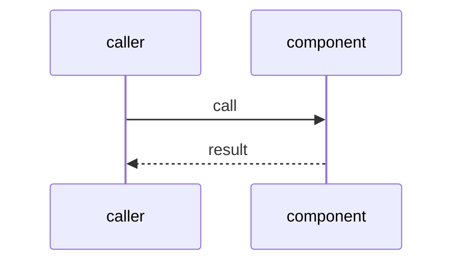
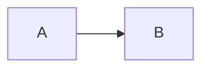

# PBI template (copy for every new PBI)

Every PBI file uses this layout. `## Technical design` is **required**: all eleven fields must be filled. Builder does not start a PBI while any field is empty, and an empty field is a **Reviewer FAIL** on the PBI PR. `make verify` (C01) is the repo gate on workflow and policy changes; Reviewer checks that the section exists and has no empty field on every new PBI.

**Shared fields (TPL01, PA8, same 5 as agentPacks):** `triage`, `feedback`, `harness`, `review-input`, `kind: skill|script`, plus `Source: D<n>` (or `PA<n>`) and the URL. `feedback:` is the feedback loop: the exact test, check or type check that tells the agent it is done (ARC08). `Module boundary:` names the small interface and the deep part behind it (ARC08). Reviewers fail a new or changed PBI that misses one or leaves it empty; existing PBIs get them in [TPL02](docs/TPL02-template-backfill.md).

Mermaid goes only in fenced `mermaid` code blocks, never as inline sequence text. One-way PBIs add the `one-way gate` line with Sven's yes and a rollback note (gist A1).

````markdown
# <ID>: <title>
- Status: todo
- Area: <folder>
- Wave: <W1..W6 or PR 0>
- Block: <n>
- Lane: Builder | Cursor CLI
- Depends on: <ids>
- proof: <one command or link that shows it works>
- door: two-way | one-way
- one-way gate: Sven's exact yes required (named ask in its block). Rollback: <exact revert step>
- triage: build | spec | ask | park | duplicate (<one-line reason>)
- feedback: <the exact test, check or type check that tells the agent it is done>
- harness: <where it runs: none (script), gh-aw engine, Cursor CLI>
- review-input: diff + this PBI + DoD (+ linked spec) + PR description, never builder session logs
- kind: skill | script
- Source: D<n> <url>
## Goal
## Context
## Steps
## Definition of Done
- [ ] ...
## Technical design
- Components and files: <paths created or changed>
- Module boundary: <the small interface this PBI exposes and the deep part behind it>
- Interfaces: <frontmatter keys, inputs (import-schema), outputs (safe-outputs, exit codes)>
- Sequence:



- Failure modes: <what breaks, how it shows, what happens then>
- Security: <tokens, permissions, network, untrusted input>
- Observability: <logs, metrics, where to look>
- Cost: <AIC per run, or 0 for scripts>
- Rollback: <exact revert step>
- Proof: <same as proof: above, or the run that proves it>
- Door: two-way | one-way (<reason>)
## Evidence
## Flow

## Named asks for Sven
## Cost
## Sources
````

Workflow PBIs (they run an agent) also carry every Bar H line from [README.md](README.md#bar-h-every-workflow-pbi) in their DoD, including "benchmark score at or above baseline" ([X07](testing/X07-workflow-benchmark.md)).
