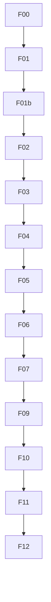

# agent-factory: overview

**Purpose:** Installable Copilot workflows (Bar H) and F00 fit index.

## PBIs

- [F00: F00-fit-index](F00-fit-index.md)
- [F01: F01-pr-review](F01-pr-review.md)
- [F01b: F01b-pr-review-auto-on-push](F01b-pr-review-auto-on-push.md)
- [F02: F02-ci-doctor](F02-ci-doctor.md)
- [F03: F03-repo-status](F03-repo-status.md)
- [F04: F04-cost-tracker](F04-cost-tracker.md)
- [F05: F05-malicious-code-scan](F05-malicious-code-scan.md)
- [F06: F06-daily-issue-triage](F06-daily-issue-triage.md)
- [F07: F07-doc-updater](F07-doc-updater.md)
- [F09: F09-release-notes](F09-release-notes.md)
- [F10: F10-repo-assist](F10-repo-assist.md)
- [F11: F11-ci-coach](F11-ci-coach.md)
- [F12: F12-code-simplifier](F12-code-simplifier.md)
- [F13: F13-grumpy-reviewer](F13-grumpy-reviewer.md)
- [F14: F14-link-checker](F14-link-checker.md)
- [F15: F15-markdown-linter](F15-markdown-linter.md)
- [F16: F16-pr-fix](F16-pr-fix.md)
- [F17: F17-q](F17-q.md)
- [F18: F18-test-improver](F18-test-improver.md)
- [F19: F19-unbloat-docs](F19-unbloat-docs.md)
- [F20: F20-dependency-analysis](F20-dependency-analysis.md)
- [F21: F21-linter-factory](F21-linter-factory.md)
- [F22: F22-metrics-analytics](F22-metrics-analytics.md)
- [F23: F23-aic-optimizer](F23-aic-optimizer.md)
- [F24: F24-audit-agent](F24-audit-agent.md)
- [F25: F25-breaking-change-checker](F25-breaking-change-checker.md)
- [F26: F26-code-scanning-fixer](F26-code-scanning-fixer.md)
- [F27: F27-secrets-analysis](F27-secrets-analysis.md)
- [F28: F28-stale-pr-cleanup](F28-stale-pr-cleanup.md)
- [F29: F29-instructions-janitor](F29-instructions-janitor.md)
- [F30: F30-accessibility-review](F30-accessibility-review.md)
- [F31: F31-adhoc-qa](F31-adhoc-qa.md)
- [F32: F32-agentic-wiki-coder](F32-agentic-wiki-coder.md)
- [F33: F33-agentic-wiki-writer](F33-agentic-wiki-writer.md)
- [F34: F34-ai-moderator](F34-ai-moderator.md)
- [F35: F35-archie](F35-archie.md)
- [F36: F36-contribution-check](F36-contribution-check.md)
- [F37: F37-contribution-guidelines-checker](F37-contribution-guidelines-checker.md)
- [F38: F38-dictation-prompt](F38-dictation-prompt.md)
- [F39: F39-discussion-task-miner](F39-discussion-task-miner.md)
- [F40: F40-duplicate-code-detector](F40-duplicate-code-detector.md)
- [F41: F41-efficiency-improver](F41-efficiency-improver.md)
- [F42: F42-glossary-maintainer](F42-glossary-maintainer.md)
- [F43: F43-issue-arborist](F43-issue-arborist.md)
- [F44: F44-issue-monster](F44-issue-monster.md)
- [F45: F45-issue-triage](F45-issue-triage.md)
- [F46: F46-large-file-simplifier](F46-large-file-simplifier.md)
- [F47: F47-lean-squad](F47-lean-squad.md)
- [F48: F48-multi-device-docs-tester](F48-multi-device-docs-tester.md)
- [F49: F49-perf-improver](F49-perf-improver.md)
- [F50: F50-plan](F50-plan.md)
- [F51: F51-pr-nitpick-reviewer](F51-pr-nitpick-reviewer.md)
- [F52: F52-repo-ask](F52-repo-ask.md)
- [F53: F53-repo-chronicle](F53-repo-chronicle.md)
- [F54: F54-repository-quality-improver](F54-repository-quality-improver.md)
- [F55: F55-sub-issue-closer](F55-sub-issue-closer.md)
- [F56: F56-team-status](F56-team-status.md)
- [F57: F57-tech-content-editorial-board](F57-tech-content-editorial-board.md)
- [F58: F58-update-docs](F58-update-docs.md)
- [F59: F59-vex-generator](F59-vex-generator.md)
- [F60: F60-weekly-issue-activity](F60-weekly-issue-activity.md)
- [F61: F61-weekly-repo-map](F61-weekly-repo-map.md)
- [F62: F62-weekly-research](F62-weekly-research.md)
- [F63: F63-pr-description-updater](F63-pr-description-updater.md)
- [F64: F64-architecture-guardian](F64-architecture-guardian.md)
- [F65: F65-test-quality-sentinel](F65-test-quality-sentinel.md)
- [F66: F66-container-image-scan](F66-container-image-scan.md)
- [F67: F67-design-decision-gate](F67-design-decision-gate.md)
- [F68: F68-workflow-opportunity-analyzer](F68-workflow-opportunity-analyzer.md)
- [F69: F69-skills-reviewer](F69-skills-reviewer.md)
- [F70: F70-semgrep-scan](F70-semgrep-scan.md)
- [F71: F71-copilot-usage-analytics](F71-copilot-usage-analytics.md)
- [F72: F72-issue-triage-repro](F72-issue-triage-repro.md)
- [F73: F73-issue-grouping](F73-issue-grouping.md)
- [F74: F74-findings-buffer](F74-findings-buffer.md)
- [F75: F75-weekly-merged-pr-sample](F75-weekly-merged-pr-sample.md)

## Dependency sketch

