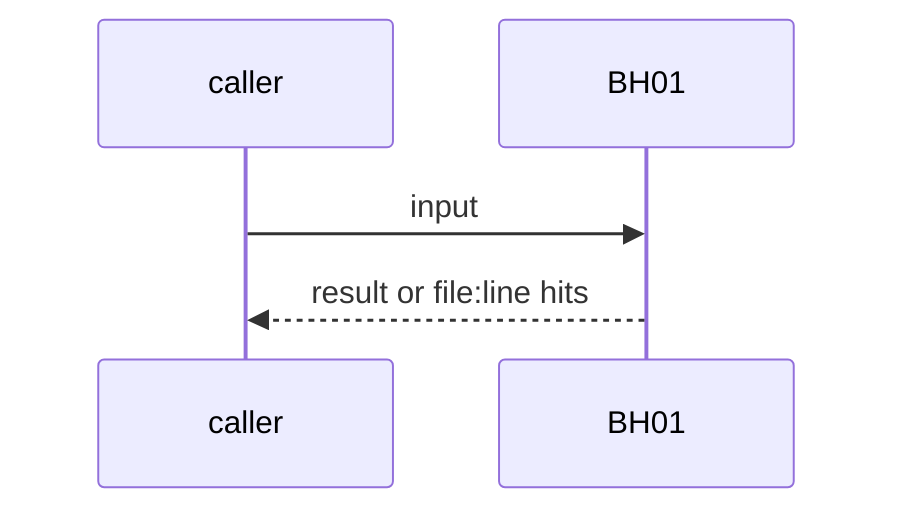
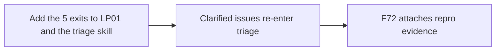

# BH01: Triage exits: build, spec, ask, park, duplicate
- Status: todo
- Area: agent-factory
- Wave: W3
- Block: 3
- Lane: Builder
- Depends on: F72, F73, P12, P13, LP01
- proof: LP01 mermaid shows 5 exits; fixture issue for each exit gets the right label; a clarified issue goes back to triage
- door: two-way
- triage: build
- feedback: triage fixtures per exit (staged, safe-outputs dry run)
- harness: gh-aw, engine copilot via shared/defaults.md (when built)
- review-input: diff + this PBI + DoD (+ linked spec) + PR description, never builder session logs (PA6)
- kind: skill
- Source: D12, D13 https://x.com/BHolmesDev/status/2106510336413012463 https://www.warp.dev/blog/self-improvement-loop-for-skills https://www.warp.dev/blog/software-factory-build-guide https://www.warp.dev/blog/we-are-now-factory-engineers-not-product-engineers https://www.warp.dev/blog/how-to-build-a-cloud-software-factory-computer-use-verification
## Goal
Triage routes each issue to one exit: build, spec, ask, park, or duplicate (links the F73 group). An answered question loops back to triage, not straight to build. F72 attaches repro evidence (command output or screenshot).
## Context
Ben Holmes' loop diagram: automatable, needs specs, needs human clarification (then back to triage), park for now. The Warp skills loop example uses a duplicate bucket. The memo and the build guide say triage tries to reproduce first. Not built in PR #4: docs only, nothing enabled (PA9).
## Steps
1. Add the 5 exits to LP01 and the triage skill.
2. Clarified issues re-enter triage.
3. F72 attaches repro evidence.
## Definition of Done
- [ ] 5 exits in LP01 mermaid
- [ ] Fixture per exit
- [ ] Repro evidence on a bug issue
- [ ] Bar H lines when the workflow ships
- [ ] Every Bar H line from [README.md](../README.md#bar-h-every-workflow-pbi) when the workflow ships
## Technical design
- Components and files: LP01, F72 workflow, triage skill
- Module boundary: exit label is the interface
- Interfaces: labels per exit
- Sequence:

- Failure modes: Unknown case goes to ask, never to build
- Security: Issue text is untrusted input
- Observability: label counts per exit
- Cost: measured per run on X01
- Rollback: Disable the triage step
- Proof: same as proof: above
- Door: two-way (revert is one commit)
## Evidence
(todo)
## Flow

## Named asks for Sven
none
## Cost
measured per run on X01
## Sources
- [Ben Holmes, factory loop](https://x.com/BHolmesDev/status/2106510336413012463)
- [Warp blog, self-improvement loop for skills](https://www.warp.dev/blog/self-improvement-loop-for-skills)
- [Warp blog, software factory build guide](https://www.warp.dev/blog/software-factory-build-guide)
- [Warp blog, factory engineers memo](https://www.warp.dev/blog/we-are-now-factory-engineers-not-product-engineers)
- [Warp blog, computer-use verification](https://www.warp.dev/blog/how-to-build-a-cloud-software-factory-computer-use-verification)
- Strategy id list v3.12 (aw-final-ids.md), url-learnings.md D12, D13
