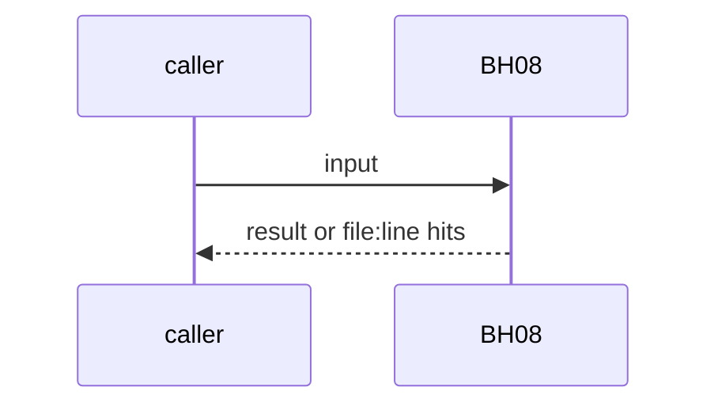
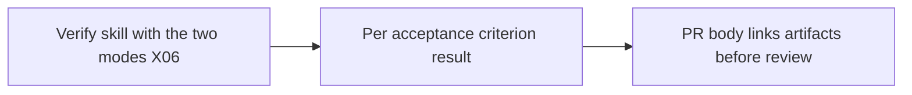

# BH08: Verify job: reproduce and verify modes, artifacts before review
- Status: todo
- Area: agent-factory
- Wave: W3
- Block: 3
- Lane: Builder
- Depends on: X06, LP01, F01
- proof: dry run of safe outputs plus screenshots where there is a UI, one result per acceptance criterion, artifacts linked in the PR before review
- door: two-way
- triage: build
- feedback: staged run on X01 with a fixture issue that has acceptance criteria
- harness: gh-aw, engine copilot via shared/defaults.md (when built)
- review-input: diff + this PBI + DoD (+ linked spec) + PR description, never builder session logs (PA6)
- kind: skill
- Source: D21, D22, PA4 https://www.warp.dev/blog/how-to-build-a-cloud-software-factory-computer-use-verification https://www.warp.dev/blog/software-factory-build-guide https://x.com/BHolmesDev/status/2106510336413012463 https://github.com/svennijhuis/agentic-workflows/pull/4
## Goal
A verify job with two modes, `reproduce` and `verify`, checks each acceptance criterion of the issue and links its artifacts in the PR before human review. B3 is a dry run plus screenshots; video or computer use is a later PBI with Sven's yes.
## Context
Warp verification post: one skill with two modes, reproduce and verify, video preferred and screenshots fine, checks against the issue's acceptance criteria. The build guide: reviewable PR artifacts move human review "from investigation to confirmation". PA4: no computer use or video in B3. PO gap 2b. Not built in PR #4: docs only, nothing enabled (PA9).
## Steps
1. Verify skill with the two modes (X06).
2. Per acceptance criterion result.
3. PR body links artifacts before review.
## Definition of Done
- [ ] Both modes run on a fixture
- [ ] One result per criterion
- [ ] Artifacts linked before review
- [ ] No video or computer use in B3
- [ ] Every Bar H line from [README.md](../README.md#bar-h-every-workflow-pbi) when the workflow ships
## Technical design
- Components and files: X06 skill, LP01 step
- Module boundary: mode plus criterion list in, artifact list out
- Interfaces: mode reproduce|verify
- Sequence:

- Failure modes: Criterion without a result fails the job
- Security: Runs on Actions runners, not Sven's machine
- Observability: artifact links in the PR
- Cost: measured on X01
- Rollback: Disable the job
- Proof: same as proof: above
- Door: two-way (revert is one commit)
## Evidence
(todo)
## Flow

## Named asks for Sven
none
## Cost
measured on X01
## Sources
- [Warp blog, computer-use verification](https://www.warp.dev/blog/how-to-build-a-cloud-software-factory-computer-use-verification)
- [Warp blog, software factory build guide](https://www.warp.dev/blog/software-factory-build-guide)
- [Ben Holmes, factory loop](https://x.com/BHolmesDev/status/2106510336413012463)
- [agentic-workflows PR #4 room (PO additions PA1 to PA9)](https://github.com/svennijhuis/agentic-workflows/pull/4)
- Strategy id list v3.12 (aw-final-ids.md), url-learnings.md D21, D22, PA4
