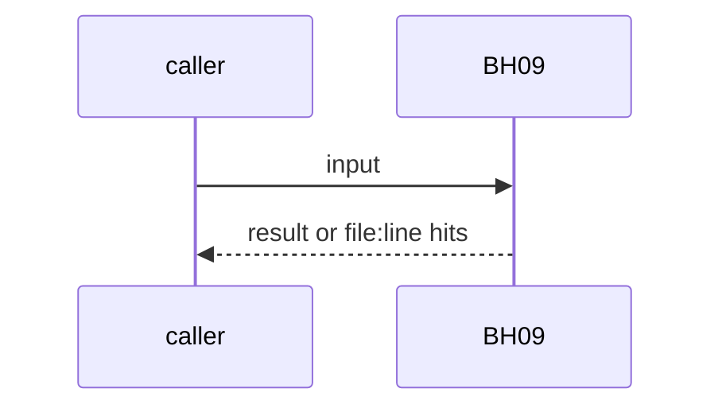
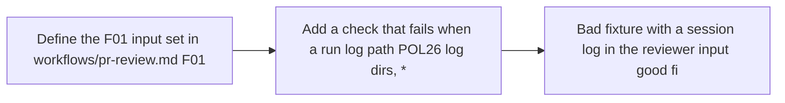

# BH09: Fresh-context review guard
- Status: todo
- Area: agent-factory
- Wave: W2
- Block: 2
- Lane: Builder
- Depends on: F01, C01
- proof: bash policies/checks/POLnn.sh test/fixtures/bad/<run-log-in-review-input>.md exits 1; good review input exits 0
- door: two-way
- triage: build (guard plus fixture, scope clear)
- feedback: C01 bad fixture with a session log in the reviewer input must fail
- harness: gh-aw, engine copilot via shared/defaults.md (when built)
- review-input: diff + this PBI + DoD (+ linked spec) + PR description, never builder session logs (PA6)
- kind: script
- Source: D15, D16, PA6 https://www.warp.dev/blog/how-to-build-a-cloud-software-factory-self-improving-code-review https://github.com/svennijhuis/agentic-workflows/pull/4
## Goal
F01 review input is the diff, the PBI, the DoD and the linked spec (plus the PR description). A builder session log or transcript is never input. C01 fails when a run log is in the input set.
## Context
Warp review skill inputs: PR description, PR diff, specs. The review agent has read-only PR access and a separate step posts comments, because write access "would introduce a prompt injection risk". Matt Pocock: "Review in a fresh context". PA6 (PO gap 1). Block 2, so not built in PR #4. Not built in PR #4: docs only, nothing enabled (PA9).
## Steps
1. Define the F01 input set in `workflows/pr-review.md` (F01).
2. Add a check that fails when a run log path (POL26 log dirs, `*.jsonl` sessions) is in the input set.
3. Bad fixture with a session log in the reviewer input; good fixture without.
## Definition of Done
- [ ] Bad fixture with a session log in the review input exits 1
- [ ] Good fixture exits 0
- [ ] F01 PBI links this guard
- [ ] Every Bar H line from [README.md](../README.md#bar-h-every-workflow-pbi) when the workflow ships
## Technical design
- Components and files: F01 workflow inputs, a new POL check, `test/fixtures/`
- Module boundary: the review input list is the interface; F01 reads only that list
- Interfaces: F01 import-schema input list
- Sequence:

- Failure modes: A new input source added later without the guard: fixture keeps it red
- Security: Builder logs can hold tokens and steer the reviewer (untrusted)
- Observability: verify.sh line per hit
- Cost: 0 AIC for the check
- Rollback: Remove the check
- Proof: same as proof: above
- Door: two-way (revert is one commit)
## Evidence
(todo)
## Flow

## Named asks for Sven
none
## Cost
0 AIC for the check
## Sources
- [Warp blog, self-improving code review](https://www.warp.dev/blog/how-to-build-a-cloud-software-factory-self-improving-code-review)
- [agentic-workflows PR #4 room (PO additions PA1 to PA9)](https://github.com/svennijhuis/agentic-workflows/pull/4)
- Strategy id list v3.12 (aw-final-ids.md), url-learnings.md D15, D16, PA6
