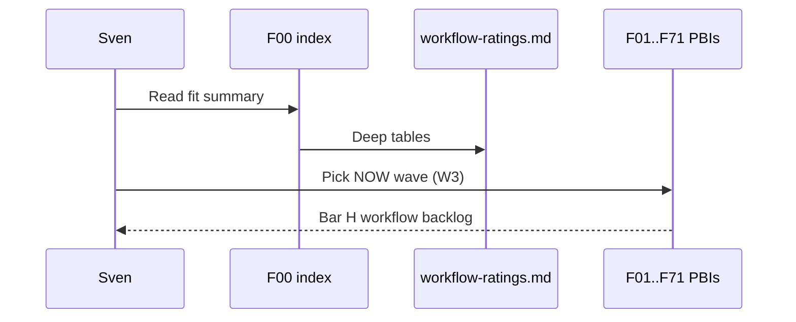

# F00: Agent factory fit index
- Status: todo
- Area: agent-factory
- Wave: PR 0
- Block: 0
- Lane: Cursor CLI
- Depends on: none
- proof: `make verify` exits 0; no run, no token spend
- door: two-way
- triage: build (index edit in PR #4)
- feedback: `make compile` (`gh aw compile --strict`)
- harness: none (docs page)
- review-input: diff + this PBI + DoD (+ linked spec) + PR description, never builder session logs (PA6)
- kind: skill
- Source: PA8 (pre-link PBI edited in PR #4, origin in its Sources) https://github.com/svennijhuis/agentic-workflows/pull/4
- Module boundary: the fit table is the interface; each F PBI holds the detail
## Goal
Publish a single index that places all 62 `githubnext/agentics` workflows, 18 gh-aw gallery pages, and the 348 agent-factory-status rows next to value, cost tier, now/later, and target PBI id so Sven can prioritize without re-reading three spreadsheets.
## Context
This file is the PR 0 companion to `docs/pbi/workflow-ratings.md` (full tables). PICK rows in agent-factory become workflow PBIs F01 to F71. Redirect workflows in agentics map to their canonical PBI. Gallery pages often overlap agentics; both columns are kept for traceability.

### Agentics (62 entries: 61 workflow .md files plus shared/; 13 redirects)
| Workflow | What it does | Value for Sven repos | Cost | When | PBI |
|---|---|---|---|---|---|
| accessibility-review | Reviews a site for a11y, files issues | M: Chatmarkt web | M | later | F30 |
| adhoc-qa | Ad hoc QA pass, discussion + PR | M: Chatmarkt, Spellwise | L | later | F31 |
| agentic-wiki-coder | Wiki edits to code PR | L: no wikis used | L | later | F32 |
| agentic-wiki-writer | Code to wiki pages | L: docs live in repo | L | later | F33 |
| ai-moderator | Spam/AI-slop labeling on issues and comments | M: public repos get spam | S | later | F34 |
| archie | /archie mermaid map of issue/PR links | M: fits mermaid habit | S | later | F35 |
| ci-coach | Daily Actions efficiency PRs | H: Actions minutes cost money | M | now | F11 |
| ci-doctor | Investigates failed runs, files issue | H: every repo | M | now | F02 |
| code-simplifier | Simplify recent code, PR | H: matches review style | M | later | F12 |
| contribution-check | Batch-checks PRs vs guidelines | L: solo dev | M | later | F36 |
| contribution-guidelines-checker | Per-PR guideline check | M: bot PRs follow CONTRIBUTING | S | later | F37 |
| cost-tracker | Reads firewall token usage after a run, reports cost | H: cost per run proof | S | now | F04 |
| daily-accessibility-review | redirect to accessibility-review | see accessibility-review | | | F30 |
| daily-doc-updater | redirect to doc-updater | see doc-updater | | | F07 |
| daily-efficiency-improver | redirect to efficiency-improver | see efficiency-improver | | | F41 |
| daily-issue-triage | Batch triage once a day | H: cheaper than per-event | M | now | F06 |
| daily-malicious-code-scan | redirect to malicious-code-scan | see malicious-code-scan | | | F05 |
| daily-multi-device-docs-tester | redirect to multi-device-docs-tester | see multi-device-docs-tester | | | F48 |
| daily-perf-improver | redirect to perf-improver | see perf-improver | | | F49 |
| daily-plan | redirect to plan | see plan | | | F50 |
| daily-qa | redirect to adhoc-qa | see adhoc-qa | | | F31 |
| daily-repo-chronicle | redirect to repo-chronicle | see repo-chronicle | | | F53 |
| daily-repo-status | redirect to repo-status | see repo-status | | | F03 |
| daily-team-status | redirect to team-status | see team-status | | | F56 |
| daily-test-improver | redirect to test-improver | see test-improver | | | F18 |
| dictation-prompt | Builds dictation prompt file | L: niche | S | later | F38 |
| discussion-task-miner | Discussions to issues | L: discussions unused | S | later | F39 |
| doc-updater | Docs follow code changes, PR | H: docs/pbi + READMEs drift | M | now | F07 |
| duplicate-code-detector | Finds duplication, issue | M: MCP C# monorepo | M | later | F40 |
| efficiency-improver | Energy/efficiency PRs | L | L | later | F41 |
| glossary-maintainer | Keeps glossary current | L | S | later | F42 |
| grumpy-reviewer | /grumpy critical review | H: second reviewer voice | M | now | F13 |
| issue-arborist | Links related issues as sub-issues | M: PBI issues tree | S | later | F43 |
| issue-monster | Assigns cookie-labeled issues to Copilot agent | H: PBI to agent pipeline | M | later | F44 |
| issue-triage | Per-issue triage on open | M: low volume, daily batch better | S | later | F45 |
| large-file-simplifier | Largest file to refactor plan issue | M | S | later | F46 |
| lean-squad | Multi-role squad (plan, build, review) | H: mirrors our room | XL | later | F47 |
| link-checker | Broken doc links to PR | H: docs heavy repos | S | now | F14 |
| malicious-code-scan | 3-day scan for malicious/agentic threats, code scanning alert | H: security | M | now | F05 |
| markdown-linter | Super Linter markdown to issue | H: agentPacks is markdown | S | now | F15 |
| multi-device-docs-tester | Playwright responsive test of doc site | M: Chatmarkt pages | L | later | F48 |
| perf-improver | Perf PRs with measurement | M | L | later | F49 |
| plan | Planner: discussion with plan | M: like Strategy | S | later | F50 |
| pr-fix | /pr-fix pushes fix for failing CI | H: Builder relief | M | later | F16 |
| pr-nitpick-reviewer | /nit style review | M | S | later | F51 |
| q | /q optimizes agentic workflows themselves | H: this repo | M | now | F17 |
| repo-ask | /ask answers repo questions | M | S | later | F52 |
| repo-assist | Friendly all-round maintainer | M: overlaps others | L | later | F10 |
| repo-chronicle | Narrative daily activity discussion | L | S | later | F53 |
| repo-status | Daily status issue | H: portfolio view | S | now | F03 |
| repository-quality-improver | Daily quality focus area to issue | M | M | later | F54 |
| sub-issue-closer | Closes parents when children done | M: PBI trees | S | later | F55 |
| team-status | Team status issue | L: solo, use repo-status | S | later | F56 |
| tech-content-editorial-board | Editorial review of docs | M: Writer-style docs | M | later | F57 |
| test-improver | Adds tests, PR | H: Chatmarkt/MCP tests | L | later | F18 |
| unbloat-docs | Shortens verbose docs | H: caveman/no slop fits | M | later | F19 |
| update-docs | On push, update docs PR | M: overlaps doc-updater (pick one) | M | later | F58 |
| vex-generator | OpenVEX on Dependabot dismissal | L | S | later | F59 |
| weekly-issue-activity | Weekly issue trends discussion | L | S | later | F60 |
| weekly-repo-map | ASCII tree map issue | L | S | later | F61 |
| weekly-research | Weekly research discussion | M: News/Research bots exist | S | later | F62 |
| shared/ (arxiv, ffmpeg, formatting, markitdown, mcp, reporting, sq) | shared imports | formatting + reporting reused | | now | C05 |

NOW in plan v3: F01, F02, F03, F04, F05, F06, F07, F11, F13, F14, F15, F17. F08 is not in plan v3 (skipped). Gallery `code-improvement` maps to F12 in ratings, not F08.

### Gallery (18 pages)
| Page | PBI |
|---|---|
| gallery index | F00 |
| ai-issue-triage | F06 |
| ai-release-notes | F09 |
| automated-pr-review | F01 |
| ci-failure-investigation | F02 |
| code-improvement | F12 |
| daily-report-portfolio | F03 |
| dependency-analysis | F20 |
| docs-automation | F07 |
| linter-factory | F21 |
| maintaining-repos | F10 |
| metrics-analytics | F22 |
| multi-repo/code-quality-monitoring | P03 |
| multi-repo/dependabot-rollout | P02 |
| multi-repo/feature-sync | P06 |
| multi-repo/issue-tracking | P01 |
| multi-repo/triage-from-side-repo | P03 |
| security-review | F05 |

### Agent-factory-status (348 rows)
Full table with Decision column (not ours, PICK, F71 analytics bucket) lives in `docs/pbi/workflow-ratings.md`. PICK rows in F00 to F35 scope include F04 (AIC audit), F11/F13 (factory names align with agentics), F20 to F29, and factory-backed F23 to F27.

### Gist handover candidates (rated)
| Id | Idea | Value | Cost tier | Block | PBI |
|---|---|---|---|---|---|
| F72 | Issue triage with repro on main (report-only) | High: ties issues to inner loop without proxy | M | 3 | [F72](F72-issue-triage-repro.md) |
| F73 | Group related issues before work | Medium: one fix per root cause | M | 5 | [F73](F73-issue-grouping.md) |
| F74 | Findings buffer on one pinned issue | High: cheap gardening, pattern visibility | S | 3 | [F74](F74-findings-buffer.md) |
| F75 | Weekly merged PR sample (3 picks) | High: sample review, feeds new guards | S | 5 | [F75](F75-weekly-merged-pr-sample.md) |
| X06 | Verification skill + script for this repo | High: one shared proof path for Tester | n/a | 1 | [X06](../done/X06-verification-skill.md) |
## Steps
1. Keep this index aligned when adding or retiring F PBIs.
2. On each new PICK, add a row here and open the matching F PBI file.
3. Reconcile gallery vs agentics naming in D02 use-case catalog (W5).
4. Run `make verify` after index edits (POL25/POL31 and compile still apply to workflow files in repo).

## Definition of Done
- [ ] All 62 agentics entries represented (redirects point to canonical PBI)
- [ ] All 18 gallery pages mapped to a PBI id
- [ ] Agent-factory 348-row table linked from `docs/pbi/workflow-ratings.md`
- [ ] Every PICK in F01 to F71 has a matching `docs/pbi/agent-factory/` file when in scope
- [ ] No em dash or en dash in this folder
- [ ] `make verify` exits 0 on the repo after index edits
## Evidence
(link to committed `docs/pbi/workflow-ratings.md`; run `make verify` on the PR SHA)

## Flow

## Named asks for Sven
none
## Cost
n/a (documentation)
## Sources
- https://github.github.com/gh-aw/gallery/
- https://github.github.com/gh-aw/agent-factory-status/
- https://github.com/githubnext/agentics/tree/main/workflows
- docs/pbi/workflow-ratings.md
