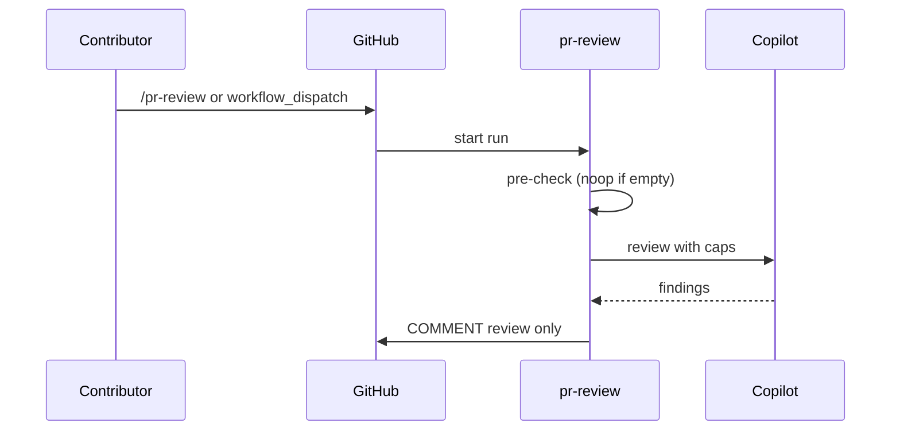

# F01: PR review (replaces squad-review)
- Status: todo
- Area: agent-factory
- Wave: W3
- Block: 2, 3
- Lane: Builder
- Depends on: C03, C04, C05, C06, C12, O01, O02, O03, X01, F00, POL21, POL22
- proof: gh aw compile --dir workflows --strict workflows/pr-review.md; gh aw audit <run-id> (Block exit runs)
- door: one-way
- one-way gate: Sven's exact yes required (named ask in its block). Rollback: disable pr-review workflow in catalog and trial repo
- triage: build (Block 2 workflow)
- feedback: gh aw compile --dir workflows --strict, POL22, staged run on X01
- harness: gh-aw, engine copilot via shared/defaults.md (when built)
- review-input: diff + this PBI + DoD (+ linked spec) + PR description, never builder session logs (PA6)
- kind: skill
- Source: PA8 (pre-link PBI edited in PR #4, origin in its Sources) https://github.com/svennijhuis/agentic-workflows/pull/4
- Module boundary: the agentPacks review command import is the interface; the review contract stays in agentPacks
## Goal
Ship `pr-review.md` as Copilot report-only PR review with C12 v1.1 agentPacks pins (tag on generated commit, not main SHA), replacing temporary `squad-review.md` after this workflow passes Bar H.
## Context
Upstream reference: [automated-pr-review](https://github.github.com/gh-aw/gallery/automated-pr-review/). Replaces [PR #2](https://github.com/svennijhuis/agentic-workflows/pull/2) pr-review pin `@34e1dec`. **Trigger (v3.5):** `workflow_dispatch` and `/pr-review` slash command only. No `pull_request` or `push` trigger. Block 2: staged smoke, report-only, no writes. Block 3: live manual runs. Auto on push is [F01b](F01b-pr-review-auto-on-push.md), gated separately.
Engine: `copilot` with `COPILOT_GITHUB_TOKEN` (personal fine-grained PAT). `copilot-requests: none` (POL21). Review output COMMENT only (POL22).
## Steps
1. Add `workflows/pr-review.md`; import `shared/defaults.md`, `shared/security.md`, and C12-pinned agentPacks review bundle.
2. Set caps per C03 (suggested 50 / 200 daily, unverified) in workflow frontmatter (POL02).
3. Staged/report-only outputs first (POL03); deterministic pre-check noop when empty diff.
4. Triggers: `workflow_dispatch` and slash `/pr-review` only until F01b approved.
5. Run `scripts/verify.sh` on PR SHA; compile with pinned gh-aw extension v0.93.4.
6. Block 2: X01 staged smoke run, no PR state change.
7. Block 3: three audited manual runs; measured AIC in Evidence; then enable as default manual review path.
8. On merge: remove `squad-review.md` and list every removed file in PR description (settled decision).
## Definition of Done
- [ ] Fetches own context with tools and imports (Bar H, gist A7); prompt never pastes repo content
- [ ] `workflows/pr-review.md` imports `shared/defaults.md` (engine copilot, admission)
- [ ] C12 v1.1 agentPacks `imports:` and `plugins:` pins (tag or tagged-commit SHA, not main)
- [ ] Pinned `gh aw` compiler version; no `@main`, no `@marketplace` branch imports
- [ ] `max-ai-credits`, `max-daily-ai-credits`, `max-turns`, `timeout-minutes` in workflow frontmatter (POL02)
- [ ] `copilot-requests: none` (POL21)
- [ ] `submit-pull-request-review` COMMENT only (POL22)
- [ ] Deterministic pre-check; writes `noop` when nothing to do (0 AIC)
- [ ] Block 2: staged/report-only smoke on X01; no schedule or token spend until Sven approves live path
- [ ] Dedupe via title, `group-by-day`, `close-older-issues`, expiry (O03)
- [ ] `min-integrity: approved` and threat detection on (POL05, POL13)
- [ ] Network allowlist and tool/MCP/bash allowlists (POL06, POL07)
- [ ] `on.roles` and skip-bots (POL10)
- [ ] Issue/PR bodies use `shared/reporting.md` footer (POL16)
- [ ] Trial on X01 with verify log on exact SHA (Q0)
- [ ] `gh aw audit` on first 3 Block 3 runs; AIC recorded in Evidence (B02)
- [ ] Triggers are `workflow_dispatch` and `/pr-review` only (no `pull_request` until F01b)
- [ ] [X07](../testing/X07-workflow-benchmark.md) benchmark: 5 or more fixed cases with known answers in `docs/benchmarks/<workflow>.md`, score at or above baseline (Bar H)
## Evidence
(commands, verify log on SHA, run links, three-run AIC table)
## Flow

## Named asks for Sven
Q7 (agentPacks tag pin); Q3 (PAT); squad-review removal file list on merge
## Cost
M tier, ~30-50 AIC per review (unverified)
## Sources
- https://github.github.com/gh-aw/gallery/automated-pr-review/
- https://github.com/svennijhuis/agentic-workflows/pull/2
- docs/pbi/done/C12-agentpacks-import-contract.md
- docs/pbi/workflow-ratings.md
