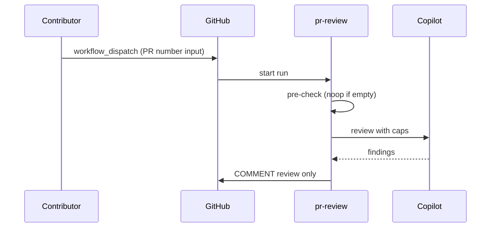

# F01: PR review (replaces squad-review)
- Status: todo
- Area: agent-factory
- Wave: W3
- Block: 2, 3
- Lane: Builder
- Depends on: C03, C04, C05, C06, C12, C12b
- proof: `make verify` exits 0 (`gh aw compile --strict --dir workflows` clean for `workflows/pr-review.md`, lock unchanged after compile, POL25 and POL31 clean); no run, no token spend
- door: two-way
- triage: build (Block 2 workflow)
- feedback: `make compile` (`gh aw compile --strict`)
- harness: gh-aw, engine copilot via shared/defaults.md (when built)
- review-input: diff + this PBI + DoD (+ linked spec) + PR description, never builder session logs (PA6)
- kind: skill
- Source: PA8 (pre-link PBI edited in PR #4, origin in its Sources) https://github.com/svennijhuis/agentic-workflows/pull/4
- Module boundary: the agentPacks review command import is the interface; the review contract stays in agentPacks
## Goal
Ship `pr-review.md` as Copilot report-only PR review with C12 v1.1 agentPacks pins (tag on generated commit, not main SHA), replacing temporary `squad-review.md` after this workflow passes Bar H.
## Context
Upstream reference: [automated-pr-review](https://github.github.com/gh-aw/gallery/automated-pr-review/). Replaces [PR #2](https://github.com/svennijhuis/agentic-workflows/pull/2) pr-review pin `@34e1dec`. **Trigger:** `workflow_dispatch` only (POL25, `sven_yes` empty). The `/pr-review` slash command is a named ask for a later Sven yes, recorded in `policies/POL25.yml` `sven_yes` before it exists. No `pull_request` or `push` trigger. This PBI is offline proof only; the X01 staged smoke and live manual runs are named asks. Auto on push is [F01b](F01b-pr-review-auto-on-push.md), gated separately.
Engine: `copilot` with `COPILOT_GITHUB_TOKEN` (personal fine-grained PAT). Review output COMMENT only via `safe-outputs`; no org billing write scopes.

## Frontmatter security
- `permissions:` read only (`contents: read`, `pull-requests: read`, `issues: read`, `actions: read`); no write permission on the token.
- Writes only through `safe-outputs`: `submit-pull-request-review` (COMMENT only, `max: 1`), `staged: true` until Sven's yes.
- `timeout-minutes:` 15 (fits a single PR review pass).
- Trigger: `workflow_dispatch` only (POL25). `/pr-review` slash or `pull_request` (F01b) are named asks for Sven, recorded in `policies/POL25.yml` `sven_yes` first.

## Steps
1. Add `workflows/pr-review.md`; import `shared/defaults.md`, `shared/security.md`, and the C12-pinned agentPacks review command (`imports:` pin). Put the same `skills:` pin from `workflows/squad-review.md` in `workflows/pr-review.md` frontmatter (not in a shared fragment, POL31).
2. Set frontmatter security (read-only `permissions`, `safe-outputs` with `staged: true` and a `max` per output, `timeout-minutes`, `workflow_dispatch` only).
3. Add deterministic pre-check; writes `noop` when empty diff.
4. Run `make compile` and commit the `.lock.yml`.
5. Run `make verify`.
6. Write the "copy this" note at `docs/reference/pr-review.md` (md, lock, `workflows/shared/` files an org copies, standalone, no secrets).
7. On merge: remove `squad-review.md` only after `pr-review.md` carries the `skills:` pin; list removed files in the PR description.

## Definition of Done
- [ ] `workflows/pr-review.md` and its `.lock.yml` committed; `gh aw compile --strict` clean (0 errors, 0 warnings), lock unchanged after `make compile`
- [ ] Frontmatter: read-only `permissions`, writes only via `safe-outputs` (`staged: true`, a `max` per output), `timeout-minutes` set
- [ ] Trigger `workflow_dispatch` only (POL25); no `skills:` in a shared fragment (POL31)
- [ ] `make verify` exits 0; no run, no token spend
- [ ] Fetches own context with tools and imports (Bar H, gist A7); prompt never pastes repo content
- [ ] `workflows/pr-review.md` imports `shared/defaults.md` (engine copilot, admission)
- [ ] C12 v1.1 agentPacks `skills:` list in `workflows/pr-review.md` frontmatter (same pin as C12b, moved from `squad-review.md` before it is removed) plus the review command as an `imports:` pin (tag or tagged-commit SHA, not main)
- [ ] Deterministic pre-check; writes `noop` when nothing to do (0 AIC)
- [ ] Dedupe via title, `group-by-day`, `close-older-issues`, and expiry
- [ ] `workflow_dispatch` only, plus the "copy this" note in `docs/reference/pr-review.md`
- [ ] No slash, `pull_request` or `push` trigger in this PBI (slash and F01b are named asks)
- [ ] [X07](../testing/X07-workflow-benchmark.md) benchmark cases: 5 or more fixed cases with known answers written in `docs/benchmarks/<workflow>.md`, docs only, no run; the X07 score is a named ask
## Evidence
(commands, verify log on SHA)
## Flow

## Named asks for Sven
- Q7 (agentPacks tag pin); Q3 (PAT); squad-review removal file list on merge
- X01 staged smoke, then 3 audited manual runs with measured AIC in Evidence (B02, Bar H live part): Sven exact yes, it spends tokens
- `/pr-review` slash command trigger: Sven exact yes, row in `policies/POL25.yml` `sven_yes` first
- X07 benchmark score at or above baseline (Bar H): each score is a live [X07](../testing/X07-workflow-benchmark.md) run on the X01 repo (`door: one-way`), Sven exact yes per run, it spends tokens
## Cost
M tier, ~30-50 AIC per review (unverified)
## Sources
- https://github.github.com/gh-aw/gallery/automated-pr-review/
- https://github.com/svennijhuis/agentic-workflows/pull/2
- docs/pbi/done/C12-agentpacks-import-contract.md
- docs/pbi/workflow-ratings.md
