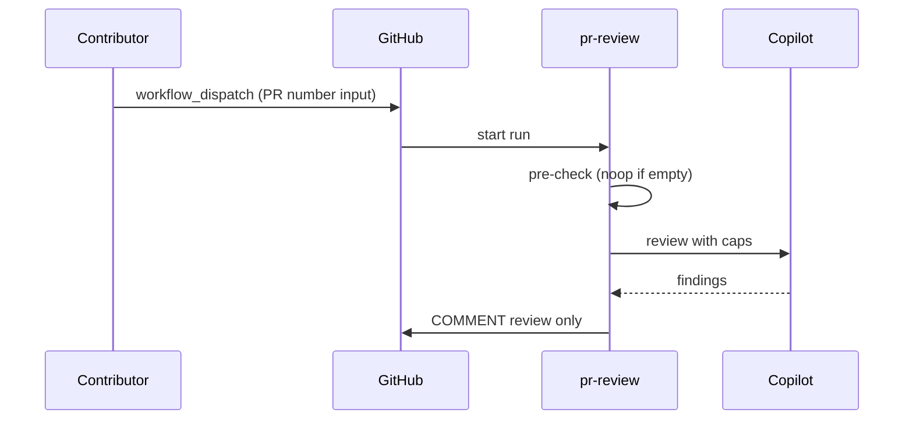

# F01: PR review (replaces squad-review)
- Status: todo
- Area: agent-factory
- Wave: W3
- Block: 2, 3
- Lane: Builder
- Depends on: C03, C04, C05, C06, C12, C12b, O01, O02, O03, POL21, POL22
- proof: `bash scripts/verify.sh` exits 0 with `0 failures` (offline: `gh aw compile --dir workflows --strict workflows/pr-review.md`, lock drift, `--no-emit` fixture); no run, no token spend
- door: two-way
- triage: build (Block 2 workflow)
- feedback: gh aw compile --dir workflows --strict, POL22, offline `scripts/verify.sh`
- harness: gh-aw, engine copilot via shared/defaults.md (when built)
- review-input: diff + this PBI + DoD (+ linked spec) + PR description, never builder session logs (PA6)
- kind: skill
- Source: PA8 (pre-link PBI edited in PR #4, origin in its Sources) https://github.com/svennijhuis/agentic-workflows/pull/4
- Module boundary: the agentPacks review command import is the interface; the review contract stays in agentPacks
## Goal
Ship `pr-review.md` as Copilot report-only PR review with C12 v1.1 agentPacks pins (tag on generated commit, not main SHA), replacing temporary `squad-review.md` after this workflow passes Bar H.
## Context
Upstream reference: [automated-pr-review](https://github.github.com/gh-aw/gallery/automated-pr-review/). Replaces [PR #2](https://github.com/svennijhuis/agentic-workflows/pull/2) pr-review pin `@34e1dec`. **Trigger:** `workflow_dispatch` only (POL25, `sven_yes` empty). The `/pr-review` slash command is a named ask for a later Sven yes, recorded in `policies/POL25.yml` `sven_yes` before it exists. No `pull_request` or `push` trigger. This PBI is offline proof only; the X01 staged smoke and live manual runs are named asks. Auto on push is [F01b](F01b-pr-review-auto-on-push.md), gated separately.
Engine: `copilot` with `COPILOT_GITHUB_TOKEN` (personal fine-grained PAT). `copilot-requests: none` (POL21). Review output COMMENT only (POL22).
## Steps
1. Add `workflows/pr-review.md`; import `shared/defaults.md`, `shared/security.md`, and C12-pinned agentPacks review bundle.
2. Set caps per C03 (suggested 50 / 200 daily, unverified) in workflow frontmatter (POL02).
3. Staged/report-only outputs first (POL03); deterministic pre-check noop when empty diff.
4. Trigger: `workflow_dispatch` only. `/pr-review` slash and auto on push (F01b) are named asks, not in this PBI.
5. Run `scripts/verify.sh` on PR SHA; compile with pinned gh-aw extension v0.93.4.
6. Offline proof only: `scripts/verify.sh` (compile --strict --actionlint, lock drift, `--no-emit` fixture). X01 staged smoke, the 3 audited manual runs and measured AIC are a named ask (Sven exact yes), not in this DoD.
7. On merge: remove `squad-review.md` and list every removed file in PR description (settled decision).
8. Write the "copy this" note at `docs/reference/pr-review.md`: the md, its lock and the `workflows/shared/` files an org copies, standalone, no secrets.
## Definition of Done
- [ ] Fetches own context with tools and imports (Bar H, gist A7); prompt never pastes repo content
- [ ] `workflows/pr-review.md` imports `shared/defaults.md` (engine copilot, admission)
- [ ] C12 v1.1 agentPacks `imports:` and `plugins:` pins (tag or tagged-commit SHA, not main)
- [ ] Pinned `gh aw` compiler version; no `@main`, no `@marketplace` branch imports
- [ ] `max-ai-credits`, `max-daily-ai-credits`, `max-turns`, `timeout-minutes` in workflow frontmatter (POL02)
- [ ] `copilot-requests: none` (POL21)
- [ ] `submit-pull-request-review` COMMENT only (POL22)
- [ ] Deterministic pre-check; writes `noop` when nothing to do (0 AIC)
- [ ] Offline proof: `scripts/verify.sh` log on exact SHA, 0 failures; Block 2 X01 smoke is a named ask, not in this DoD
- [ ] `workflow_dispatch` only, plus the "copy this" note in `docs/reference/pr-review.md` (step 8: md, lock, `shared/` files an org copies), standalone, no secrets. The D01 quick start link to it is a D01 DoD row, not this PBI
- [ ] Dedupe via title, `group-by-day`, `close-older-issues`, expiry (O03)
- [ ] `min-integrity: approved` and threat detection on (POL05, POL13)
- [ ] Network allowlist and tool/MCP/bash allowlists (POL06, POL07)
- [ ] `on.roles` and skip-bots (POL10)
- [ ] Issue/PR bodies use `shared/reporting.md` footer (POL16)
- [ ] No slash, `pull_request` or `push` trigger in this PBI (slash and F01b are named asks)
- [ ] [X07](../testing/X07-workflow-benchmark.md) benchmark: 5 or more fixed cases with known answers in `docs/benchmarks/<workflow>.md`, score at or above baseline (Bar H)
## Evidence
(commands, verify log on SHA)
## Flow

## Named asks for Sven
- Q7 (agentPacks tag pin); Q3 (PAT); squad-review removal file list on merge
- X01 staged smoke, then 3 audited manual runs with measured AIC in Evidence (B02, Bar H live part): Sven exact yes, it spends tokens
- `/pr-review` slash command trigger: Sven exact yes, row in `policies/POL25.yml` `sven_yes` first
## Cost
M tier, ~30-50 AIC per review (unverified)
## Sources
- https://github.github.com/gh-aw/gallery/automated-pr-review/
- https://github.com/svennijhuis/agentic-workflows/pull/2
- docs/pbi/done/C12-agentpacks-import-contract.md
- docs/pbi/workflow-ratings.md
