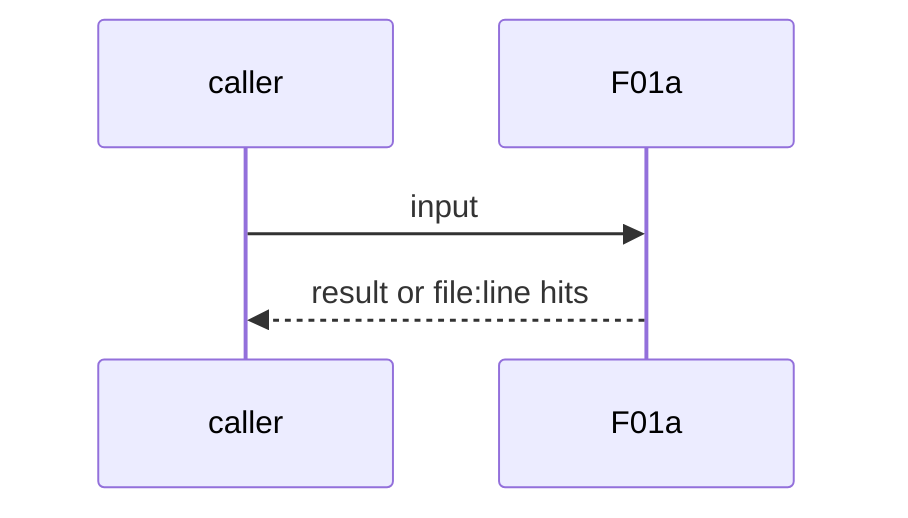
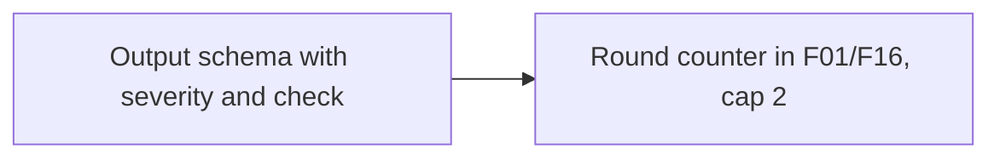

# F01a: Review severity, verified suggestions, 2-round cap
- Status: todo
- Area: agent-factory
- Wave: W3
- Block: 3
- Lane: Builder
- Depends on: F01, F16, BH09
- proof: fixture review output: each finding has severity severe|important|nit and the check it ran, else marked unverified; 3rd FAIL round gets needs-human and no 3rd run
- door: two-way
- triage: build
- feedback: review output schema check plus the round-cap fixture
- harness: gh-aw, engine copilot via shared/defaults.md (when built)
- review-input: diff + this PBI + DoD (+ linked spec) + PR description, never builder session logs (PA6)
- kind: skill
- Source: D15, D17, D19 https://www.warp.dev/blog/how-to-build-a-cloud-software-factory-self-improving-code-review https://www.warp.dev/blog/software-factory-build-guide https://x.com/BHolmesDev/status/2106510336413012463
## Goal
F01 output is structured: each finding has a severity (severe, important, nit) and names the check it ran; without one it is marked unverified. F01 and F16 loop at most 2 rounds, then `needs-human` (absorbs BH02).
## Context
Warp review skill: structured `review.json` with severity severe, important, nit; the reviewer can build and test, so it can test hypotheses before it suggests changes. Ben Holmes: the review agent cycles "for a few rounds before human review". Not built in PR #4: docs only, nothing enabled (PA9).
## Steps
1. Output schema with severity and check.
2. Round counter in F01/F16, cap 2.
## Definition of Done
- [ ] Schema check red on a finding without severity
- [ ] Unverified mark on a finding without a check
- [ ] 3rd round fixture gets needs-human, no run
- [ ] Every Bar H line from [README.md](../README.md#bar-h-every-workflow-pbi) when the workflow ships
## Technical design
- Components and files: F01 and F16 workflows, schema under `workflows/shared/`
- Module boundary: the review output schema
- Interfaces: severity enum, check field, round label
- Sequence:

- Failure modes: Cap reached means a human decides
- Security: Read-only review (POL22 COMMENT only)
- Observability: rounds per PR
- Cost: per F01 run
- Rollback: Drop the schema check
- Proof: same as proof: above
- Door: two-way (revert is one commit)
## Evidence
(todo)
## Flow

## Named asks for Sven
none
## Cost
per F01 run
## Sources
- [Warp blog, self-improving code review](https://www.warp.dev/blog/how-to-build-a-cloud-software-factory-self-improving-code-review)
- [Warp blog, software factory build guide](https://www.warp.dev/blog/software-factory-build-guide)
- [Ben Holmes, factory loop](https://x.com/BHolmesDev/status/2106510336413012463)
- Strategy id list v3.12 (aw-final-ids.md), url-learnings.md D15, D17, D19
