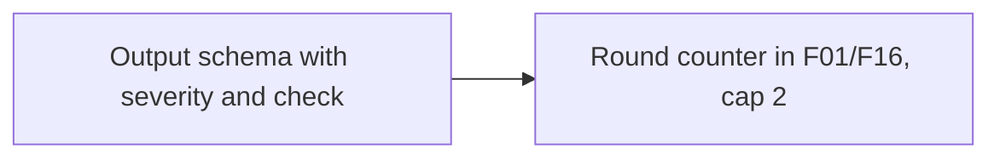

# F01a: Review severity, verified suggestions, 2-round cap
- Status: todo
- Area: agent-factory
- Wave: W3
- Block: 3
- Lane: Builder
- Depends on: F01, F16, BH09
- proof: `make verify` exits 0; no run, no token spend
- door: two-way
- triage: build
- feedback: `make compile` (`gh aw compile --strict`)
- harness: gh-aw, engine copilot via shared/defaults.md (when built)
- review-input: diff + this PBI + DoD (+ linked spec) + PR description, never builder session logs (PA6)
- kind: skill
- Source: D15, D17, D19 https://www.warp.dev/blog/how-to-build-a-cloud-software-factory-self-improving-code-review https://www.warp.dev/blog/software-factory-build-guide https://x.com/BHolmesDev/status/2106510336413012463
## Goal
F01 output is structured: each finding has a severity (severe, important, nit) and names the check it ran; without one it is marked unverified. F01 and F16 loop at most 2 rounds, then `needs-human` (absorbs BH02).
## Context
Warp review skill: structured `review.json` with severity severe, important, nit; the reviewer can build and test, so it can test hypotheses before it suggests changes. Ben Holmes: the review agent cycles "for a few rounds before human review". Not built in PR #4: docs only, nothing enabled (PA9).

## Frontmatter security
- Applies to `workflows/pr-review.md` and `workflows/pr-fix.md` when F01a ships: read-only `permissions` unchanged from F01/F16; review output stays COMMENT-only via `safe-outputs`.
- No new write outputs; schema lives in prompt/imports, not GitHub writes.
- `timeout-minutes:` unchanged from parent workflows (15 for review, 20 for pr-fix).
- Trigger: still `workflow_dispatch` only (POL25) on those workflows; F01a does not add triggers.

## Steps
1. Define review output schema (severity severe|important|nit, check field) under `workflows/shared/` or agentPacks import.
2. Wire schema validation into F01 and F16 prompts; unverified when check missing.
3. Add round counter in F01/F16 workflows, cap at 2 rounds then `needs-human`.
4. Run `make compile` and `make verify` when F01/F16 workflow files change.
5. Add fixture or doc check: finding without severity fails; third round fixture gets needs-human.

## Definition of Done
- [ ] Schema check red on a finding without severity
- [ ] Unverified mark on a finding without a check
- [ ] 3rd round fixture gets needs-human, no run
- [ ] `make verify` exits 0 when F01/F16 workflow changes land; no run, no token spend
- [ ] Every Bar H line from [README.md](../README.md#bar-h-every-workflow-pbi) when the workflow ships
## Evidence
(todo)
## Flow

## Named asks for Sven
none
## Cost
per F01 run
## Sources
- [Warp blog, self-improving code review](https://www.warp.dev/blog/how-to-build-a-cloud-software-factory-self-improving-code-review)
- [Warp blog, software factory build guide](https://www.warp.dev/blog/software-factory-build-guide)
- [Ben Holmes, factory loop](https://x.com/BHolmesDev/status/2106510336413012463)
- Strategy id list v3.12 (aw-final-ids.md), url-learnings.md D15, D17, D19
