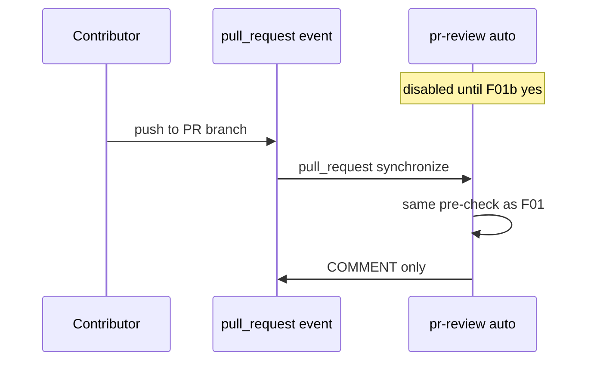

# F01b: PR review auto on push
- Status: todo
- Area: agent-factory
- Wave: W3
- Block: 3
- Lane: Builder
- Depends on: F01
- proof: `make verify` exits 0 (`gh aw compile --strict --dir workflows` clean for `workflows/pr-review.md`, lock unchanged after compile, POL25 and POL31 clean); no run, no token spend
- door: one-way
- one-way gate: Sven's exact yes required (named ask in its block). Rollback: remove pull_request trigger in one PR
- triage: build (gated, Sven exact yes first)
- feedback: `make compile` (`gh aw compile --strict`)
- harness: gh-aw, engine copilot via shared/defaults.md (same as F01)
- review-input: diff + this PBI + DoD (+ linked spec) + PR description, never builder session logs (PA6)
- kind: skill
- Source: PA8 (Plan v3.5 F01b, gist point F) https://github.com/svennijhuis/agentic-workflows/pull/4
- Module boundary: the `pull_request` trigger on pr-review is the only new interface; the F01 review prompt and agentPacks pins stay as F01 ships them
## Goal
Optional second step: enable `pull_request` opened/synchronize trigger for pr-review only after three audited F01 manual runs with measured AIC cost and Sven's exact yes.
## Context
Plan v3.5 and gist point F: auto review spends Copilot credits on every push. Default remains F01 manual (`workflow_dispatch` only). The `/pr-review` slash is its own named ask, with a row in `policies/POL25.yml` `sven_yes` first. This PBI is gated; nothing merges without Sven yes named ask F01b.

## Frontmatter security
- `permissions:` read only (`contents: read`, `pull-requests: read`, `issues: read`, `actions: read`); no write permission on the token.
- Writes only through `safe-outputs`: `submit-pull-request-review` (COMMENT only, `max: 1`), `staged: true` until Sven's yes.
- `timeout-minutes:` 15 (fits a single PR review pass).
- Trigger: `workflow_dispatch` only (POL25). `/pr-review` slash or `pull_request` (F01b) are named asks for Sven, recorded in `policies/POL25.yml` `sven_yes` first.

## Steps
1. Document cost impact from three audited F01 manual runs (median and p95 AIC).
2. After Sven yes (F01b), add `pull_request` types opened and synchronize on `workflows/pr-review.md` with the same frontmatter security caps and COMMENT-only safe-outputs.
3. Keep `staged: true` on all writes until a second Sven yes removes staging.
4. Run `make compile` and commit any `.lock.yml` change; run `make verify`.
5. Update D01 troubleshooting for credit burn on busy repos.
6. Rollback: remove `pull_request` trigger in one PR.

## Definition of Done
- [ ] `workflows/pr-review.md` and its `.lock.yml` committed; `gh aw compile --strict` clean (0 errors, 0 warnings), lock unchanged after `make compile`
- [ ] Frontmatter: read-only `permissions`, writes only via `safe-outputs` (`staged: true`, a `max` per output), `timeout-minutes` set
- [ ] Trigger `workflow_dispatch` only (POL25); no `skills:` in a shared fragment (POL31)
- [ ] `make verify` exits 0; no run, no token spend
- [ ] Not enabled until Sven yes (F01b) recorded in Evidence
- [ ] Three F01 audited runs with measured AIC attached
- [ ] Same COMMENT-only safe-outputs and caps as F01
- [ ] Rollback documented: remove `pull_request` trigger in one PR
## Evidence
(F01 AIC table, Sven yes note, trial repo run links)
## Flow

## Named asks for Sven
F01b (exact yes to enable pull_request trigger)
## Cost
M tier, per-push cost from F01 audit (unverified)
## Sources
- Plan v3.5 F01b
- gist-handover-agentic-workflows.md point F
