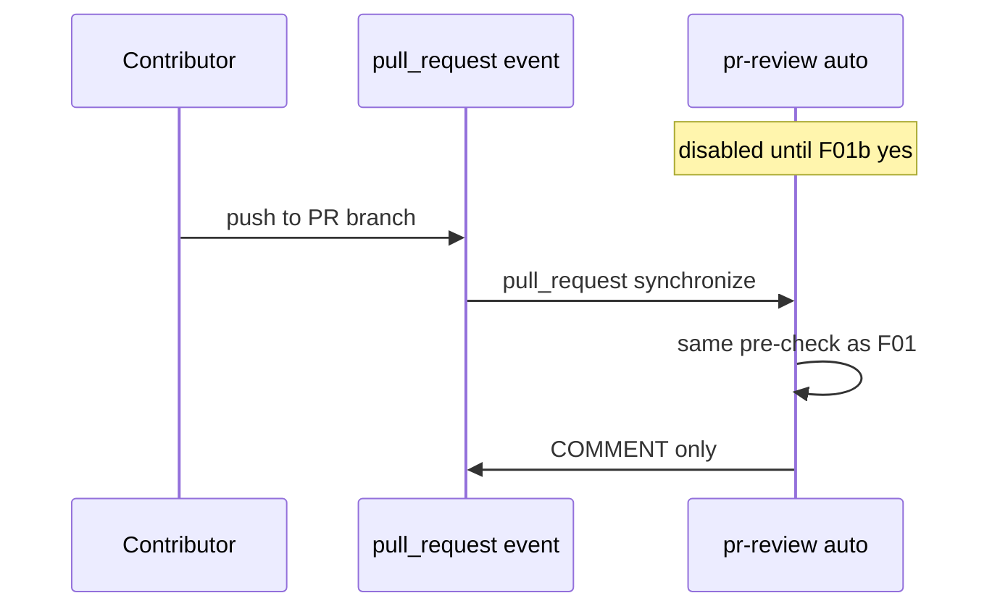

# F01b: PR review auto on push
- Status: todo
- Area: agent-factory
- Wave: W3
- Block: 3
- Lane: Builder
- Depends on: F01, POL22, POL03
- proof: gh aw compile --dir workflows --strict workflows/pr-review.md; gh aw audit <run-id> after pull_request trigger enabled (Block exit)
- door: one-way
- one-way gate: Sven's exact yes required (named ask in its block). Rollback: remove pull_request trigger in one PR
- triage: build (gated, Sven exact yes first)
- feedback: gh aw compile --dir workflows --strict, POL22, POL25, `scripts/verify.sh`
- harness: gh-aw, engine copilot via shared/defaults.md (same as F01)
- review-input: diff + this PBI + DoD (+ linked spec) + PR description, never builder session logs (PA6)
- kind: skill
- Source: PA8 (Plan v3.5 F01b, gist point F) https://github.com/svennijhuis/agentic-workflows/pull/4
- Module boundary: the `pull_request` trigger on pr-review is the only new interface; the F01 review prompt and agentPacks pins stay as F01 ships them
## Goal
Optional second step: enable `pull_request` opened/synchronize trigger for pr-review only after three audited F01 manual runs with measured AIC cost and Sven's exact yes.
## Context
Plan v3.5 and gist point F: auto review spends Copilot credits on every push. Default remains F01 manual (`workflow_dispatch` only). The `/pr-review` slash is its own named ask, with a row in `policies/POL25.yml` `sven_yes` first. This PBI is gated; nothing merges without Sven yes named ask F01b.
## Steps
1. Document cost impact from F01 three-run audit (median and p95 AIC).
2. Add `pull_request` types opened, synchronize with same caps and COMMENT-only outputs.
3. Keep staged/report-only first run in trial repo before enabling in production consumers.
4. Ship behind explicit workflow frontmatter flag or separate workflow file per G04 config governance.
5. Update D01 troubleshooting for credit burn on busy repos.
## Definition of Done
- [ ] Fetches own context with tools and imports (Bar H, gist A7); prompt never pastes repo content
- [ ] Not enabled until Sven yes (F01b) recorded in Evidence
- [ ] Three F01 audited runs with measured AIC attached
- [ ] Same Bar H caps, POL21, POL22, POL03 as F01
- [ ] `scripts/verify.sh` pass on SHA
- [ ] Rollback documented: remove pull_request trigger in one PR
## Evidence
(F01 AIC table, Sven yes note, trial repo run links)
## Flow

## Named asks for Sven
F01b (exact yes to enable pull_request trigger)
## Cost
M tier, per-push cost from F01 audit (unverified)
## Sources
- Plan v3.5 F01b
- gist-handover-agentic-workflows.md point F
