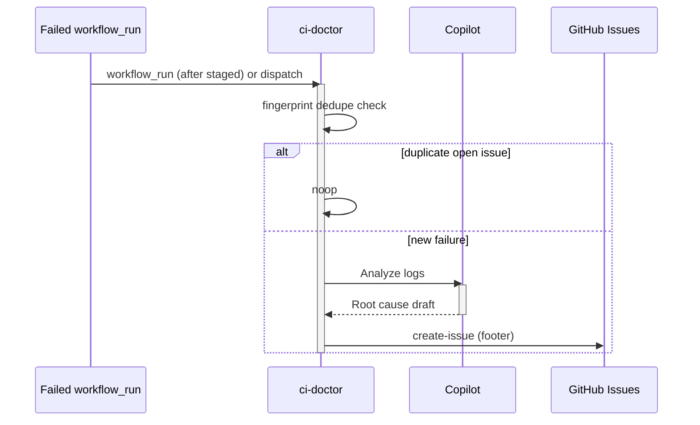

# F02: CI failure investigator
- Status: todo
- Area: agent-factory
- Wave: W3
- Block: 3
- Lane: Builder
- Depends on: C03, C04, C06, O01, O02, O03, X01, R04, F00
- proof: gh aw compile --dir workflows --strict workflows/ci-doctor.md; gh aw audit <run-id> (Block exit runs)
- door: one-way
- one-way gate: Sven's exact yes required (named ask in its block). Rollback: disable workflow via workflow_dispatch off or remove schedule trigger
## Goal
On failed CI, investigate logs and file a deduped issue with root cause and next steps.
## Context
Upstream reference: `ci-failure-investigation` (https://github.github.com/gh-aw/gallery/ci-failure-investigation/).
**What it does:** On failed CI, investigate logs and file a deduped issue with root cause and next steps.
**Value for Sven repos:** See workflow-ratings.md row; prioritize NOW set for daily maintenance and security.
**How ours beats the example (Bar H):** Pre-step skips if fingerprint issue open; central vs per-repo dispatch documented
**Trigger:** `workflow_dispatch` first; `workflow_run` after staged OK
**Safe outputs and limits:** `create-issue`, `create-issue-comment` with dedupe title
**Issue/PR format:** Title prefix `[F02]`, body uses `shared/reporting.md` audit footer with workflow id, run URL, and AIC when known.
Engine: `copilot` with `COPILOT_GITHUB_TOKEN` (personal PAT). No `copilot-requests: write` (org billing only).

## Steps
1. Add `workflows/ci-doctor.md` from upstream pattern; import `shared/defaults.md` and `shared/security.md`.
2. Set staged/report-only outputs; wire `workflow_dispatch` as the only live trigger initially.
3. Add deterministic pre-check step returning `noop` when there is nothing to do.
4. Run `scripts/verify.sh` on PR SHA; compile with pinned gh-aw version.
5. Trial on X01 repo; capture first 3 `gh aw audit` AIC measurements in Evidence.
6. After Sven explicit yes, enable secondary triggers (schedule, `workflow_run`, slash) one at a time.

## Definition of Done
- [ ] Fetches own context with tools and imports (Bar H, gist A7); prompt never pastes repo content
- [ ] `workflows/ci-doctor.md` imports `shared/defaults.md` (engine copilot, caps, admission)
- [ ] Pinned `gh aw` compiler version and all imports use tag or SHA (no `@main`, no `@marketplace`)
- [ ] `max-ai-credits: 50`, `max-daily-ai-credits: 200`, `max-turns` and `timeout-minutes` set per C03
- [ ] Deterministic `steps:` pre-check; writes `noop` when nothing to do (0 AIC)
- [ ] First rollout is `workflow_dispatch` plus staged/report-only; no schedule or spend until Sven approves
- [ ] Dedupe via title, `group-by-day`, `close-older-issues`, and expiry per O03
- [ ] `min-integrity: approved` and threat detection enabled (POL05, POL13)
- [ ] Network allowlist and tool/MCP/bash allowlists (POL06, POL07); no wildcard network
- [ ] `on.roles` and skip-bots configured (POL10)
- [ ] Issue/PR bodies follow `shared/reporting.md` footer format (POL16)
- [ ] Trial run on X01 test repo with verify log on exact SHA (Q0: local `scripts/verify.sh` until Actions billing fixed)
- [ ] `gh aw audit` on first 3 runs; measured AIC recorded in this PBI Evidence section (B02)
## Evidence
(commands, logs, verify log on SHA, run links)
## Flow

## Named asks for Sven
Q1 (central dispatch vs install per repo for ci-doctor)
## Cost
M tier, ~25-45 AIC per failure (unverified)
## Sources
- https://github.github.com/gh-aw/gallery/ci-failure-investigation/
- https://github.com/githubnext/agentics/tree/main/workflows
- https://github.github.com/gh-aw/reference/workflows/
- docs/pbi/workflow-ratings.md
