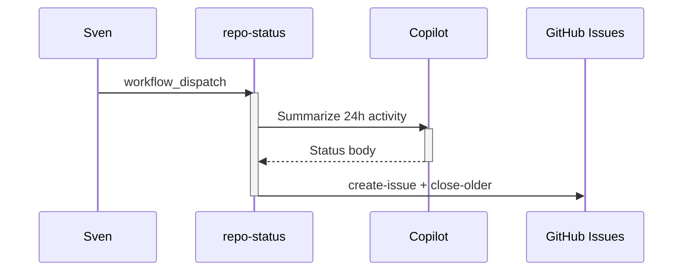

# F03: Daily repo status report
- Status: todo
- Area: agent-factory
- Wave: W3
- Block: 3
- Lane: Builder
- Depends on: C03, C04, C06, O01, O02, O03, R01
- proof: gh aw compile --dir workflows --strict workflows/f03.md; gh aw audit <run-id> (Block exit runs)
- door: one-way
- one-way gate: Sven's exact yes required (named ask in its block). Rollback: disable workflow via workflow_dispatch off or remove schedule trigger
- triage: build (Block 3 workflow)
- feedback: gh aw compile --dir workflows --strict, offline `scripts/verify.sh`
- harness: gh-aw, engine copilot via shared/defaults.md (when built)
- review-input: diff + this PBI + DoD (+ linked spec) + PR description, never builder session logs (PA6)
- kind: skill
- Source: PA8 (pre-link PBI from PR #4, origin in its Sources) https://github.com/svennijhuis/agentic-workflows/pull/4 https://github.github.com/gh-aw/gallery/daily-report-portfolio/
- Module boundary: `workflows/repo-status.md` + its lock + `workflows/shared/` is the copy unit; agentPacks imports stay behind the POL01 pin
## Goal
Publish a daily status issue per repo with activity summary; close older issues.
## Context
Upstream reference: `daily-report-portfolio` (https://github.github.com/gh-aw/gallery/daily-report-portfolio/).
**What it does:** Publish a daily status issue per repo with activity summary; close older issues.
**Value for Sven repos:** See workflow-ratings.md row; prioritize NOW set for daily maintenance and security.
**How ours beats the example (Bar H):** Portfolio-friendly footer; admission cap per day
**Trigger:** `workflow_dispatch`; fuzzy schedule only after Sven yes
**Safe outputs and limits:** `create-issue` with `close-older-issues`
**Issue/PR format:** Title prefix `[F03]`, body uses `shared/reporting.md` audit footer with workflow id, run URL, and AIC when known.
Engine: `copilot` with `COPILOT_GITHUB_TOKEN` (personal PAT). No `copilot-requests: write` (org billing only).

## Steps
1. Add `workflows/repo-status.md` from upstream pattern; import `shared/defaults.md` and `shared/security.md`.
2. Set staged/report-only outputs; wire `workflow_dispatch` as the only live trigger initially.
3. Add deterministic pre-check step returning `noop` when there is nothing to do.
4. Run `scripts/verify.sh` on PR SHA; compile with pinned gh-aw version.
5. Offline proof only: `scripts/verify.sh` (compile --strict --actionlint, lock drift, `--no-emit` fixture). X01 live trial and AIC audit are a named ask (Sven exact yes), not in this DoD.
6. After Sven explicit yes, enable secondary triggers (schedule, `workflow_run`, slash) one at a time.

## Definition of Done
- [ ] Fetches own context with tools and imports (Bar H, gist A7); prompt never pastes repo content
- [ ] `workflows/repo-status.md` imports `shared/defaults.md` (engine copilot, caps, admission)
- [ ] Pinned `gh aw` compiler version and all imports use tag or SHA (no `@main`, no `@marketplace`)
- [ ] `max-ai-credits: 50`, `max-daily-ai-credits: 200`, `max-turns` and `timeout-minutes` set per C03
- [ ] Deterministic `steps:` pre-check; writes `noop` when nothing to do (0 AIC)
- [ ] First rollout is `workflow_dispatch` plus staged/report-only; no schedule or spend until Sven approves
- [ ] Dedupe via title, `group-by-day`, `close-older-issues`, and expiry per O03
- [ ] `min-integrity: approved` and threat detection enabled (POL05, POL13)
- [ ] Network allowlist and tool/MCP/bash allowlists (POL06, POL07); no wildcard network
- [ ] `on.roles` and skip-bots configured (POL10)
- [ ] Issue/PR bodies follow `shared/reporting.md` footer format (POL16)
- [ ] Offline proof: `scripts/verify.sh` log on exact SHA, 0 failures (no X01 trial, no token spend)
- [ ] `workflow_dispatch` only, plus a "copy this" note: the md, lock and `shared/` files an org copies, standalone, no secrets
- [ ] `gh aw audit` on first 3 runs; measured AIC recorded in this PBI Evidence section (B02)
- [ ] [X07](../testing/X07-workflow-benchmark.md) benchmark: 5 or more fixed cases with known answers in `docs/benchmarks/<workflow>.md`, score at or above baseline (Bar H)
## Evidence
(commands, logs, verify log on SHA, run links)
## Flow

## Named asks for Sven
none
## Cost
S tier, ~10-20 AIC per repo-day (unverified)
## Sources
- https://github.github.com/gh-aw/gallery/daily-report-portfolio/
- https://github.com/githubnext/agentics/tree/main/workflows
- https://github.github.com/gh-aw/reference/workflows/
- docs/pbi/workflow-ratings.md
