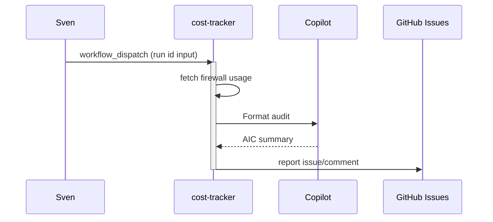

# F04: Cost tracker and AIC audit
- Status: todo
- Area: agent-factory
- Wave: W3
- Block: 3
- Lane: Builder
- Depends on: C03, C04, C06, O01, O02, O03, B02
- proof: `bash scripts/verify.sh` exits 0 with `0 failures` (offline: `gh aw compile --dir workflows --strict workflows/cost-tracker.md`, lock drift, `--no-emit` fixture); no run, no token spend
- door: two-way
- triage: build (Block 3 workflow)
- feedback: gh aw compile --dir workflows --strict, offline `scripts/verify.sh`
- harness: gh-aw, engine copilot via shared/defaults.md (when built)
- review-input: diff + this PBI + DoD (+ linked spec) + PR description, never builder session logs (PA6)
- kind: skill
- Source: PA8 (pre-link PBI from PR #4, origin in its Sources) https://github.com/svennijhuis/agentic-workflows/pull/4 https://github.com/githubnext/agentics/tree/main/workflows/cost-tracker.md
- Module boundary: `workflows/cost-tracker.md`, its lock and `workflows/shared/` are the copy unit; no agentPacks import in this PBI
## Goal
After runs, read firewall/token usage and append AIC audit to issue or comment.
## Context
Upstream reference: `cost-tracker` (https://github.com/githubnext/agentics/tree/main/workflows/cost-tracker.md).
**What it does:** After runs, read firewall/token usage and append AIC audit to issue or comment.
**Value for Sven repos:** See workflow-ratings.md row; prioritize NOW set for daily maintenance and security.
**How ours beats the example (Bar H):** Ties to B02 measured spend; 50/200 caps enforced
**Trigger:** `workflow_dispatch` only (POL25). A `workflow_run` hook after other AW runs is a named ask for a later Sven yes, recorded in `policies/POL25.yml` `sven_yes` before it exists.
**Safe outputs and limits:** `create-issue` or `update-issue` report-only
**Issue/PR format:** Title prefix `[F04]`, body uses `shared/reporting.md` audit footer with workflow id, run URL, and AIC when known.
Engine: `copilot` with `COPILOT_GITHUB_TOKEN` (personal PAT). No `copilot-requests: write` (org billing only).

## Steps
1. Add `workflows/cost-tracker.md` from upstream pattern; import `shared/defaults.md` and `shared/security.md`.
2. Set staged/report-only outputs; wire `workflow_dispatch` as the only live trigger.
3. Add deterministic pre-check step returning `noop` when there is nothing to do.
4. Run `scripts/verify.sh` on PR SHA; compile with pinned gh-aw version.
5. Offline proof only: `scripts/verify.sh` (compile --strict --actionlint, lock drift, `--no-emit` fixture). X01 live trial and AIC audit are a named ask (Sven exact yes), not in this DoD.
6. No other trigger in this PBI. A `workflow_run` hook after other AW runs is a named ask (Sven exact yes, row in `policies/POL25.yml` `sven_yes` first), built in a later PBI.
7. Write the "copy this" note at `docs/reference/cost-tracker.md`: the md, its lock and the `workflows/shared/` files an org copies, standalone, no secrets.

## Definition of Done
- [ ] Fetches own context with tools and imports (Bar H, gist A7); prompt never pastes repo content
- [ ] `workflows/cost-tracker.md` imports `shared/defaults.md` (engine copilot, caps, admission)
- [ ] Pinned `gh aw` compiler version and all imports use tag or SHA (no `@main`, no `@marketplace`)
- [ ] `max-ai-credits: 50`, `max-daily-ai-credits: 200`, `max-turns` and `timeout-minutes` set per C03
- [ ] Deterministic `steps:` pre-check; writes `noop` when nothing to do (0 AIC)
- [ ] Staged/report-only outputs; no schedule, no other trigger and no token spend in this PBI
- [ ] Dedupe via title, `group-by-day`, `close-older-issues`, and expiry per O03
- [ ] `min-integrity: approved` and threat detection enabled (POL05, POL13)
- [ ] Network allowlist and tool/MCP/bash allowlists (POL06, POL07); no wildcard network
- [ ] `on.roles` and skip-bots configured (POL10)
- [ ] Issue/PR bodies follow `shared/reporting.md` footer format (POL16)
- [ ] Offline proof: `scripts/verify.sh` log on exact SHA, 0 failures (no X01 trial, no token spend)
- [ ] `workflow_dispatch` only, plus the "copy this" note at `docs/reference/cost-tracker.md` (step 7): the md, lock and `shared/` files an org copies, standalone, no secrets
- [ ] [X07](../testing/X07-workflow-benchmark.md) benchmark cases: 5 or more fixed cases with known answers written in `docs/benchmarks/<workflow>.md`, docs only, no run; the X07 score is a named ask
## Evidence
(commands, verify log on SHA)
## Flow

## Named asks for Sven
- X01 live trial plus `gh aw audit` on the first 3 runs with measured AIC in Evidence (B02, Bar H live part): Sven exact yes, it spends tokens
- A `workflow_run` hook after other AW runs: Sven exact yes per trigger, row in `policies/POL25.yml` `sven_yes` first
- X07 benchmark score at or above baseline (Bar H): each score is a live [X07](../testing/X07-workflow-benchmark.md) run on the X01 repo (`door: one-way`), Sven exact yes per run, it spends tokens
## Cost
S tier, ~5-15 AIC per audit (unverified)
## Sources
- https://github.com/githubnext/agentics/tree/main/workflows/cost-tracker.md
- https://github.com/githubnext/agentics/tree/main/workflows
- https://github.github.com/gh-aw/reference/workflows/
- docs/pbi/workflow-ratings.md
