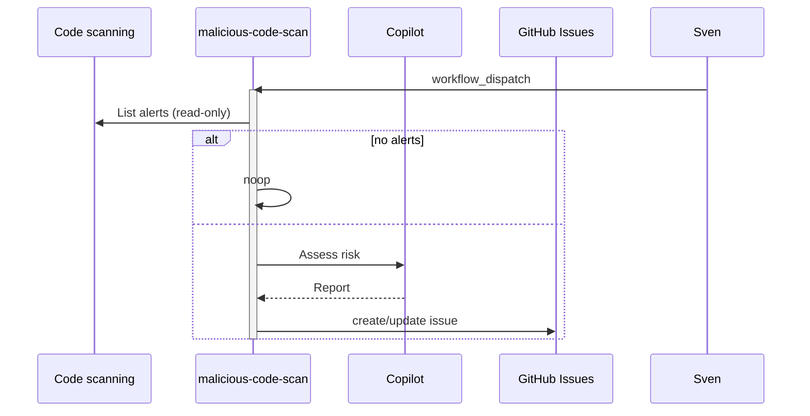

# F05: Malicious code and agentic threat scan
- Status: todo
- Area: agent-factory
- Wave: W3
- Block: 3
- Lane: Builder
- Depends on: C03, C04, C06, X01, S03, F00
- proof: `make verify` exits 0 (`gh aw compile --strict --dir workflows` clean for `workflows/malicious-code-scan.md`, lock unchanged after compile, POL25 and POL31 clean); no run, no token spend
- feedback: `make compile` (`gh aw compile --strict`)
- door: one-way
- one-way gate: Sven's exact yes required (named ask in its block). Rollback: disable workflow via workflow_dispatch off or remove schedule trigger
## Goal
Review code scanning alerts and agentic risk signals; file or update security issue.
## Context
Upstream reference: `security-review` (https://github.github.com/gh-aw/gallery/security-review/).
**What it does:** Review code scanning alerts and agentic risk signals; file or update security issue.
**Value for Sven repos:** See workflow-ratings.md row; prioritize NOW set for daily maintenance and security.
**How ours beats the example (Bar H):** Read-only agent, threat detection on, no auto-merge fixes
**Trigger:** `workflow_dispatch`; 3-day cadence only after yes
**Safe outputs and limits:** `create-issue`, limited comments
**Issue/PR format:** Title prefix `[F05]`, body uses `shared/reporting.md` audit footer with workflow id, run URL, and AIC when known.
Engine: `copilot` with `COPILOT_GITHUB_TOKEN` (personal PAT). No `copilot-requests: write` (org billing only).

## Frontmatter security
- `permissions:` read only (`contents: read`, `security-events: read`, `issues: read`); no write permission.
- Writes only through `safe-outputs`: `create-issue`, `create-issue-comment` (`max: 2` each), `staged: true` until Sven's yes.
- `timeout-minutes:` 15.
- Trigger: `workflow_dispatch` only (POL25). Schedule or other triggers are named asks for Sven, recorded in `policies/POL25.yml` `sven_yes` first.

## Steps
1. Add `workflows/malicious-code-scan.md`; import `shared/defaults.md` and `shared/security.md`.
2. Set frontmatter security (read-only `permissions`, `safe-outputs` with `staged: true` and a `max` per output, `timeout-minutes`, `workflow_dispatch` only).
3. Add deterministic pre-check step; writes `noop` when there is nothing to do.
4. Run `make compile` and commit the `.lock.yml`.
5. Run `make verify`.

## Definition of Done
- [ ] `workflows/malicious-code-scan.md` and its `.lock.yml` committed; `gh aw compile --strict` clean (0 errors, 0 warnings), lock unchanged after `make compile`
- [ ] Frontmatter: read-only `permissions`, writes only via `safe-outputs` (`staged: true`, a `max` per output), `timeout-minutes` set
- [ ] Trigger `workflow_dispatch` only (POL25); no `skills:` in a shared fragment (POL31)
- [ ] `make verify` exits 0; no run, no token spend
- [ ] Fetches own context with tools and imports (Bar H, gist A7); prompt never pastes repo content
- [ ] `workflows/malicious-code-scan.md` imports `shared/defaults.md` (engine copilot, caps, admission)
- [ ] Deterministic `steps:` pre-check; writes `noop` when nothing to do (0 AIC)
- [ ] [X07](../testing/X07-workflow-benchmark.md) benchmark cases: 5 or more fixed cases with known answers written in `docs/benchmarks/<workflow>.md`, docs only, no run; the X07 score is a named ask
## Evidence
(commands, logs, verify log on SHA, run links)
## Flow

## Named asks for Sven
none
## Cost
M tier, ~30-50 AIC per scan (unverified)
## Sources
- https://github.github.com/gh-aw/gallery/security-review/
- https://github.com/githubnext/agentics/tree/main/workflows
- https://github.github.com/gh-aw/reference/workflows/
- docs/pbi/workflow-ratings.md
