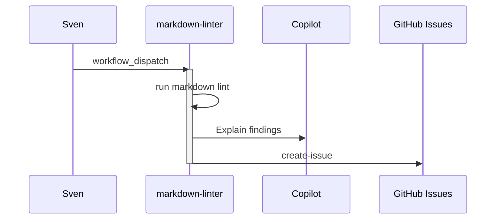

# F15: Markdown linter
- Status: todo
- Area: agent-factory
- Wave: W3
- Block: 3
- Lane: Builder
- Depends on: C03, C04, C06
- proof: `make verify` exits 0 (`gh aw compile --strict --dir workflows` clean for `workflows/markdown-linter.md`, lock unchanged after compile, POL25 and POL31 clean); no run, no token spend
- door: two-way
- triage: build (Block 3 workflow)
- feedback: `make compile` (`gh aw compile --strict`)
- harness: gh-aw, engine copilot via shared/defaults.md (when built)
- review-input: diff + this PBI + DoD (+ linked spec) + PR description, never builder session logs (PA6)
- kind: skill
- Source: PA8 (pre-link PBI from PR #4, origin in its Sources) https://github.com/svennijhuis/agentic-workflows/pull/4 https://github.com/githubnext/agentics/tree/main/workflows/markdown-linter.md
- Module boundary: `workflows/markdown-linter.md`, its lock and `workflows/shared/` are the copy unit; no agentPacks import in this PBI
## Goal
Run markdown lint (Super Linter style); file issue with findings.
## Context
Upstream reference: `markdown-linter` (https://github.com/githubnext/agentics/tree/main/workflows/markdown-linter.md).
**What it does:** Run markdown lint (Super Linter style); file issue with findings.
**Value for Sven repos:** See workflow-ratings.md row; prioritize NOW set for daily maintenance and security.
**How ours beats the example (Bar H):** No em dash in outputs; agentPacks markdown repos
**Trigger:** `workflow_dispatch` only (POL25). No other trigger is planned.
**Safe outputs and limits:** `create-issue`
**Issue/PR format:** Title prefix `[F15]`, body uses `shared/reporting.md` audit footer with workflow id, run URL, and AIC when known.
Engine: `copilot` with `COPILOT_GITHUB_TOKEN` (personal PAT). No `copilot-requests: write` (org billing only).

## Frontmatter security
- `permissions:` read only (`contents: read`, `issues: read`); no write permission.
- Writes only through `safe-outputs`: `create-issue` (`max: 1`), `staged: true` until Sven's yes.
- `timeout-minutes:` 10.
- Trigger: `workflow_dispatch` only (POL25). A schedule is a named ask for Sven, recorded in `policies/POL25.yml` `sven_yes` first.

## Steps
1. Add `workflows/markdown-linter.md`; import `shared/defaults.md` and `shared/security.md`.
2. Set frontmatter security (read-only `permissions`, `safe-outputs` with `staged: true` and a `max` per output, `timeout-minutes`, `workflow_dispatch` only).
3. Add deterministic pre-check step; writes `noop` when there is nothing to do.
4. Run `make compile` and commit the `.lock.yml`.
5. Run `make verify`.
6. Write the "copy this" note at `docs/reference/markdown-linter.md`: the md, its lock, and `workflows/shared/` files an org copies, standalone, no secrets.

## Definition of Done
- [ ] `workflows/markdown-linter.md` and its `.lock.yml` committed; `gh aw compile --strict` clean (0 errors, 0 warnings), lock unchanged after `make compile`
- [ ] Frontmatter: read-only `permissions`, writes only via `safe-outputs` (`staged: true`, a `max` per output), `timeout-minutes` set
- [ ] Trigger `workflow_dispatch` only (POL25); no `skills:` in a shared fragment (POL31)
- [ ] `make verify` exits 0; no run, no token spend
- [ ] Fetches own context with tools and imports (Bar H, gist A7); prompt never pastes repo content
- [ ] `workflows/markdown-linter.md` imports `shared/defaults.md` (engine copilot, caps, admission)
- [ ] Deterministic `steps:` pre-check; writes `noop` when nothing to do (0 AIC)
- [ ] `workflow_dispatch` only, plus the "copy this" note at `docs/reference/markdown-linter.md` (step 7): the md, lock and `shared/` files an org copies, standalone, no secrets
- [ ] [X07](../testing/X07-workflow-benchmark.md) benchmark cases: 5 or more fixed cases with known answers written in `docs/benchmarks/<workflow>.md`, docs only, no run; the X07 score is a named ask
## Evidence
(commands, verify log on SHA)
## Flow

## Named asks for Sven
- X01 live trial plus `gh aw audit` on the first 3 runs with measured AIC in Evidence (B02, Bar H live part): Sven exact yes, it spends tokens
- X07 benchmark score at or above baseline (Bar H): each score is a live [X07](../testing/X07-workflow-benchmark.md) run on the X01 repo (`door: one-way`), Sven exact yes per run, it spends tokens
## Cost
S tier, ~10-20 AIC per run (unverified)
## Sources
- https://github.com/githubnext/agentics/tree/main/workflows/markdown-linter.md
- https://github.com/githubnext/agentics/tree/main/workflows
- https://github.github.com/gh-aw/reference/workflows/
- docs/pbi/workflow-ratings.md
