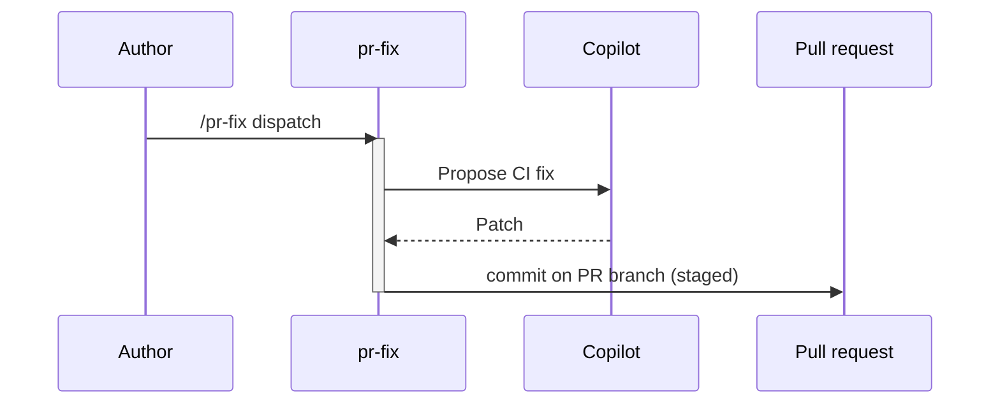

# F16: PR fix for failing CI
- Status: todo
- Area: agent-factory
- Wave: W6
- Block: 5
- Lane: Builder
- Depends on: C03, C04, C06, X01, F01, F02, F00, P04
- proof: `make verify` exits 0 (`gh aw compile --strict --dir workflows` clean for `workflows/pr-fix.md`, lock unchanged after compile, POL25 and POL31 clean); no run, no token spend
- feedback: `make compile` (`gh aw compile --strict`)
- door: one-way
- one-way gate: Sven's exact yes required (named ask in its block). Rollback: disable workflow via workflow_dispatch off or remove schedule trigger
## Goal
Close the review-to-fix loop next to [P04](../multi-repo/P04-research-plan-assign-copilot.md): on human review "changes requested", push a fix commit on the PR branch (max 2 fix rounds per PR).
## Context
Upstream reference: `pr-fix` (https://github.com/githubnext/agentics/tree/main/workflows/pr-fix.md). LP00 and LP01: after [F01](F01-pr-review.md) FAIL, F16 runs before re-review. Block 5 with P04 chain.
**What it does:** fix commit on PR after changes requested (high risk, staged).
**Value for Sven repos:** See workflow-ratings.md row; prioritize NOW set for daily maintenance and security.
**How ours beats the example (Bar H):** Never on default branch; human must merge
**Trigger:** `pull_request_review` with changes requested (human); optional `workflow_dispatch` and slash after extended staged
**Safe outputs and limits:** `create-commit-on-branch` capped
**Issue/PR format:** Title prefix `[F16]`, body uses `shared/reporting.md` audit footer with workflow id, run URL, and AIC when known.
Engine: `copilot` with `COPILOT_GITHUB_TOKEN` (personal PAT). No `copilot-requests: write` (org billing only).

## Frontmatter security
- `permissions:` read only (`contents: read`, `pull-requests: read`, `actions: read`); no direct write permission.
- Writes only through `safe-outputs`: `create-commit-on-branch` (`max: 3`), `create-pull-request` (`max: 1`), `staged: true` until Sven's yes.
- `timeout-minutes:` 20.
- Trigger: `workflow_dispatch` only (POL25). A `/pr-fix` slash trigger is a named ask for Sven, recorded in `policies/POL25.yml` `sven_yes` first.

## Steps
1. Add `workflows/pr-fix.md`; import `shared/defaults.md` and `shared/security.md`.
2. Set frontmatter security (read-only `permissions`, `safe-outputs` with `staged: true` and a `max` per output, `timeout-minutes`, `workflow_dispatch` only).
3. Add deterministic pre-check step; writes `noop` when there is nothing to do.
4. Run `make compile` and commit the `.lock.yml`.
5. Run `make verify`.

## Definition of Done
- [ ] `workflows/pr-fix.md` and its `.lock.yml` committed; `gh aw compile --strict` clean (0 errors, 0 warnings), lock unchanged after `make compile`
- [ ] Frontmatter: read-only `permissions`, writes only via `safe-outputs` (`staged: true`, a `max` per output), `timeout-minutes` set
- [ ] Trigger `workflow_dispatch` only (POL25); no `skills:` in a shared fragment (POL31)
- [ ] `make verify` exits 0; no run, no token spend
- [ ] Fetches own context with tools and imports (Bar H, gist A7); prompt never pastes repo content
- [ ] `workflows/pr-fix.md` imports `shared/defaults.md` (engine copilot, caps, admission)
- [ ] Deterministic `steps:` pre-check; writes `noop` when nothing to do (0 AIC)
- [ ] Max 2 fix rounds per PR enforced
## Evidence
(commands, logs, verify log on SHA, run links)
## Flow

## Named asks for Sven
none
## Cost
M tier, ~35-55 AIC per fix attempt (unverified)
## Sources
- https://github.com/githubnext/agentics/tree/main/workflows/pr-fix.md
- https://github.com/githubnext/agentics/tree/main/workflows
- https://github.github.com/gh-aw/reference/workflows/
- docs/pbi/workflow-ratings.md
