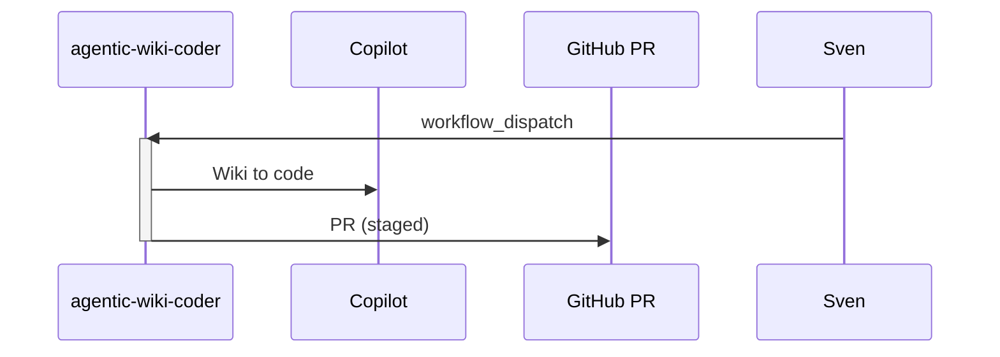

# F32: Agentic wiki coder
- Status: todo
- Area: agent-factory
- Wave: W6
- Block: 6
- Lane: Builder
- Depends on: C03, C04, C06, X01, F00
- proof: `make verify` exits 0 (`gh aw compile --strict --dir workflows` clean for `workflows/agentic-wiki-coder.md`, lock unchanged after compile, POL25 and POL31 clean); no run, no token spend
- feedback: `make compile` (`gh aw compile --strict`)
- door: one-way
- one-way gate: Sven's exact yes required (named ask in its block). Rollback: disable workflow via workflow_dispatch off or remove schedule trigger
## Goal
Wiki edits to code PR (low fit: no wikis).
## Context
Upstream reference: `agentic-wiki-coder` (https://github.com/githubnext/agentics/tree/main/workflows/agentic-wiki-coder.md).
**What it does:** Wiki edits to code PR (low fit: no wikis).
**Value for Sven repos:** See workflow-ratings.md row; prioritize NOW set for daily maintenance and security.
**How ours beats the example (Bar H):** Defer unless wiki used
**Trigger:** `workflow_dispatch` if ever enabled
**Safe outputs and limits:** PR capped
**Issue/PR format:** Title prefix `[F32]`, body uses `shared/reporting.md` audit footer with workflow id, run URL, and AIC when known.
Engine: `copilot` with `COPILOT_GITHUB_TOKEN` (personal PAT). No `copilot-requests: write` (org billing only).
## Frontmatter security
- `permissions:` read only (`contents: read`, `issues: read`, `pull-requests: read`); no write permission in `permissions:`.
- Writes only through `safe-outputs` (`create-issue` max 1, `create-pull-request` max 1), `staged: true` until Sven's yes.
- `timeout-minutes:` 15
- Trigger: `workflow_dispatch` only (POL25). Schedule, `issues`, slash, or other triggers are named asks for Sven, recorded in `policies/POL25.yml` `sven_yes` first.
## Steps
1. Add `workflows/agentic-wiki-coder.md`; import `shared/defaults.md` and `shared/security.md`.
2. Set frontmatter security: read-only `permissions`, `safe-outputs` with a `max` per output and `staged: true`, `timeout-minutes`, `workflow_dispatch` only (POL25).
3. Add deterministic pre-check returning `noop` when nothing to do.
4. Run `make compile`; commit `workflows/agentic-wiki-coder.lock.yml`.
5. Run `make verify`.
## Definition of Done
- [ ] `workflows/agentic-wiki-coder.md` and its `.lock.yml` committed; `gh aw compile --strict` clean (0 errors, 0 warnings), lock unchanged after `make compile`
- [ ] Frontmatter: read-only `permissions`, writes only via `safe-outputs` (`staged: true`, a `max` per output), `timeout-minutes` set
- [ ] Trigger `workflow_dispatch` only (POL25); no `skills:` in a shared fragment (POL31)
- [ ] `make verify` exits 0; no run, no token spend
- [ ] Fetches own context with tools and imports (Bar H, gist A7); prompt never pastes repo content
- [ ] Workflow imports `shared/defaults.md` and `shared/security.md`
- [ ] Deterministic pre-check; writes `noop` when nothing to do (0 AIC)
- [ ] First rollout is `workflow_dispatch` with `staged: true` on all write outputs until Sven approves live writes
- [ ] Dedupe via title, `group-by-day`, `close-older-issues`, and expiry
- [ ] Issue and PR bodies follow `shared/reporting.md` footer format
## Evidence
(commands, verify log on SHA)
## Flow

## Named asks for Sven
- X01 live trial and first 3 measured AIC runs: Sven exact yes (spends tokens); not in offline proof DoD
## Cost
L tier, ~90-150 AIC (unverified)
## Sources
- https://github.com/githubnext/agentics/tree/main/workflows/agentic-wiki-coder.md
- https://github.com/githubnext/agentics/tree/main/workflows
- https://github.github.com/gh-aw/reference/workflows/
- docs/pbi/workflow-ratings.md
