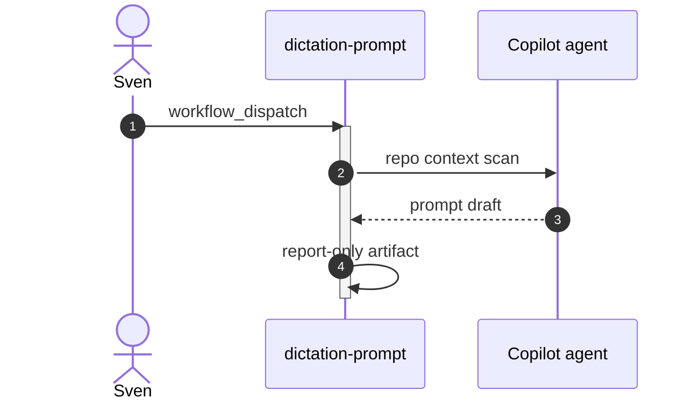

# F38: Dictation prompt builder
- Status: todo
- Area: agent-factory
- Wave: PR 0 (implementation W6)
- Block: 6
- Lane: Builder
- Depends on: C01, C02, C03, C04, C05, C06, O01, O02, O03, R01, X01, L01
- proof: gh aw compile --dir workflows --strict workflows/f38.md; gh aw audit <run-id> (Block exit runs)
- door: one-way
- one-way gate: Sven's exact yes required (named ask in its block). Rollback: disable workflow via workflow_dispatch off or remove schedule trigger
## Goal
Ship `dictation-prompt` as an installable gh-aw workflow for svennijhuis repos that builds a dictation-oriented prompt file from repo context without committing secrets.
## Context
Wave W6 later workflow. PR 0 documents intent only. Ratings: Niche; optional helper for voice-to-prompt workflows. Cost tier S (unverified). Provider: GitHub Copilot (`engine: copilot`) on personal account svennijhuis.
## Steps
1. Study upstream `githubnext/agentics` workflow `dictation-prompt` and Agent Factory equivalents.
2. Author `workflows/dictation-prompt.md` with `engine: copilot` and shared imports.
3. Compile with pinned gh-aw; run `scripts/verify.sh` on the workflow commit SHA.
4. Trial on X01: staged or report-only run for `workflow_dispatch only.`.
5. Record AIC for first 3 runs in Evidence; enable write outputs only after Sven yes.
## Definition of Done
- [ ] Fetches own context with tools and imports (Bar H, gist A7); prompt never pastes repo content
- [ ] `workflows/dictation-prompt.md` imports `shared/defaults.md` and uses `engine: copilot` with pinned gh-aw version and import SHA or tag (POL01)
- [ ] Cost caps: max-ai-credits 50, max-daily-ai-credits 200, max-turns and timeout-minutes set (POL02, POL15)
- [ ] Pre-check step then noop path; staged or report-only mode before any write outputs (POL03, O02)
- [ ] Dedupe on output title, group-by-day, close-older, expires configured (O03)
- [ ] `min-integrity: approved` on agent run (POL05)
- [ ] Minimal network allowlist, no wildcards (POL06)
- [ ] Tool, MCP, and bash allowlists documented (POL07)
- [ ] Every output uses safe-output max limits (POL08)
- [ ] Rate limits, concurrency, cooldown from shared defaults (POL09)
- [ ] `on.roles` and skip-bots for triggers (POL10)
- [ ] Least permissions, read-only agent where possible (POL11)
- [ ] Explicit allowed-repos or target-repo in workflow (POL12)
- [ ] Threat detection enabled, never off (POL13)
- [ ] No merge-pull-request or unsafe pull_request_target (POL14)
- [ ] Issue and PR bodies follow `shared/reporting.md` format (POL16)
- [ ] Trial run on X01 test repo with staged or report-only first
- [ ] First 3 production runs audited; measured AIC per run recorded in this PBI (B02)
- [ ] `scripts/verify.sh` passes on workflow SHA (Q0 local verify until Actions billing fixed)
## Evidence
- `scripts/verify.sh` log on workflow SHA (Q0)
- X01 trial run URL and mode (staged or report-only)
- First 3 run links with measured AIC recorded below
## Flow

## Named asks for Sven
none
## Cost
Tier S: estimated 8-18 AIC per run (unverified). Daily cap 200 AIC repo-wide suggested.
## Sources
- https://github.github.com/gh-aw/agent-factory-status/
- https://github.com/githubnext/agentics/tree/main/workflows
- https://github.github.com/gh-aw/reference/aw-yml-package-manifest/
- https://github.github.com/gh-aw/blog/2026-01-13-meet-the-workflows-interactive-chatops/

## Workflow detail (Bar H)
**What it does:** Builds a dictation-oriented prompt file from repo context without committing secrets.

**Value:** Niche; optional helper for voice-to-prompt workflows.

**Better than example:** POL04 no secrets, allowlisted paths, staged PR only after review.

**Trigger:** workflow_dispatch only.

**Safe outputs:** PR adding or updating a prompts file under allowed paths; report-only first.

**Issue or PR format:** Title prefix `[F38]`, footer from `shared/reporting.md`, dedupe key `dictation-prompt:{date}`.
