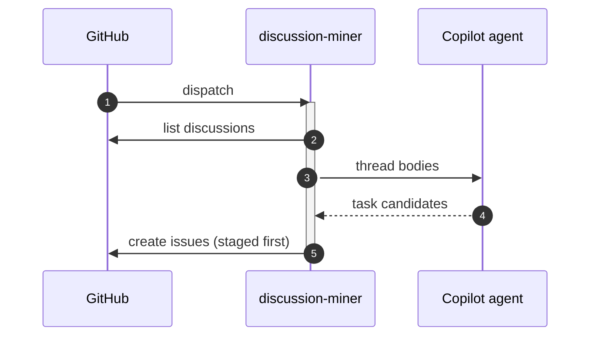

# F39: Discussion task miner
- Status: todo
- Area: agent-factory
- Wave: PR 0 (implementation W6)
- Block: 6
- Lane: Builder
- Depends on: C01, C02, C03, C04, C05, C06, R01, X01, L01
- proof: `make verify` exits 0 (`gh aw compile --strict --dir workflows` clean for `workflows/discussion-task-miner.md`, lock unchanged after compile, POL25 and POL31 clean); no run, no token spend
- feedback: `make compile` (`gh aw compile --strict`)
- door: one-way
- one-way gate: Sven's exact yes required (named ask in its block). Rollback: disable workflow via workflow_dispatch off or remove schedule trigger
## Goal
Ship `discussion-task-miner` as an installable gh-aw workflow for svennijhuis repos that scans open discussions and proposes issues for tasks found in threads.
## Context
Wave W6 later workflow. PR 0 documents intent only. Ratings: Low until Discussions are used; converts discussion threads into actionable issues. Cost tier S (unverified). Provider: GitHub Copilot (`engine: copilot`) on personal account svennijhuis.

**What it does:** Scans open discussions and proposes issues for tasks found in threads.

**Value:** Low until Discussions are used; converts discussion threads into actionable issues.

**Better than example:** Explicit target-repo, dedupe, and no auto-close of discussions.

**Trigger:** workflow_dispatch; schedule only after Sven yes.

**Safe outputs:** Issues with source discussion link; deduped by discussion id.

**Issue or PR format:** Title prefix `[F39]`, footer from `shared/reporting.md`, dedupe key `discussion-task-miner:{date}`.
## Frontmatter security
- `permissions:` read only (`contents: read`, `issues: read`, `pull-requests: read`, `discussions: read`); no write permission in `permissions:`.
- Writes only through `safe-outputs` (workflow-appropriate outputs with a `max` each), `staged: true` until Sven's yes.
- `timeout-minutes:` 15
- Trigger: `workflow_dispatch` only (POL25). Any other trigger (schedule or cron trigger) is a named ask for Sven, recorded in `policies/POL25.yml` `sven_yes` first.
## Steps
1. Add `workflows/discussion-task-miner.md`; import `shared/defaults.md` and `shared/security.md`.
2. Set frontmatter security: read-only `permissions`, `safe-outputs` with a `max` per output and `staged: true`, `timeout-minutes`, `workflow_dispatch` only (POL25).
3. Add deterministic pre-check returning `noop` when nothing to do.
4. Run `make compile`; commit `workflows/discussion-task-miner.lock.yml`.
5. Run `make verify`.
## Definition of Done
- [ ] `workflows/discussion-task-miner.md` and its `.lock.yml` committed; `gh aw compile --strict` clean (0 errors, 0 warnings), lock unchanged after `make compile`
- [ ] Frontmatter: read-only `permissions`, writes only via `safe-outputs` (`staged: true`, a `max` per output), `timeout-minutes` set
- [ ] Trigger `workflow_dispatch` only (POL25); no `skills:` in a shared fragment (POL31)
- [ ] `make verify` exits 0; no run, no token spend
- [ ] Fetches own context with tools and imports (Bar H, gist A7); prompt never pastes repo content
- [ ] Workflow imports `shared/defaults.md` and `shared/security.md`
- [ ] Deterministic pre-check; writes `noop` when nothing to do (0 AIC)
- [ ] First rollout is `workflow_dispatch` with `staged: true` on all write outputs until Sven approves live writes
- [ ] Dedupe via title, `group-by-day`, `close-older-issues`, and expiry
- [ ] Issue and PR bodies follow `shared/reporting.md` footer format
- [ ] Dedupe key `discussion-task-miner:{date}` configured on outputs
## Evidence
(commands, verify log on SHA)
## Flow

## Named asks for Sven
- Schedule or cron trigger: Sven exact yes, row in `policies/POL25.yml` `sven_yes` first (spends tokens when live)
- X01 live trial and first 3 measured AIC runs: Sven exact yes (spends tokens); not in offline proof DoD
## Cost
Tier S: estimated 12-22 AIC per run (unverified). Daily cap 200 AIC repo-wide suggested.
## Sources
- https://github.github.com/gh-aw/agent-factory-status/
- https://github.com/githubnext/agentics/tree/main/workflows
- https://github.github.com/gh-aw/reference/aw-yml-package-manifest/
- https://github.github.com/gh-aw/blog/2026-01-13-meet-the-workflows-issue-management/
