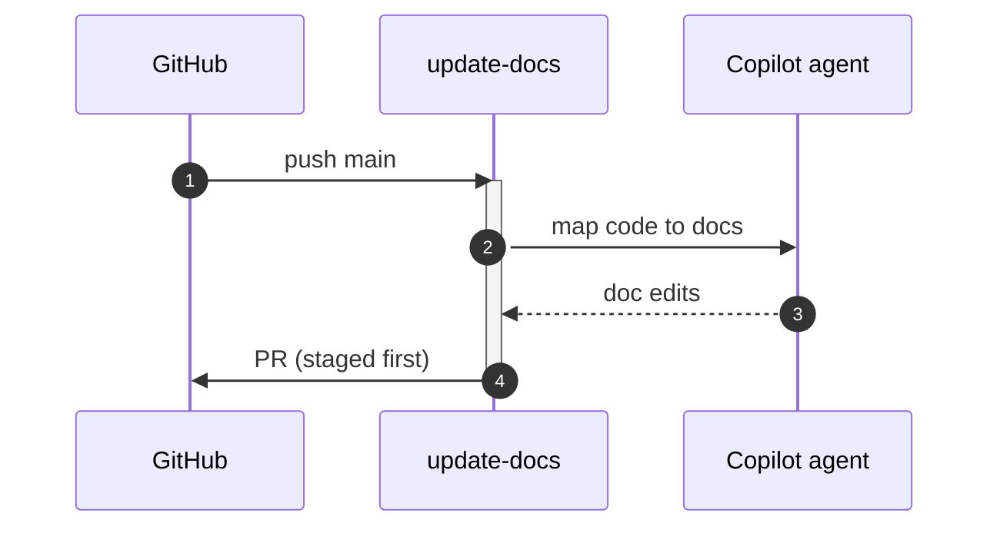

# F58: Update docs on push
- Status: todo
- Area: agent-factory
- Wave: PR 0 (implementation W6)
- Block: 6
- Lane: Builder
- Depends on: C01, C02, C03, C04, C05, C06, R01, X01, L01, F07
- proof: `make verify` exits 0 (`gh aw compile --strict --dir workflows` clean for `workflows/update-docs.md`, lock unchanged after compile, POL25 and POL31 clean); no run, no token spend
- door: one-way
- feedback: `make compile` (`gh aw compile --strict`)
## Goal
Ship `update-docs` as an installable gh-aw workflow for svennijhuis repos that on push to main, opens docs sync pr when code changes imply doc drift.
## Context
Wave W6 later workflow. PR 0 documents intent only.
**What it does:** On push to main, opens docs sync PR when code changes imply doc drift.
**Value:** Overlaps F07 doc-updater; pick one per repo to avoid duplicate PRs.
**How ours beats the example (Bar H):** Mutual exclusion note with F07; dedupe one PR per day.
**Trigger:** `workflow_dispatch` only (POL25). `push` to main with paths filter is a named ask, row in `policies/POL25.yml` `sven_yes` first.
**Safe outputs and limits:** Docs PR with shared/reporting.md body.; `create-pull-request` max 1, `staged: true`.
**Issue/PR format:** Title prefix `[F58]`, footer from `shared/reporting.md`, dedupe key `update-docs:{date}`.
Engine: `copilot` with `COPILOT_GITHUB_TOKEN` (personal fine-grained PAT).

## Frontmatter security
- `permissions:` read only (`contents: read`, `pull-requests: read`); no write permission.
- Writes only through `safe-outputs` (`create-pull-request` max 1), `staged: true` until Sven's yes.
- `timeout-minutes:` 20
- Trigger: `workflow_dispatch` only (POL25). `push` trigger is a named ask in `policies/POL25.yml` `sven_yes` first.
## Steps
1. Study upstream `githubnext/agentics` workflow `update-docs` and Agent Factory equivalents.
2. Add `workflows/update-docs.md`; import `shared/defaults.md` and `shared/security.md`; set the frontmatter security above.
3. Add deterministic pre-check returning `noop` when nothing to do.
4. Run `make compile` and commit `workflows/update-docs.lock.yml`.
5. Run `make verify`; no workflow run, no token spend.

## Definition of Done
- [ ] `workflows/update-docs.md` and its `.lock.yml` committed; `gh aw compile --strict` clean (0 errors, 0 warnings), lock unchanged after `make compile`
- [ ] Frontmatter: read-only `permissions`, writes only via `safe-outputs` (`staged: true`, a `max` per output), `timeout-minutes` set
- [ ] Trigger `workflow_dispatch` only (POL25); no `skills:` in a shared fragment (POL31)
- [ ] `make verify` exits 0; no run, no token spend
- [ ] Fetches own context with tools and imports (Bar H, gist A7); prompt never pastes repo content
- [ ] Mutual exclusion note with F07 doc-updater; dedupe one docs PR per day
## Evidence
(verify log on SHA when workflow lands)
## Flow

## Named asks for Sven
- Secondary triggers listed in Context: Sven exact yes, row in `policies/POL25.yml` `sven_yes` first
- X01 live trial and first 3 audited runs (B02): Sven exact yes, spends tokens
## Cost
Tier M: estimated 25-45 AIC per run (unverified). Daily cap 200 AIC repo-wide suggested.
## Sources
- https://github.github.com/gh-aw/agent-factory-status/
- https://github.com/githubnext/agentics/tree/main/workflows
- https://github.github.com/gh-aw/reference/aw-yml-package-manifest/
- https://github.github.com/gh-aw/gallery/docs-automation/
