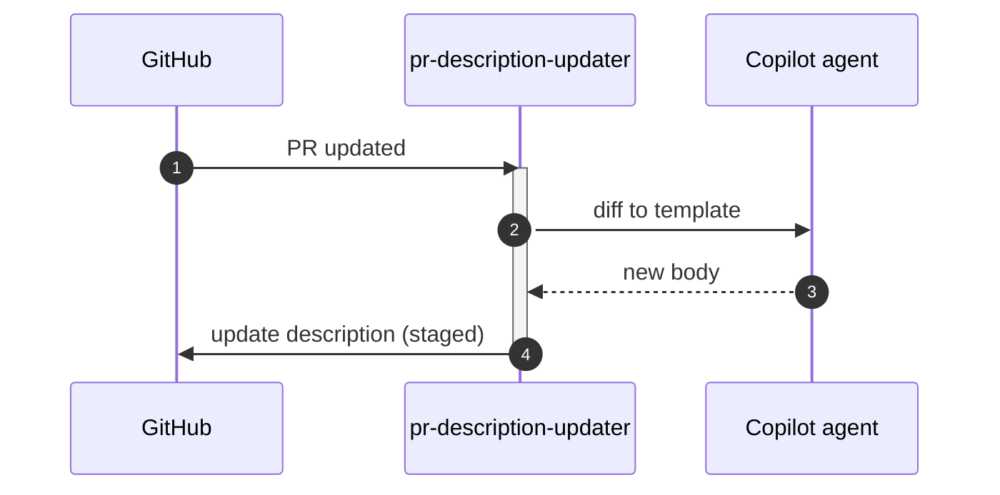

# F63: PR description updater
- Status: todo
- Area: agent-factory
- Wave: PR 0 (implementation W6)
- Block: 6
- Lane: Builder
- Depends on: C01, C02, C03, C04, C05, C06, R01, X01, L01
- proof: `make verify` exits 0 (`gh aw compile --strict --dir workflows` clean for `workflows/pr-description-updater.md`, lock unchanged after compile, POL25 and POL31 clean); no run, no token spend
- door: one-way
- feedback: `make compile` (`gh aw compile --strict`)
## Goal
Ship `pr-description-updater` as an installable gh-aw workflow for svennijhuis repos that agent factory pick: rewrites pr description from diff and checklist.
## Context
Wave W6 later workflow. PR 0 documents intent only.
**What it does:** Agent Factory pick: rewrites PR description from diff and checklist.
**Value:** Keeps PR bodies aligned with diff and template.
**How ours beats the example (Bar H):** Copilot engine (upstream copilot pick), Bar H caps, no merge.
**Trigger:** `workflow_dispatch` only (POL25). `pull_request` synchronize is a named ask, row in `policies/POL25.yml` `sven_yes` first.
**Safe outputs and limits:** Updated PR body via safe output; no title change without label.; `update-pull-request` max 1 (body only), `staged: true`.
**Issue/PR format:** Title prefix `[F63]`, footer from `shared/reporting.md`, dedupe key `pr-description-updater:{date}`.
Engine: `copilot` with `COPILOT_GITHUB_TOKEN` (personal fine-grained PAT).

## Frontmatter security
- `permissions:` read only (`contents: read`, `pull-requests: read`); no write permission.
- Writes only through `safe-outputs` (`update-pull-request` max 1 (body only)), `staged: true` until Sven's yes.
- `timeout-minutes:` 15
- Trigger: `workflow_dispatch` only (POL25). `pull_request` synchronize is a named ask in `policies/POL25.yml` `sven_yes` first.
## Steps
1. Study upstream `githubnext/agentics` workflow `pr-description-updater` and Agent Factory equivalents.
2. Add `workflows/pr-description-updater.md`; import `shared/defaults.md` and `shared/security.md`; set the frontmatter security above.
3. Add deterministic pre-check returning `noop` when nothing to do.
4. Run `make compile` and commit `workflows/pr-description-updater.lock.yml`.
5. Run `make verify`; no workflow run, no token spend.

## Definition of Done
- [ ] `workflows/pr-description-updater.md` and its `.lock.yml` committed; `gh aw compile --strict` clean (0 errors, 0 warnings), lock unchanged after `make compile`
- [ ] Frontmatter: read-only `permissions`, writes only via `safe-outputs` (`staged: true`, a `max` per output), `timeout-minutes` set
- [ ] Trigger `workflow_dispatch` only (POL25); no `skills:` in a shared fragment (POL31)
- [ ] `make verify` exits 0; no run, no token spend
- [ ] Fetches own context with tools and imports (Bar H, gist A7); prompt never pastes repo content
- [ ] Updates PR body only; no title change without label
## Evidence
(verify log on SHA when workflow lands)
## Flow

## Named asks for Sven
- Secondary triggers listed in Context: Sven exact yes, row in `policies/POL25.yml` `sven_yes` first
- X01 live trial and first 3 audited runs (B02): Sven exact yes, spends tokens
## Cost
Tier M: estimated 20-40 AIC per run (unverified). Daily cap 200 AIC repo-wide suggested.
## Sources
- https://github.github.com/gh-aw/agent-factory-status/
- https://github.com/githubnext/agentics/tree/main/workflows
- https://github.github.com/gh-aw/reference/aw-yml-package-manifest/
- https://github.github.com/gh-aw/agent-factory-status/
- agentic-workflows-workflow-ratings.md (agent-factory-status PICK row)
