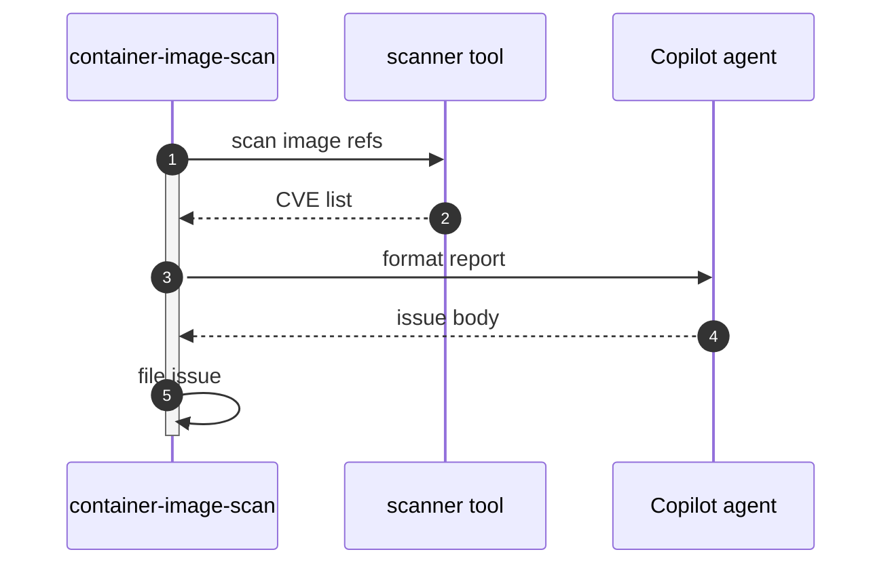

# F66: Daily container image security scan
- Status: todo
- Area: agent-factory
- Wave: PR 0 (implementation W6)
- Block: 6
- Lane: Builder
- Depends on: C01, C02, C03, C04, C05, C06, R01, X01, L01, F05
- proof: `make verify` exits 0 (`gh aw compile --strict --dir workflows` clean for `workflows/container-image-scan.md`, lock unchanged after compile, POL25 and POL31 clean); no run, no token spend
- door: one-way
- feedback: `make compile` (`gh aw compile --strict`)
## Goal
Ship `container-image-scan` as an installable gh-aw workflow for svennijhuis repos that agent factory pick: daily image vuln scan with issue on findings.
## Context
Wave W6 later workflow. PR 0 documents intent only.
**What it does:** Agent Factory pick: daily image vuln scan with issue on findings.
**Value:** Scans container images referenced in repo for known CVEs.
**How ours beats the example (Bar H):** Aligns with F05 malicious-code-scan cadence and dedupe.
**Trigger:** `workflow_dispatch` only (POL25). Daily cron is a named ask after Sven yes.
**Safe outputs and limits:** Security issue with CVE table; no image pull secrets in files.; `create-issue` max 1, `staged: true`.
**Issue/PR format:** Title prefix `[F66]`, footer from `shared/reporting.md`, dedupe key `container-image-scan:{date}`.
Engine: `copilot` with `COPILOT_GITHUB_TOKEN` (personal fine-grained PAT).

## Frontmatter security
- `permissions:` read only (`contents: read`, `issues: read`); no write permission.
- Writes only through `safe-outputs` (`create-issue` max 1), `staged: true` until Sven's yes.
- `timeout-minutes:` 20
- Trigger: `workflow_dispatch` only (POL25). Daily schedule is a named ask in `policies/POL25.yml` `sven_yes` first.
## Steps
1. Study upstream `githubnext/agentics` workflow `container-image-scan` and Agent Factory equivalents.
2. Add `workflows/container-image-scan.md`; import `shared/defaults.md` and `shared/security.md`; set the frontmatter security above.
3. Add deterministic pre-check returning `noop` when nothing to do.
4. Run `make compile` and commit `workflows/container-image-scan.lock.yml`.
5. Run `make verify`; no workflow run, no token spend.

## Definition of Done
- [ ] `workflows/container-image-scan.md` and its `.lock.yml` committed; `gh aw compile --strict` clean (0 errors, 0 warnings), lock unchanged after `make compile`
- [ ] Frontmatter: read-only `permissions`, writes only via `safe-outputs` (`staged: true`, a `max` per output), `timeout-minutes` set
- [ ] Trigger `workflow_dispatch` only (POL25); no `skills:` in a shared fragment (POL31)
- [ ] `make verify` exits 0; no run, no token spend
- [ ] Fetches own context with tools and imports (Bar H, gist A7); prompt never pastes repo content
- [ ] Aligns with F05 cadence; CVE table in issue; no image pull secrets in files
## Evidence
(verify log on SHA when workflow lands)
## Flow

## Named asks for Sven
- Secondary triggers listed in Context: Sven exact yes, row in `policies/POL25.yml` `sven_yes` first
- X01 live trial and first 3 audited runs (B02): Sven exact yes, spends tokens
## Cost
Tier M: estimated 35-60 AIC per run (unverified). Daily cap 200 AIC repo-wide suggested.
## Sources
- https://github.github.com/gh-aw/agent-factory-status/
- https://github.com/githubnext/agentics/tree/main/workflows
- https://github.github.com/gh-aw/reference/aw-yml-package-manifest/
- https://github.github.com/gh-aw/blog/2026-01-13-meet-the-workflows-security-compliance/
- agentic-workflows-workflow-ratings.md (agent-factory-status PICK row)
