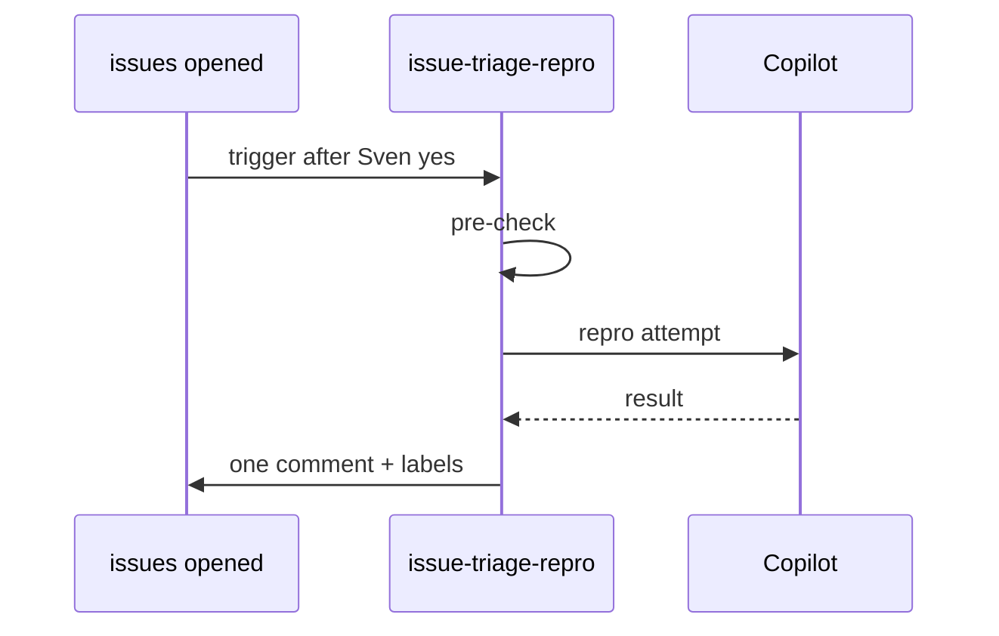

# F72: Issue triage with repro
- Status: todo
- Area: agent-factory
- Wave: W3
- Block: 3
- Lane: Builder
- Depends on: C03, C04, O01, O02, O03, R02, X01, F00
- proof: gh aw compile --dir workflows --strict workflows/f72.md; gh aw audit <run-id> (Block exit runs)
- door: one-way
- one-way gate: Sven's exact yes required (named ask in its block). Rollback: disable workflow via workflow_dispatch off or remove schedule trigger
## Goal
On `issues: opened`, read the issue, attempt repro against main with repo-native commands, label and post one report-only comment with repro result. No code changes (gist candidate 1).
## Context
Connects outer loop (issues) to inner loop without Sven as proxy. Token spend requires Sven exact yes before live trigger; start with `workflow_dispatch` staged.
## Steps
1. Add `workflows/issue-triage-repro.md` with shared defaults and reporting footer.
2. Pre-check noop when issue template missing repro fields and policy says skip.
3. Staged/report-only first; `workflow_dispatch` before `issues: opened`.
4. `scripts/verify.sh` on SHA; X01 trial with fake issue.
5. Three audited runs; AIC in Evidence.
## Definition of Done
- [ ] Fetches own context with tools and imports (Bar H, gist A7); prompt never pastes repo content
- [ ] Shared defaults import, pinned gh-aw and imports (POL01)
- [ ] Caps in workflow frontmatter (POL02); `copilot-requests: none` (POL21)
- [ ] Pre-check noop; staged/report-only before writes (POL03)
- [ ] Dedupe, expiry, reporting footer (O03, POL16)
- [ ] min-integrity, threat detection, allowlists (POL05-POL07, POL13)
- [ ] on.roles, skip-bots (POL10)
- [ ] X01 trial + verify log (Q0)
- [ ] Three audited runs with measured AIC
- [ ] [X07](../testing/X07-workflow-benchmark.md) benchmark: 5 or more fixed cases with known answers in `docs/benchmarks/<workflow>.md`, score at or above baseline (Bar H)
## Evidence
(verify log, run links, AIC table)
## Flow

## Named asks for Sven
Exact yes before `issues: opened` goes live
## Cost
M tier, ~25-40 AIC per issue (unverified)
## Sources
- gist-handover-agentic-workflows.md candidate 1
- Plan v3.2 F72 Block 3
