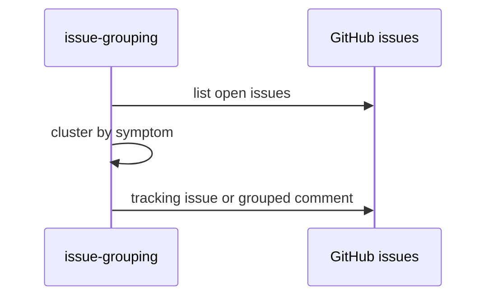

# F73: Issue grouping
- Status: todo
- Area: agent-factory
- Wave: W5
- Block: 5
- Lane: Builder
- Depends on: C03, C04, O01, O03, R02, X01, F72
- proof: gh aw compile --dir workflows --strict workflows/f73.md; gh aw audit <run-id> (Block exit runs)
- door: one-way
- one-way gate: Sven's exact yes required (named ask in its block). Rollback: disable workflow via workflow_dispatch off or remove schedule trigger
## Goal
Triage workflow clusters open issues with the same symptom into one tracking issue (gist candidate 2, point 16).
## Context
Block 5 scale item. Report-only grouping comments and optional tracking issue creation with staged mode first.
## Steps
1. Add `workflows/issue-grouping.md` with Bar H defaults.
2. `workflow_dispatch` and weekly schedule only after Sven yes for schedule.
3. Dedupe by symptom fingerprint in title/body hash.
4. Verify, X01 trial, three audited runs.
## Definition of Done
- [ ] Fetches own context with tools and imports (Bar H, gist A7); prompt never pastes repo content
- [ ] Bar H: defaults, pins, caps, pre-check noop, staged first, dedupe, integrity, allowlists, roles, reporting footer
- [ ] X01 trial + verify log
- [ ] Three audited runs with measured AIC
- [ ] No writes until staged period complete
## Evidence
(verify log, run links, AIC table)
## Flow

## Named asks for Sven
Schedule yes if fuzzy cron used (R01)
## Cost
M tier, ~30-55 AIC per run (unverified)
## Sources
- gist-handover-agentic-workflows.md candidate 2
- Plan v3.2 F73 Block 5
