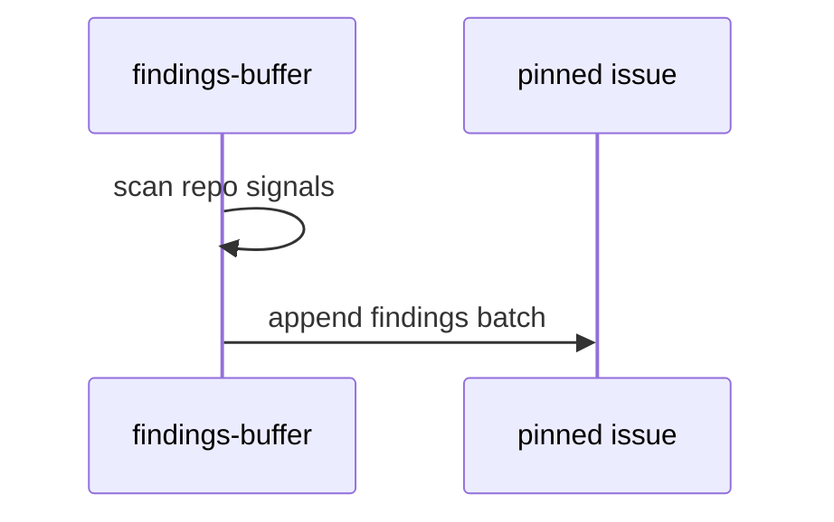

# F74: Findings buffer
- Status: todo
- Area: agent-factory
- Wave: W3
- Block: 3
- Lane: Builder
- Depends on: C03, C04, O01, O02, O03, R01, X01
- proof: gh aw compile --dir workflows --strict workflows/f74.md; gh aw audit <run-id> (Block exit runs)
- door: one-way
- one-way gate: Sven's exact yes required (named ask in its block). Rollback: disable workflow via workflow_dispatch off or remove schedule trigger
## Goal
Scheduled report-only workflow appends findings (banned patterns, stale docs, failing pins) to one pinned tracking issue instead of opening many PRs (gist candidate 3).
## Context
Cheap gardening; batch review shows patterns. Schedule and token spend need Sven yes. Start dispatch-only.
## Steps
1. Add `workflows/findings-buffer.md`; configure pinned tracking issue via `import-schema` input.
2. Append-only comment or issue body section with dedupe by finding id.
3. Staged preview mode lists would-append items without writing.
4. Verify, X01, three audited runs.
## Definition of Done
- [ ] Fetches own context with tools and imports (Bar H, gist A7); prompt never pastes repo content
- [ ] Bar H checklist complete (defaults, pins, caps, POL21, pre-check, staged, dedupe, integrity, allowlists, roles, footer)
- [ ] Pinned issue input documented in import-schema
- [ ] X01 trial + verify log
- [ ] Three audited runs with measured AIC
## Evidence
(verify log, tracking issue link, AIC table)
## Flow

## Named asks for Sven
Exact yes before schedule goes live
## Cost
S tier, ~15-25 AIC per run (unverified)
## Sources
- gist-handover-agentic-workflows.md candidate 3
- Plan v3.2 F74 Block 3
