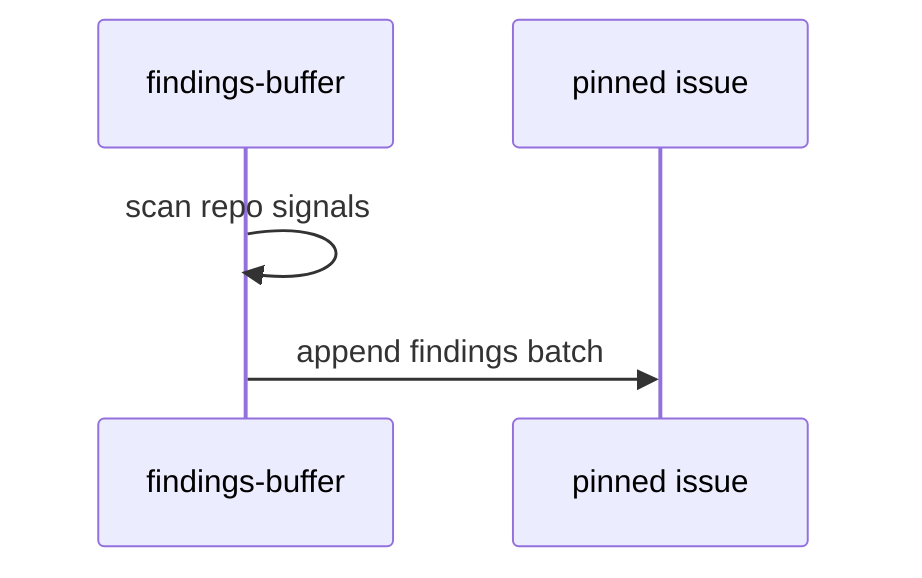

# F74: Findings buffer
- Status: todo
- Area: agent-factory
- Wave: W3
- Block: 3
- Lane: Builder
- Depends on: C03, C04, R01, X01
- proof: `make verify` exits 0 (`gh aw compile --strict --dir workflows` clean for `workflows/findings-buffer.md`, lock unchanged after compile, POL25 and POL31 clean); no run, no token spend
- door: one-way
- feedback: `make compile` (`gh aw compile --strict`)
## Goal
Scheduled report-only workflow appends findings (banned patterns, stale docs, failing pins) to one pinned tracking issue instead of opening many PRs (gist candidate 3).
## Context
Cheap gardening; batch review shows patterns. Schedule and token spend need Sven yes. Start dispatch-only.
**What it does:** Scheduled report-only workflow appends findings (banned patterns, stale docs, failing pins) to one pinned tracking issue instead of opening many PRs (gist candidate 3)
**Value:** 
**How ours beats the example (Bar H):** Bar H defaults, staged outputs, dispatch-only rollout
**Trigger:** `workflow_dispatch` only (POL25). Schedule is a named ask, row in `policies/POL25.yml` `sven_yes` first.
**Safe outputs and limits:** `create-issue-comment` max 1 (append to pinned tracking issue); `create-issue-comment` max 1 (append to pinned tracking issue), `staged: true`.
**Issue/PR format:** Title prefix `[F74]`, footer from `shared/reporting.md`
Engine: `copilot` with `COPILOT_GITHUB_TOKEN` (personal fine-grained PAT).

## Frontmatter security
- `permissions:` read only (`contents: read`, `issues: read`); no write permission.
- Writes only through `safe-outputs` (`create-issue-comment` max 1 (append to pinned tracking issue)), `staged: true` until Sven's yes.
- `timeout-minutes:` 15
- Trigger: `workflow_dispatch` only (POL25). Schedule trigger is a named ask in `policies/POL25.yml` `sven_yes` first.
## Steps
1. Study upstream `githubnext/agentics` workflow `findings-buffer` and Agent Factory equivalents.
2. Add `workflows/findings-buffer.md`; import `shared/defaults.md` and `shared/security.md`; set the frontmatter security above.
3. Add deterministic pre-check returning `noop` when nothing to do.
4. Run `make compile` and commit `workflows/findings-buffer.lock.yml`.
5. Run `make verify`; no workflow run, no token spend.

## Definition of Done
- [ ] `workflows/findings-buffer.md` and its `.lock.yml` committed; `gh aw compile --strict` clean (0 errors, 0 warnings), lock unchanged after `make compile`
- [ ] Frontmatter: read-only `permissions`, writes only via `safe-outputs` (`staged: true`, a `max` per output), `timeout-minutes` set
- [ ] Trigger `workflow_dispatch` only (POL25); no `skills:` in a shared fragment (POL31)
- [ ] `make verify` exits 0; no run, no token spend
- [ ] Fetches own context with tools and imports (Bar H, gist A7); prompt never pastes repo content
- [ ] Pinned tracking issue input documented in workflow inputs
- [ ] Staged preview lists would-append items without writing
- [ ] [X07](../testing/X07-workflow-benchmark.md) benchmark: 5 or more fixed cases with known answers in `docs/benchmarks/findings-buffer.md`, docs only; live score is a named ask
## Evidence
(verify log on SHA when workflow lands)
## Flow

## Named asks for Sven
- Exact yes before schedule goes live, row in `policies/POL25.yml` `sven_yes` first
- X01 live trial and first 3 audited runs (B02): Sven exact yes, spends tokens
- X07 live benchmark score: Sven exact yes per run, spends tokens
## Cost
S tier, ~15-25 AIC per run (unverified)
## Sources
- gist-handover-agentic-workflows.md candidate 3
- Plan v3.2 F74 Block 3
