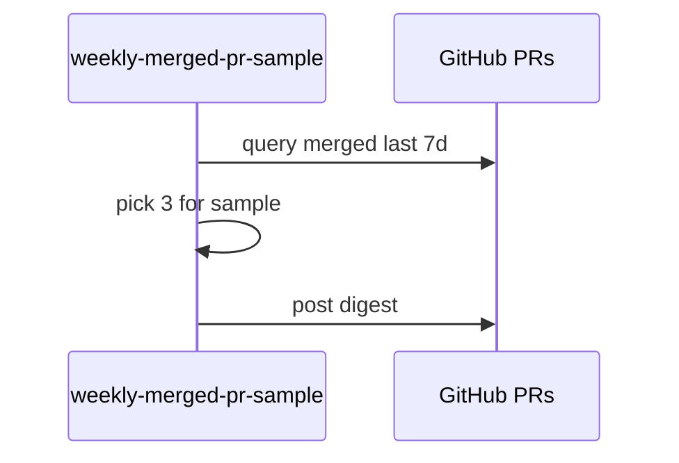

# F75: Weekly merged PR sample
- Status: todo
- Area: agent-factory
- Wave: W5
- Block: 5
- Lane: Builder
- Depends on: C03, C04, R01, X01
- proof: `make verify` exits 0 (`gh aw compile --strict --dir workflows` clean for `workflows/weekly-merged-pr-sample.md`, lock unchanged after compile, POL25 and POL31 clean); no run, no token spend
- door: one-way
- feedback: `make compile` (`gh aw compile --strict`)
## Goal
Folded into [AO10 sampled human review](../agent-ops/AO10-sampled-human-review.md). Weekly digest of merged PRs with three picked for human sample review (gist candidate 4, sample review over blocking review).
## Context
Block 5. Report-only issue or discussion post. Schedule needs Sven yes; start with `workflow_dispatch`.
**What it does:** Folded into [AO10 sampled human review](
**Value:** 
**How ours beats the example (Bar H):** Bar H defaults, staged outputs, dispatch-only rollout
**Trigger:** `workflow_dispatch` only (POL25). Weekly cron is a named ask, row in `policies/POL25.yml` `sven_yes` first.
**Safe outputs and limits:** `create-issue` max 1; `create-issue` max 1, `staged: true`.
**Issue/PR format:** Title prefix `[F75]`, footer from `shared/reporting.md`
Engine: `copilot` with `COPILOT_GITHUB_TOKEN` (personal fine-grained PAT).

## Frontmatter security
- `permissions:` read only (`contents: read`, `issues: read`, `pull-requests: read`); no write permission.
- Writes only through `safe-outputs` (`create-issue` max 1), `staged: true` until Sven's yes.
- `timeout-minutes:` 15
- Trigger: `workflow_dispatch` only (POL25). Weekly schedule is a named ask in `policies/POL25.yml` `sven_yes` first.
## Steps
1. Study upstream `githubnext/agentics` workflow `weekly-merged-pr-sample` and Agent Factory equivalents.
2. Add `workflows/weekly-merged-pr-sample.md`; import `shared/defaults.md` and `shared/security.md`; set the frontmatter security above.
3. Add deterministic pre-check returning `noop` when nothing to do.
4. Run `make compile` and commit `workflows/weekly-merged-pr-sample.lock.yml`.
5. Run `make verify`; no workflow run, no token spend.

## Definition of Done
- [ ] `workflows/weekly-merged-pr-sample.md` and its `.lock.yml` committed; `gh aw compile --strict` clean (0 errors, 0 warnings), lock unchanged after `make compile`
- [ ] Frontmatter: read-only `permissions`, writes only via `safe-outputs` (`staged: true`, a `max` per output), `timeout-minutes` set
- [ ] Trigger `workflow_dispatch` only (POL25); no `skills:` in a shared fragment (POL31)
- [ ] `make verify` exits 0; no run, no token spend
- [ ] Fetches own context with tools and imports (Bar H, gist A7); prompt never pastes repo content
- [ ] Pick 3 merged PRs for sample review; footer links to F01 manual review when useful
- [ ] No APPROVE or merge actions in workflow
## Evidence
(verify log on SHA when workflow lands)
## Flow

## Named asks for Sven
- Schedule yes for weekly cron (R01), row in `policies/POL25.yml` `sven_yes` first
- X01 live trial and first 3 audited runs (B02): Sven exact yes, spends tokens
## Cost
S tier, ~20-35 AIC per week (unverified)
## Sources
- gist-handover-agentic-workflows.md candidate 4
- Plan v3.2 F75 Block 5
