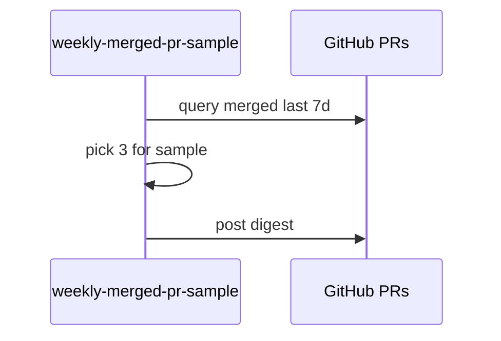

# F75: Weekly merged PR sample
- Status: todo
- Area: agent-factory
- Wave: W5
- Block: 5
- Lane: Builder
- Depends on: C03, C04, O01, O03, R01, X01
- proof: gh aw compile --dir workflows --strict workflows/f75.md; gh aw audit <run-id> (Block exit runs)
- door: one-way
- one-way gate: Sven's exact yes required (named ask in its block). Rollback: disable workflow via workflow_dispatch off or remove schedule trigger
## Goal
Weekly digest of merged PRs with three picked for human sample review (gist candidate 4, sample review over blocking review).
## Context
Block 5. Report-only issue or discussion post. Schedule needs Sven yes; start with `workflow_dispatch`.
## Steps
1. Add `workflows/weekly-merged-pr-sample.md`.
2. Select merged PRs in last 7 days; rank for risk and novelty; pick 3 for sample.
3. Footer links to F01 manual review for sampled PRs if still open.
4. Verify, X01, three audited runs.
## Definition of Done
- [ ] Fetches own context with tools and imports (Bar H, gist A7); prompt never pastes repo content
- [ ] Bar H checklist complete
- [ ] X01 trial + verify log
- [ ] Three audited runs with measured AIC
- [ ] No APPROVE/merge actions (POL14)
## Evidence
(verify log, sample digest link, AIC table)
## Flow

## Named asks for Sven
Schedule yes for weekly cron
## Cost
S tier, ~20-35 AIC per week (unverified)
## Sources
- gist-handover-agentic-workflows.md candidate 4
- Plan v3.2 F75 Block 5
