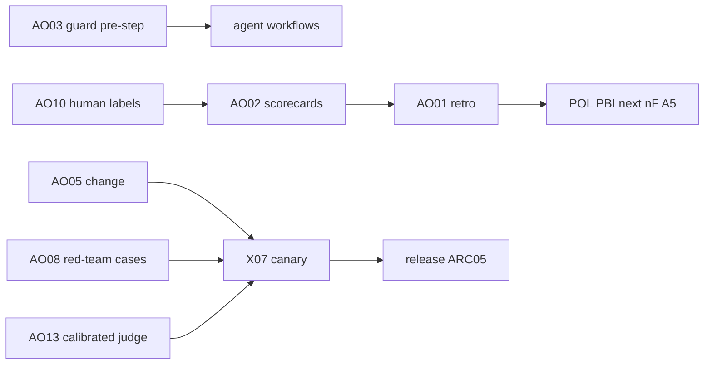

# agent-ops: overview

**Purpose:** Operational PBIs for running AI agents safely: retros, scorecards, kill switch, incidents, change control, access review, audit, red team, privacy, human sampling, error budgets, risk routing, calibrated judges, and NIST mapping. Sourced from industry practice (S1-S11). Plan v3.7 folds F75 into AO10; AO03 guard sits in B2 for LP02 `/stop`.

## Sources

| Id | Org | Claim used | Source | Date |
|---|---|---|---|---|
| S1 | GitHub | Four principles: defense in depth, don't trust agents with secrets, stage and vet all writes, log everything | [GitHub blog: security architecture of Agentic Workflows](https://github.blog/ai-and-ml/generative-ai/under-the-hood-security-architecture-of-github-agentic-workflows/) | read 2026-10-25 |
| S2 | GitHub | Threat detection scans outputs for prompt injection, secret leaks and malicious patches before writes | [gh-aw threat detection](https://github.github.com/gh-aw/reference/threat-detection/) | read 2026-10-25 |
| S3 | Google | Blameless postmortems, triggers defined before incidents, every postmortem ends in action items | [SRE book: Postmortem Culture](https://sre.google/sre-book/postmortem-culture/) | book, read 2026-10-25 |
| S4 | Google | Postmortems use roles, not names, and leave out customer details | [Google Cloud blog: fearless shared postmortems](https://cloud.google.com/blog/products/gcp/fearless-shared-postmortems-cre-life-lessons) | read 2026-10-25 |
| S5 | Google | Canary: small, time-limited exposure first | [SRE workbook ch. 16: Canarying Releases](https://sre.google/workbook/canarying-releases/) | workbook, read 2026-10-25 |
| S6 | Google | Error budget policy: when the budget is gone, releases freeze | [SRE workbook: Error Budget Policy](https://sre.google/workbook/error-budget-policy/) | workbook, read 2026-10-25 |
| S7 | Stripe | Minions: over 1,300 agent PRs merged per week, all human-reviewed. Blueprints mix deterministic steps with agent loops | [Stripe: Minions part 1](https://stripe.dev/blog/minions-stripes-one-shot-end-to-end-coding-agents), [part 2](https://stripe.dev/blog/minions-stripes-one-shot-end-to-end-coding-agents-part-2) | 2026-02-09, 2026-02-19 |
| S8 | Uber | uReview rates, filters and dedupes comments, routes by change risk and cost | [Uber blog: uReview](https://www.uber.com/us/en/blog/ureview/), [AI Engineer talk](https://www.youtube.com/watch?v=EL123UNokkI) | read 2026-10-25 |
| S9 | Shopify | LLM judges calibrated against human-labeled ground truth before they score changes | [Shopify: production-ready agentic systems](https://shopify.engineering/building-production-ready-agentic-systems), [Sidekick continual learning loop](https://shopify.engineering/sidekicks-continual-learning-loop) | 2025, 2026 |
| S10 | OWASP | LLM01 prompt injection. LLM06 excessive agency: high-impact actions need approval | [OWASP LLM01](https://genai.owasp.org/llmrisk/llm01-prompt-injection/), [LLM06](https://genai.owasp.org/llmrisk/llm062025-excessive-agency/) | 2025 |
| S11 | NIST | AI RMF Generative AI profile: Govern, Map, Measure, Manage | [NIST AI 600-1](https://www.nist.gov/publications/artificial-intelligence-risk-management-framework-generative-artificial-intelligence) | July 2024 |

## PBIs

| Id | Title | Block | Door | Link |
|---|---|---|---|---|
| AO01 | Retro workflow | 3 | one-way (tokens) | [AO01-retro-workflow.md](AO01-retro-workflow.md) |
| AO02 | Agent scorecards | 3 | two-way | [AO02-agent-scorecards.md](AO02-agent-scorecards.md) |
| AO03 | Kill switch | 2 | two-way | [AO03-kill-switch.md](AO03-kill-switch.md) |
| AO04 | Incident runbook + postmortem | 5 | two-way | [AO04-incident-runbook-postmortem.md](AO04-incident-runbook-postmortem.md) |
| AO05 | Change management | 5 | one-way (tags) | [AO05-change-management.md](AO05-change-management.md) |
| AO06 | Access review | 5 | two-way | [AO06-access-review.md](AO06-access-review.md) |
| AO07 | Audit trail | 5 | two-way | [AO07-audit-trail.md](AO07-audit-trail.md) |
| AO08 | Red-team set in X07 | 5 | one-way (tokens) | [AO08-red-team-set.md](AO08-red-team-set.md) |
| AO09 | Data + privacy rules | 5 | two-way | [AO09-data-privacy-rules.md](AO09-data-privacy-rules.md) |
| AO10 | Sampled human review | 5 | two-way | [AO10-sampled-human-review.md](AO10-sampled-human-review.md) |
| AO11 | Error budget per workflow | 5 | two-way | [AO11-error-budget.md](AO11-error-budget.md) |
| AO12 | Risk-based review routing | 5 | one-way (tokens) | [AO12-risk-based-review-routing.md](AO12-risk-based-review-routing.md) |
| AO13 | Calibrated judge for X07 | 5 | one-way (tokens) | [AO13-calibrated-judge.md](AO13-calibrated-judge.md) |
| AO14 | NIST mapping doc | 5 | two-way | [AO14-nist-mapping.md](AO14-nist-mapping.md) |

## Parked (reason)

- Agent self-merge on consumer repos. S7 keeps a human review on every PR, and Sven's rule is that humans merge outside the AW and Chatmarkt rooms.
- Our own sandbox or devbox fleet (S7). The gh-aw runner sandbox and firewall (S1) already cover isolation.
- Third-party reviewer bake-off (S8). It comes after X07 exists, as a C03 comparison in B6.

## Dependency sketch

