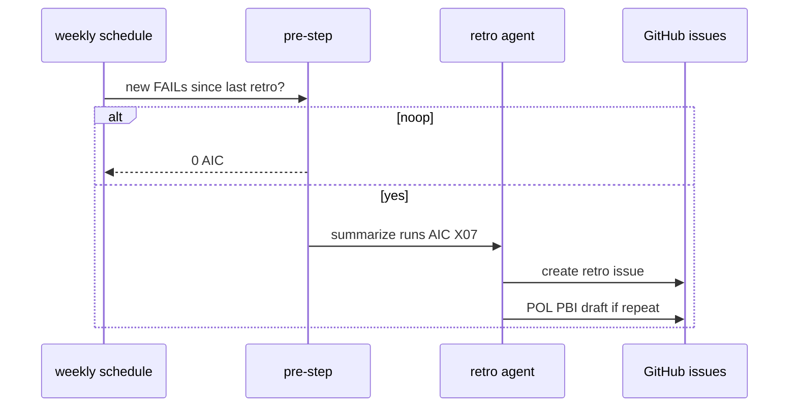
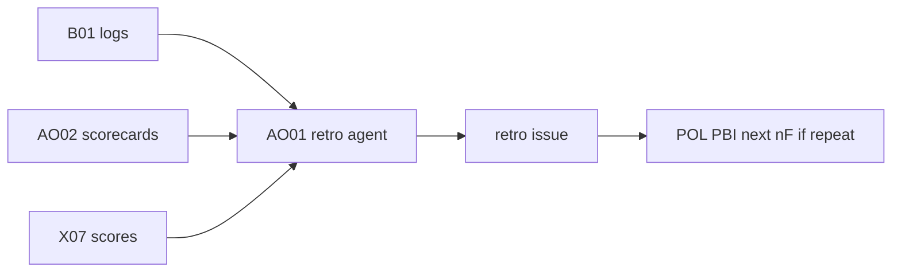

# AO01: Retro workflow
- Status: todo
- Area: agent-ops
- Wave: W3
- Block: 3
- Lane: Builder
- Depends on: B01, AO02, X07
- proof: gh aw compile --dir workflows --strict workflows/ao01-retro.md; weekly retro issue link after three audited runs
- door: one-way
- one-way gate: Sven's exact yes required (named ask in its block). Rollback: disable workflow via workflow_dispatch off or remove schedule trigger
## Goal
Weekly and report-only retro: read runs, FAILs, reverts, AIC, and X07 scores; write one retro issue (went well, went wrong, repeated mistakes). Each repeated mistake becomes a POL PBI in the next nF (A5).
## Context
Uses [X07](../testing/X07-workflow-benchmark.md) scores in the narrative. Before release-class changes, X07 runs first; a lower score than baseline blocks promotion (same rule as [AO05](AO05-change-management.md) and [ARC05](../done/ARC05-release-flow.md)). Feeds improvement loop LP00 step 5 and LP01 Done column.
## Steps
1. Add `workflows/ao01-retro.md` with weekly schedule after manual trial.
2. Deterministic pre-step: skip if no new FAIL or revert since last retro.
3. Agent summarizes B01 logs, scorecards, X07 deltas into one issue.
4. Script opens POL PBI draft for repeated mistakes (A5).
## Definition of Done
- [ ] `imports:` shared/defaults.md (engine copilot, caps, admission, concurrency)
- [ ] Pinned gh-aw compiler version and every remote import uses tag or SHA (no @main)
- [ ] `max-ai-credits: 50`, `max-daily-ai-credits: 200`, `max-turns: 15`, `timeout-minutes: 10` (tune after measure)
- [ ] Deterministic `steps:` pre-check; `noop` when nothing to do (0 AIC path)
- [ ] `workflow_dispatch` plus staged/report-only rollout before production writes
- [ ] Dedupe: `deduplicate-by-title`, `group-by-day`, `close-older-issues`, `expires`
- [ ] `min-integrity: approved`, threat detection on, minimal `network` allowlist
- [ ] Tool, bash, and MCP allowlists; `on.roles` and skip-bots configured
- [ ] Issue format matches `shared/reporting.md`
- [ ] Trial run on X01 test repo; `gh aw audit` on first 3 runs; measured AIC in Evidence
- [ ] `./scripts/verify.sh` pass on workflow SHA
- [ ] X07 benchmark score at or above baseline (5+ cases)
- [ ] Repeated mistake opens POL PBI draft for next nF
## Technical design
- Components and files: `workflows/ao01-retro.md`, B01 run export, AO02 scorecard script output, X07 baseline files under `docs/benchmarks/`.
- Interfaces: read-only GitHub API for runs; safe-output `create-issue` for retro body; link to POL template.
- Sequence:

- Failure modes: empty week noop; token missing fails loud; duplicate retro deduped by title.
- Security: read-only agent job; issue write only via safe-output max; no merge actions.
- Observability: retro issue links run ids; AIC in footer per shared/reporting.md.
- Cost: Tier S, estimate 25-40 AIC per week after measure.
- Rollback: disable schedule; close template issues.
- Proof: three audited runs; retro issue URL in Evidence.
- Door: one-way (tokens and schedule promotion need Sven yes).
## Evidence
(verify log, `gh aw audit` output, retro issue link, AIC table)
## Flow

## Named asks for Sven
Weekly schedule yes after 3 manual retros; token scope yes for read APIs
## Cost
Tier S, ~25-40 AIC per week (unverified)
## Sources
- S3: [SRE book: Postmortem Culture](https://sre.google/sre-book/postmortem-culture/) (book, read 2026-10-25)
- gist 28 (plan retro cadence, agent-ops.md)
- Plan v3.7 AO01 (agentic-workflows-pbi-plan.md)
