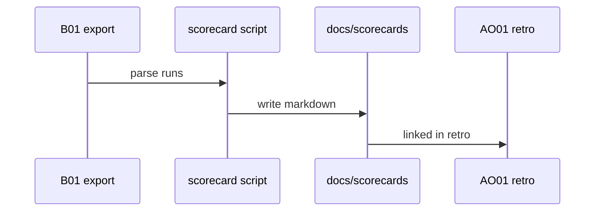
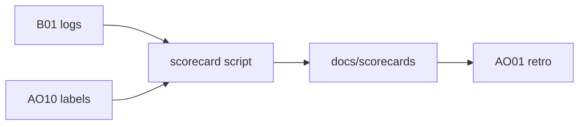

# AO02: Agent scorecards
- Status: todo
- Area: agent-ops
- Wave: W3
- Block: 3
- Lane: Builder
- Depends on: B01, AO10
- proof: test -f scripts/agent-scorecard.sh; scorecard markdown generated from fixture logs; ./scripts/verify.sh
- door: two-way
## Goal
Per workflow scorecard: success rate, false alarms, AIC, time, human overrule rate. Built by a deterministic script from B01 logs and AO10 labels (no tokens in the script path).
## Context
Runs on push to main and after PR approve (LP02): script only, 0 AIC. Feeds AO01 retro and B03a value columns. Labels from [AO10](AO10-sampled-human-review.md) ground truth.
## Steps
1. Add `scripts/agent-scorecard.sh` reading B01 export format.
2. Map AO10 labels to useful, noise, wrong buckets.
3. Emit markdown table per workflow under `docs/scorecards/`.
4. Wire CI or weekly job (no agent).
## Definition of Done
- [ ] Script runs locally with fixture logs (0 AIC)
- [ ] Columns documented: success, false alarm, AIC, duration, overrule rate
- [ ] Output consumed by AO01 retro pre-step
- [ ] door two-way; no PAT required for script
## Technical design
- Components and files: `scripts/agent-scorecard.sh`, `docs/scorecards/<workflow>.md`, B01 log layout spec.
- Interfaces: stdin or path to B01 JSON/CSV; stdout markdown table.
- Sequence:

- Failure modes: missing AO10 labels show unknown bucket; script exits non-zero on corrupt input.
- Security: no secrets; read-only local files.
- Observability: scorecard commit on main documents weekly trend.
- Cost: 0 AIC (script).
- Rollback: remove script job; delete generated docs.
- Proof: fixture run output in PR Evidence.
- Door: two-way (script and schema evolve in PR).
## Evidence
(fixture scorecard snippet; verify log)
## Flow

## Named asks for Sven
None for script-only path
## Cost
0 AIC
## Sources
- S8: [Uber blog: uReview](https://www.uber.com/us/en/blog/ureview/), [AI Engineer talk](https://www.youtube.com/watch?v=EL123UNokkI) (read 2026-10-25)
- S9: [Shopify: production-ready agentic systems](https://shopify.engineering/building-production-ready-agentic-systems), [Sidekick continual learning loop](https://shopify.engineering/sidekicks-continual-learning-loop) (2025, 2026)
- Plan v3.7 AO02 (agentic-workflows-pbi-plan.md)
