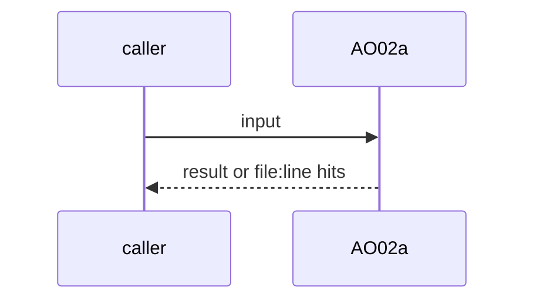
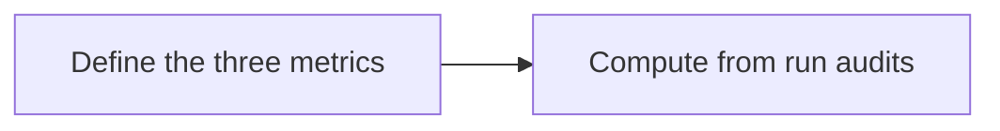

# AO02a: Metrics: automation rate, human interventions, cycle time
- Status: todo
- Area: agent-ops
- Wave: W5
- Block: 5
- Lane: Builder
- Depends on: AO02, B03a
- proof: scorecard fixture shows automation rate, human interventions and cycle time per workflow
- door: two-way
- triage: build
- feedback: scorecard fixture
- harness: none (script run by scripts/verify.sh)
- review-input: diff + this PBI + DoD (+ linked spec) + PR description, never builder session logs (PA6)
- kind: script
- Source: D10 https://docs.warp.dev/factories/ https://www.warp.dev/blog/we-are-now-factory-engineers-not-product-engineers
## Goal
AO02 scorecards add automation rate (merged without human code edits), human interventions and cycle time per workflow.
## Context
Warp memo: the metric is the "percentage of all changes that are shipped automatically, and at what cost", and every time a human is brought into the loop it is recorded. Warp Factories dashboard: PR activity, autonomy, cycle time, and cost. Not built in PR #4: docs only, nothing enabled (PA9).
## Steps
1. Define the three metrics.
2. Compute from run audits.
## Definition of Done
- [ ] Fixture scorecard
- [ ] Definitions written
## Technical design
- Components and files: AO02 scorecard
- Module boundary: three numbers per workflow
- Interfaces: scorecard columns
- Sequence:

- Failure modes: No runs: n/a
- Security: No personal data
- Observability: scorecard
- Cost: 0 AIC
- Rollback: Drop the columns
- Proof: same as proof: above
- Door: two-way (revert is one commit)
## Evidence
(todo)
## Flow

## Named asks for Sven
none
## Cost
0 AIC
## Sources
- [Warp Factories overview](https://docs.warp.dev/factories/)
- [Warp blog, factory engineers memo](https://www.warp.dev/blog/we-are-now-factory-engineers-not-product-engineers)
- Strategy id list v3.12 (aw-final-ids.md), url-learnings.md D10
