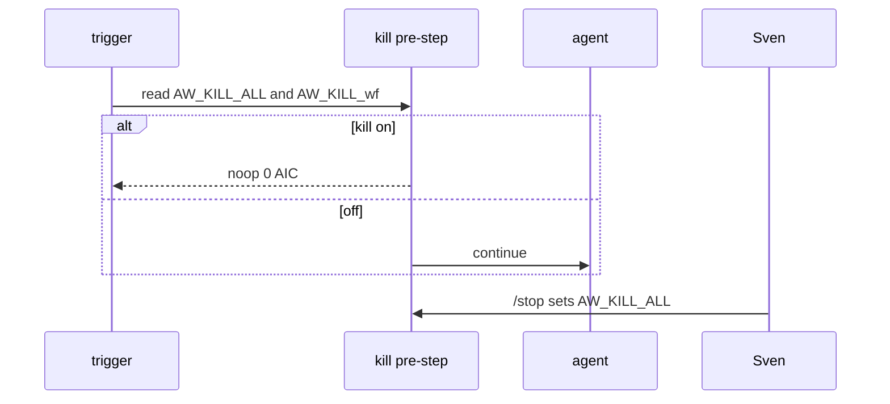
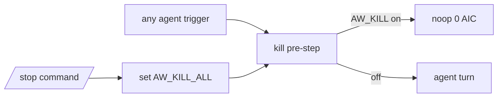

# AO03: Kill switch
- Status: todo
- Area: agent-ops
- Wave: W2
- Block: 2
- Lane: Builder
- Depends on: C03
- proof: Set global kill repo variable; trigger any agent workflow; run completes with 0 AIC noop before agent step
- door: two-way
## Goal
One repo variable for all workflows plus one per workflow. Every agent workflow pre-step reads both and noops before any agent turn. `/stop` command sets the global var via a deterministic job (0 AIC). Document runbook line to flip switches.
## Context
Moved to B2 as guard dependency for LP02 (pr0-adds/loops.md v3.8b). When on, M05 cross-repo and all agent workflows noop. Proof: flip global var, run workflow, observe 0 AIC and no Copilot calls.
## Steps
1. Define repo variables: `AW_KILL_ALL`, `AW_KILL_<workflow_id>`.
2. Shared pre-step snippet imported by all agent workflows.
3. Add gh-aw `command: /stop` workflow setting `AW_KILL_ALL=true`.
4. Document flip-back in AO04 runbook.
## Definition of Done
- [ ] Pre-step reads global and per-workflow vars before agent turn
- [ ] Noop path logs reason and exits 0 AIC
- [ ] `/stop` command documented in LP02 human activity table
- [ ] Proof run captured in Evidence
## Technical design
- Components and files: `shared/kill-switch-pre.md` import; `workflows/stop-kill-switch.md` for `/stop`; repo variables in GitHub settings.
- Interfaces: `gh variable list`; pre-step bash reads vars; no agent on noop.
- Sequence:

- Failure modes: var missing treated as off; mis-typed workflow id falls back to global only.
- Security: only admin/write can set vars or run `/stop` (`on.roles` on the stop workflow).
- Observability: log line `kill-switch: noop` on block.
- Cost: 0 AIC when noop; `/stop` job 0 AIC.
- Rollback: set `AW_KILL_ALL=false`; clear per-workflow vars.
- Proof: flip global, run M05 or F01 trial, 0 AIC in run summary.
- Door: two-way (Sven flips without PR); emergency stop is immediate.
## Evidence
(run link showing noop; variable screenshot names only)
## Flow

## Named asks for Sven
Create repo variables; test `/stop` once on catalog repo
## Cost
0 AIC for guard path
## Sources
- S10: [OWASP LLM06 excessive agency](https://genai.owasp.org/llmrisk/llm062025-excessive-agency/) (2025)
- S6: [SRE workbook: Error Budget Policy](https://sre.google/workbook/error-budget-policy/) (workbook, read 2026-10-25)
- Plan v3.8b AO03 B2 guard (agentic-workflows-pbi-plan.md)
- Strategy pr0-adds/loops.md LP02 `/stop` (2026-10-25)
