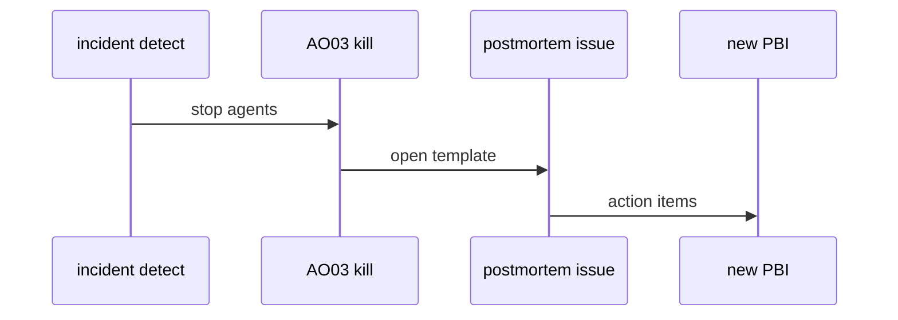
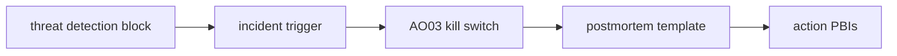

# AO04: Incident runbook + postmortem
- Status: todo
- Area: agent-ops
- Wave: W5
- Block: 5
- Lane: Builder
- Depends on: AO03, ARC04
- proof: docs/runbooks/agent-incident.md exists; template issue opened in drill; links to AO03 and ARC04 resolve
- door: two-way
## Goal
Triggers defined up front: wrong write, secret in output, spend spike, injection hit. Kill switch first ([AO03](AO03-kill-switch.md)), then blameless postmortem with roles not names, action items as PBIs.
## Context
ARC04 blocked write path references AO04. Aligns with NIST incident disclosure themes (S11). No customer names in postmortem (S4).
## Steps
1. Publish `docs/runbooks/agent-incident.md` with trigger table.
2. Add postmortem issue template (roles, timeline, action items).
3. Link AO03 flip steps and AO07 audit export.
4. Tabletop drill once before B5 exit.
## Definition of Done
- [ ] Triggers listed: wrong write, secret leak, spend spike, injection
- [ ] Step 1 is always AO03 kill switch
- [ ] Template uses roles not names
- [ ] Each action item becomes a PBI link
## Technical design
- Components and files: `docs/runbooks/agent-incident.md`, `.github/ISSUE_TEMPLATE/agent-postmortem.md`.
- Interfaces: issue template fields; link format to AO07 run id.
- Sequence:

- Failure modes: missing run id; AO07 export backfills timeline.
- Security: redact secrets from postmortem body; reference run id only.
- Observability: label `incident:agent` on issues.
- Cost: 0 AIC for doc drill; agent incidents rare.
- Rollback: archive bad template via PR revert.
- Proof: drill issue link in Evidence.
- Door: two-way (runbook improves in PR).
## Evidence
(drill issue URL; template merge PR)
## Flow

## Named asks for Sven
30 min tabletop when runbook merges
## Cost
0 AIC
## Sources
- S3: [SRE book: Postmortem Culture](https://sre.google/sre-book/postmortem-culture/) (book, read 2026-10-25)
- S4: [Google Cloud blog: fearless shared postmortems](https://cloud.google.com/blog/products/gcp/fearless-shared-postmortems-cre-life-lessons) (read 2026-10-25)
- S11: [NIST AI 600-1](https://www.nist.gov/publications/artificial-intelligence-risk-management-framework-generative-artificial-intelligence) (July 2024)
