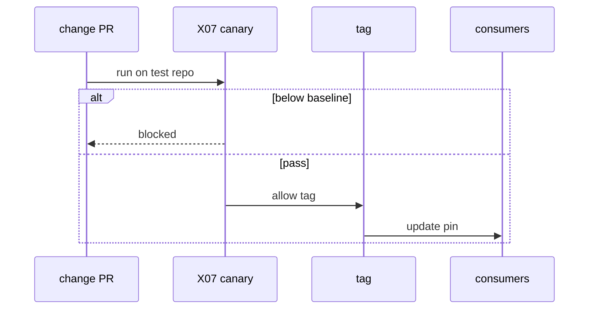
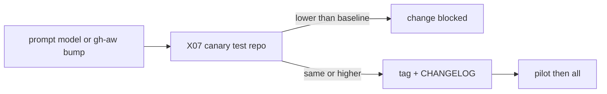

# AO05: Change management
- Status: todo
- Area: agent-ops
- Wave: W5
- Block: 5
- Lane: Builder
- Depends on: X07, ARC05, L01
- proof: CHANGELOG entry + X07 row showing same or higher than baseline before tag; canary note in test repo
- door: one-way
- one-way gate: Sven's exact yes required (named ask in its block). Rollback: pin consumers and workflows to previous annotated tag
- triage: build
- feedback: CHANGELOG entry plus X07 row at or above baseline
- harness: none (process and release job)
- review-input: diff + this PBI + DoD (+ linked spec) + PR description, never builder session logs (PA6)
- kind: script
- Source: PA8 (pre-link PBI edited in PR #4, origin in its Sources) https://github.com/svennijhuis/agentic-workflows/pull/4
## Goal
Prompt version and model in each workflow frontmatter; CHANGELOG per workflow; canary in test repo first (X07 run). Rollback by pinning previous tag. **Release, prompt bump, model bump, or gh-aw bump runs X07 first; a lower score than baseline blocks the change.**
## Context
Implements regression rule from plan v3.7 with [ARC05](../done/ARC05-release-flow.md). Canary pattern from S5. Tied to L01 tagged releases.
## Steps
1. Require `prompt-version` and `model` keys in workflow frontmatter (POL check).
2. CHANGELOG section per workflow on every prompt or model edit.
3. Document canary: X07 on test repo before pilot/all promotion.
4. Document rollback: consumer pin to `vX.Y.Z-1`.
## Definition of Done
- [ ] Frontmatter keys documented in shared/defaults or template
- [ ] CHANGELOG format in repo root or per-workflow file
- [ ] X07 gate documented with block when score lower than baseline
- [ ] Canary order matches ARC02 environments
## Technical design
- Components and files: `CHANGELOG`, `docs/benchmarks/*.md`, workflow frontmatter, L01 tag job.
- Module boundary: CHANGELOG and X07 rows are the interface; the L01 tag job is behind it
- Interfaces: X07 harness CLI; semver tags; `gh aw update` on consumers.
- Sequence:

- Failure modes: benchmark flake; rerun with Sven yes; baseline update is separate one-way ask.
- Security: no bypass of X07 for workflow changes touching `workflows/*.md`.
- Observability: benchmark row stored per release commit.
- Cost: X07 AIC per canary (gated).
- Rollback: revert tag pointer; consumers pin previous SHA.
- Proof: blocked release example or green X07 row in CHANGELOG PR.
- Door: one-way (tag promotion and baseline moves need Sven yes).
## Evidence
(CHANGELOG excerpt; X07 markdown row)
## Flow

## Named asks for Sven
Yes per canary X07 spend; yes to tag after green benchmark
## Cost
X07 harness cost per change (B02 measured)
## Sources
- S5: [SRE workbook: Canarying Releases](https://sre.google/workbook/canarying-releases/) (workbook, read 2026-10-25)
- S11: [NIST AI 600-1](https://www.nist.gov/publications/artificial-intelligence-risk-management-framework-generative-artificial-intelligence) (July 2024)
- Plan v3.7 regression rule (agentic-workflows-pbi-plan.md)
