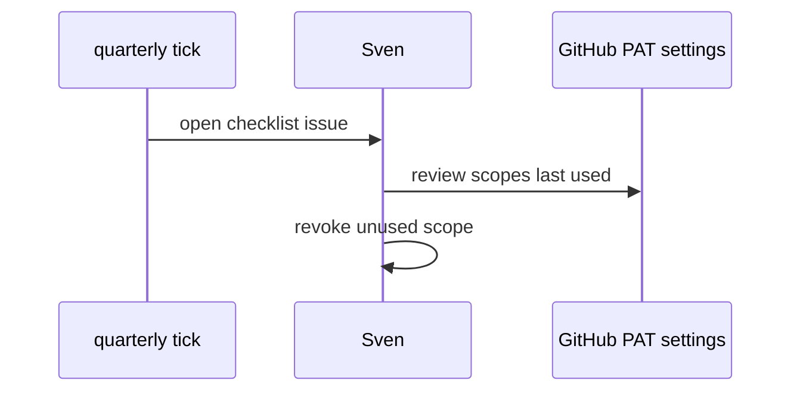
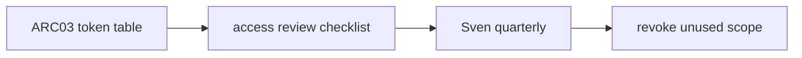

# AO06: Access review
- Status: todo
- Area: agent-ops
- Wave: W5
- Block: 5
- Lane: Builder
- Depends on: ARC03, C04
- proof: docs/runbooks/access-review.md with token table snapshot; quarterly checklist issue template
- door: two-way
- triage: build
- feedback: the runbook token table check in the proof line
- harness: none (runbook)
- review-input: diff + this PBI + DoD (+ linked spec) + PR description, never builder session logs (PA6)
- kind: skill
- Source: PA8 (pre-link PBI edited in PR #4, origin in its Sources) https://github.com/svennijhuis/agentic-workflows/pull/4
## Goal
Each token and app gets owner, scope, expiry, and last used. Reviewed every quarter; unused scope removed. Mirrors [ARC03](../done/ARC03-identity-auth.md) table including M05 and P04 PATs.
## Context
Supports OWASP LLM06 least privilege (S10) and NIST Govern (S11). No org tokens until G05.
## Steps
1. Publish quarterly checklist markdown.
2. Map each secret name to owner and scopes (names only).
3. Procedure to revoke and rotate with Sven masked entry.
4. Calendar reminder issue or schedule (no agent required).
## Definition of Done
- [ ] Checklist covers all ARC03 token rows
- [ ] Quarterly cadence documented
- [ ] Unused scope removal steps named
- [ ] Links to C04 auth reference
## Technical design
- Components and files: `docs/runbooks/access-review.md`, ARC03 table as source, GitHub fine-grained PAT UI exports (manual).
- Module boundary: the token table is the interface; GitHub token settings are behind it
- Interfaces: checklist issue template; `gh api` read token metadata where available.
- Sequence:

- Failure modes: stale doc; diff against ARC03 on each edit.
- Security: never paste token values in issues.
- Observability: label `access-review` on closed quarterly issues.
- Cost: 0 AIC.
- Rollback: revert checklist doc.
- Proof: merged runbook path; sample closed checklist issue.
- Door: two-way (process doc); rotation is Sven in GitHub UI.
## Evidence
(checklist issue link; ARC03 diff clean)
## Flow

## Named asks for Sven
Execute first quarterly review after B5 start
## Cost
0 AIC
## Sources
- S1: [GitHub blog: security architecture of Agentic Workflows](https://github.blog/ai-and-ml/generative-ai/under-the-hood-security-architecture-of-github-agentic-workflows/) (read 2026-10-25)
- S10: [OWASP LLM01](https://genai.owasp.org/llmrisk/llm01-prompt-injection/), [LLM06](https://genai.owasp.org/llmrisk/llm062025-excessive-agency/) (2025)
- S11: [NIST AI 600-1](https://www.nist.gov/publications/artificial-intelligence-risk-management-framework-generative-artificial-intelligence) (July 2024)
