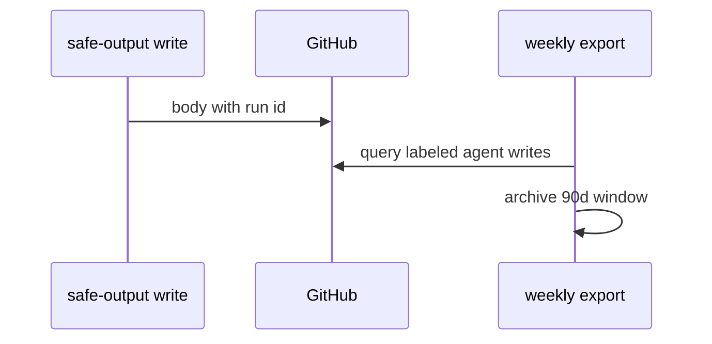
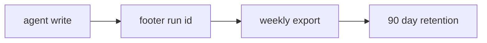

# AO07: Audit trail
- Status: todo
- Area: agent-ops
- Wave: W5
- Block: 5
- Lane: Builder
- Depends on: B01, shared/reporting
- proof: Sample agent issue footer contains run id and prompt-version; weekly export script path documented
- door: two-way
## Goal
Each agent write (issue, comment, PR, label) links to its run id and prompt version. Weekly export, kept 90 days. Implements S1 log everything.
## Context
Footer format from `shared/reporting.md`. Feeds AO04 postmortems and AO06 access reviews. Export is deterministic script (0 AIC) where possible.
## Steps
1. Document required footer fields in reporting.md cross-link.
2. Add weekly export job or script listing writes with run metadata.
3. Retention policy 90 days in repo or artifact store.
4. Verify on three workflows in X01 trial.
## Definition of Done
- [ ] Footer spec lists run id and prompt-version
- [ ] Export format documented (CSV or JSON)
- [ ] 90 day retention stated
- [ ] AO04 runbook links here
## Technical design
- Components and files: `shared/reporting.md`, `scripts/export-agent-writes.sh`, B01 correlation ids.
- Interfaces: GitHub search API or B01 DB for writes; artifact upload weekly.
- Sequence:

- Failure modes: missing footer fails POL check when added; backfill not required for old issues.
- Security: export redacts bodies; metadata only option for sensitive repos.
- Observability: export job logs row count.
- Cost: 0 AIC for export script.
- Rollback: stop scheduled export.
- Proof: example issue footer in Evidence.
- Door: two-way (schema via PR).
## Evidence
(issue screenshot with footer; export sample row)
## Flow

## Named asks for Sven
Artifact storage yes if export exceeds repo limits
## Cost
0 AIC
## Sources
- S1: [GitHub blog: security architecture of Agentic Workflows](https://github.blog/ai-and-ml/generative-ai/under-the-hood-security-architecture-of-github-agentic-workflows/) (read 2026-10-25)
